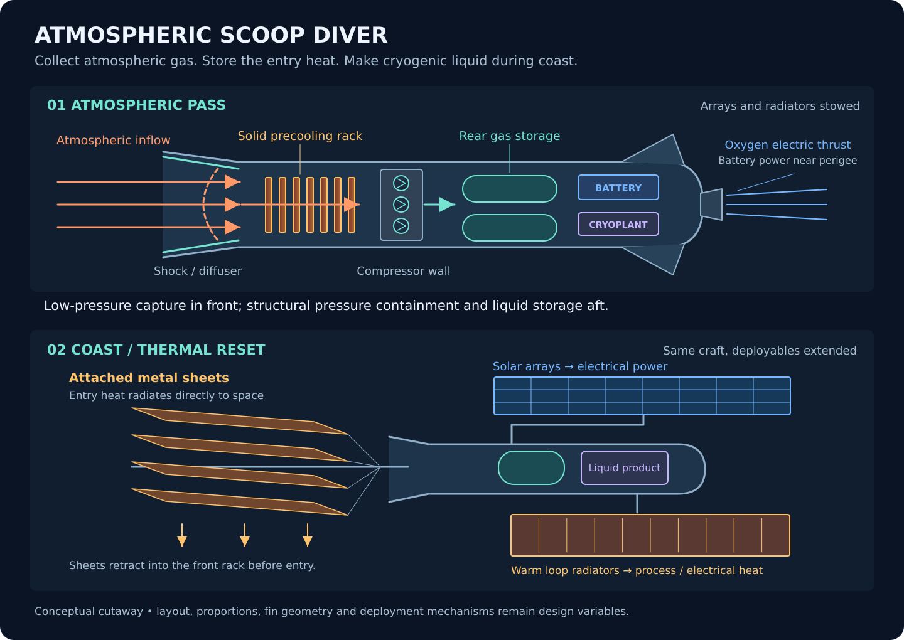
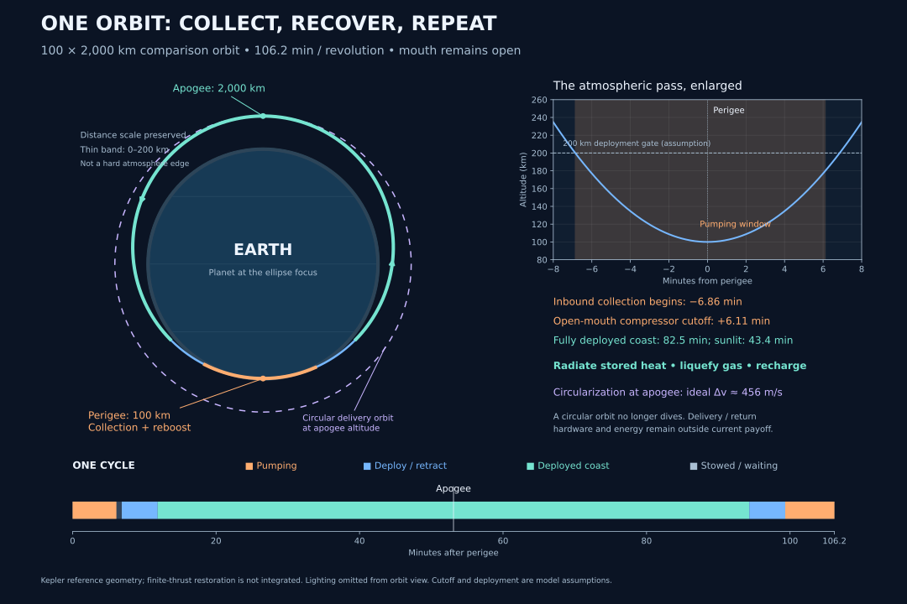

# Atmospheric Scoop Divers

**A reusable orbital factory, fed by Earth's atmosphere.**

The concept was first published on AlanCoding's
[Atmospheric Scoop Divers page](https://alancoding.github.io/concepts/atmospheric-scoop-divers/).
This repository develops its engineering description and numerical analysis.

**Version plan:** [v1.0.1 accuracy refinements → v1.1 downstream coolant tubes →
v2.0 propulsion-free diver and tether mothership](docs/VERSION_ROADMAP.md).
These are documented plans; the published v1.0 reference remains unchanged.

The concept is a spacecraft that collects air during repeated 7–8 km/s
atmospheric passes, transfers it into rear tanks, and makes useful cryogenic
liquids during the coast. A solid metal rack absorbs entry heat. Once clear of
the atmosphere, the craft extends that same metal through its mouth to radiate
the heat to space, unfolds solar arrays, and runs its separation and
liquefaction plant. Recovered nitrogen and oxygen supply electric propulsion for reboost.



**Mouth → shock/diffuser → solid precooling rack → compressor wall → rear gas
storage → coast liquefaction.**

The ambition is sustained production from repeated passes, with the spacecraft
and its thermal inventory reused each orbit. This package asks what that takes:
physical dimensions, compressor duty, heat storage, deployed areas, power,
hardware mass and net production—all connected by explicit balances.

Start with the [illustrated design description](docs/DESIGN.md). Completed
engineering decisions and their numerical evidence live in
[investigations/](investigations/README.md). The active program follows one open-inlet
architecture, with an optional incremental LN2-mixing parameter for analysis.
The drawings specify component roles, not a qualified layout or scale.

The [atmospheric-column derivation](modeling/primary/ATMOSPHERIC_COLUMN.md)
explains a central result: hundreds of kilometres of swept atmosphere still
require kilometres of unpumped chamber at the assumed cooled-gas pressure.
Precooling increases density; compressors move that gas into storage whose
pressure is supported by a vessel. Diving deeper increases both available
pressure and admitted mass, so density alone does not solve the volume problem.

The mission metric is time to deliver one dry spacecraft mass of useful
cryogenic liquids into a **circular orbit at apogee**. The implemented metric is
currently dry mass divided by net daily production in the operating orbit.
Circular delivery/return is an open item, so those two metrics remain distinct.
Dry mass has no imposed ceiling. The numerical results are conditional on the
stated component capabilities and flow assumptions; this is a living engineering
model and design specification.

## The orbit is part of the machine



The illustrated **100 × 2,000 km** comparison orbit takes **106.2 minutes**.
The Earth and orbit use the same distance scale; the low-altitude pass is enlarged
at right. The dashed circle is the circular delivery destination at apogee
altitude. Reaching apogee on the diving ellipse does not itself circularize the
product's orbit. The diagram's cutoff and deployment timings come from the
open-mouth control/capacity search at this geometry, not a final operating policy.

## Modeling and analysis

| Area | Purpose | Entry point |
|---|---|---|
| Subsystem modeling research | Comparable hardware, real-gas physics, heat transfer and validated replacements for numerical approximations | [Research index](modeling/README.md), [compressor](modeling/compressor/README.md), [metal coolers](modeling/metal_coolers/README.md) |
| Coupled primary model | One forward cycle with finite hardware, evolving gas/rack states and periodic constraints | [Implementation and inputs](modeling/primary/TRANSIENT_IMPLEMENTATION.md), `atmo_scoops/transient/` |
| Legacy scalar model | Reproduce earlier reduced-cycle studies | [Scalar equations](modeling/primary/MODEL.md), `atmo_scoops/scalar/` compatibility gateway |
| Design optimization | Search independent coordinates using the primary model | [Search definition and results](modeling/optimization/RESULTS.md), `atmo_scoops/optimization/` |
| Detailed fluid analysis | Evaluate selected geometries; resolve shocks, cooling, capture and leakage | [Fluid study specification](modeling/fluid/README.md); solver integration pending |
| Flight stability | Fluid forces/moments coupled to attitude, mass distribution and flexibility | [Stability study specification](modeling/stability/FLIGHT_STUDY.md); solver integration pending |

Detailed fluid and stability simulations are **outside the optimization loop**.
They can supply reviewed coefficient tables or reduced constraints back to the
primary model. The [improvement list](docs/MODEL_IMPROVEMENTS.md) tracks these
interfaces and missing physics. [Sources](docs/SOURCES.md) separate evidence from
hardware-development targets.

The new [coupled forward-cycle model](modeling/primary/TRANSIENT_IMPLEMENTATION.md)
tracks gas and rack states, finite compressors, liquefaction, power storage,
radiation and propellant through a complete orbit. Each candidate compiles its
hardware first and integrates once. The [current plate results](investigations/plates/README.md)
replace the isolated chamber study's anchored payoff proxy.

The working **parallel-plate cooler** reference gives **278.02 days** in the
operating orbit: **13,250 tonnes dry** and **3,509 kg of new liquid per orbit**.
It retains gaseous propellant bypass and uses full plane-Poiseuille friction as
additional compressor electricity, without suction-pressure feedback.

A real **33-variable constrained COBYLA optimization** terminated successfully
after **99 completed forward evaluations**, with no missing or failed cycles.
Its returned 277.66-day point missed battery closure under refined integration.
The working reference is a nearby actual optimizer-history point with additional
closure reserve; it passes all constraints and numerical gates at **three
resolutions**. Tolerances were not relaxed. This is a local, scoped search, not a
certified global optimum. See the [plate results](investigations/plates/README.md)
and [model equations](modeling/metal_coolers/PLATES.md).

```bash
.venv/bin/python -m atmo_scoops.transient --config configs/transient_active.json
OPENBLAS_NUM_THREADS=1 .venv/bin/python -m atmo_scoops.transient.plate_optimize --config configs/transient_plates_optimization_seed.json --output results/transient/plates/new_search --maxiter 300 --tol 0.01 --rhobeg 0.03 --seconds 240
```

The [skin-friction sensitivity](investigations/skin_friction/ANALYSIS.md) adds explicit external drag: a Cf=0.002 capacity proposal gives about 308 days, versus the 285-day zero-skin comparison. Cf is an illustrative scenario, not a calibrated prediction. [Planned refinements](docs/NEXT_REFINEMENTS.md) cover gaseous propellant bypass, rack pitch and omitted penalties.

The geometry is fixed at 30 m bore and 317 m overall length. The current search fixes the orbit at 85 × 2,000 km and holds suction/head
capabilities, peak electrical ratings and processing schedule fixed; it is not a
global optimization of every stage and hardware allocation. Read the [implementation assumptions](modeling/primary/TRANSIENT_IMPLEMENTATION.md)
and [study scope](investigations/transient/README.md) alongside the numbers.

## Reproduce the legacy scalar cycle

Use the project-local virtual environment:

```sh
.venv/bin/python -m atmo_scoops --config configs/finite_rack_reference.json
.venv/bin/python -m atmo_scoops --config configs/reference.json --front-depth 100 --rear-depth 25 --output results/short_front.json
.venv/bin/python -m atmo_scoops --mixing-ratio 0.1 --mixing-path fixed_rack
.venv/bin/python -m atmo_scoops --write-config configs/my_design.json
```

Lengths are physical metres, including rear tank heads; temperatures are kelvin.
Front depth is a minimum and expands if needed to fit its rack. Independent rack
masses and wire geometry are in `racks`; equipment envelopes and deployment
speed are in `packaging`. The current path does not use a fixed machinery bay.
Configurations separate geometry, hardware/performance/process capabilities,
atmosphere, inlet capabilities, operating controls and mixing. Unknown input
names are rejected. The 250 m reference front is a comparison coordinate,
not a selected dimension.

```python
from dataclasses import replace
from atmo_scoops.system import Design, simulate
from atmo_scoops.mixing import Mixing

result = simulate(replace(Design(), front_depth_m=100),
                  mixing=Mixing(ratio=0.1, thermal_path="fixed_rack"))
print(result["outputs"]["operating_mass_payoff_days"])
print(result["outputs"]["mixing"])
print(result["constraints"])
```

The continuous inlet computes admission, reverse leakage and pump cutoff on
both legs. Useful pump speed declines toward its ultimate pressure. Mixing
balances enthalpy and reserves coolant for the next pass before counting new
product. `simulate` writes no files; its output records exact inputs, component
masses, deployed areas, production and constraint margins.

The earlier [altitude sensitivity](investigations/altitude_sensitivity/ANALYSIS.md)
compares 50–150 km perigees before finite racks and package constraints. Use the
[finite-rack investigation](investigations/altitude_sensitivity/FINITE_RACK_LIMITS.md)
for the current constrained reference.

## Transient chamber laboratory

The [standalone chamber experiment](investigations/chamber_transient/README.md)
plots gas pressure, temperature, density, inventory and metal temperature through
an atmospheric pass and 40 minutes into coast. Edit each chamber's empty/rack
volume, rod geometry, initial temperatures, compressor controls and liquefaction
feed withdrawal independently. It is separate from the primary payoff model. A [constrained allocation search](investigations/chamber_transient/OPTIMIZATION.md) compares rack and empty volumes using an explicit mass/product proxy.

```sh
.venv/bin/python -m atmo_scoops.chambers --config configs/chamber_transient_reference.json
```

## Reproduce analyses

```sh
.venv/bin/python -m atmo_scoops.studies.incremental_mixing --workers 4
.venv/bin/python -m atmo_scoops.studies.incremental_mixing --sensitivity --workers 4
MPLCONFIGDIR=/tmp/atmo-scoops-mpl .venv/bin/python -m atmo_scoops.studies.mixing_report
.venv/bin/python -m atmo_scoops.studies.column_physics
MPLCONFIGDIR=/tmp/atmo-scoops-mpl .venv/bin/python -m atmo_scoops.studies.orbital_diagram
.venv/bin/python -m atmo_scoops.studies.current_cycle
.venv/bin/python -m atmo_scoops.studies.compressor_refinement
.venv/bin/python -m atmo_scoops.studies.altitude_sensitivity
```

The [incremental mixing conclusion](investigations/incremental_mixing/ANALYSIS.md)
compares ratios with equal control freedom, counts coolant restoration and
reports sensitivity thresholds. Broader geometry searches use the same active
model; [their definition](modeling/optimization/RESULTS.md) states current
coordinates and limits. No revised whole-vehicle optimum is claimed here.

Passing the numerical screens does not establish omitted shock, heat-transfer,
aerodynamic or structural performance. The original decision experiments are
preserved separately with frozen inputs/source so later model changes do not
silently rewrite their evidence.

```sh
.venv/bin/python -m pytest -q
.venv/bin/python -m atmo_scoops.audit
```

The [rack-material comparison](investigations/chamber_transient/MATERIALS.md)
reoptimizes these allocations for FeCrAl or SiC up front and aluminum downstream,
including density, heat transfer and radiative reset time.

The [gas-reserve and rack-spacing study](investigations/feed_pitch/RESULTS.md) adds an explicit gaseous propellant branch and independently spaced transverse racks with coupled pressure loss. See the [physical flow diagram](docs/images/feed_racks.svg) and [concept geometry export](results/transient/feed_pitch/geometry.json).

- [Staged refinement](investigations/staged_refinement/README.md): active gas bypass first, then gated pressure-loss, pitch and radius releases.
- [Earlier joint radius/pitch experiment](investigations/rack_radius/RESULTS.md): retained research, not the active reference.

Publication assets for the current snapshot: [v1.0 publication kit](docs/publication/V1_0.md), including current-reference figures, numerical tables and the provisional axial mass layout.

New development checkpoint: [corrected staggered plates and explicit stage geometry](investigations/staggered_stage_a/README.md), constrained convergence at **275.7 operating-orbit days**, with rack dimensions, pressure-loss diagnostics and an updated scale drawing. The frozen v1.0 reference above is unchanged. [Subsequent packaging/storage checkpoints](docs/SCALE_REVIEW_IMPLEMENTATION_PLAN.md) remain separate.
