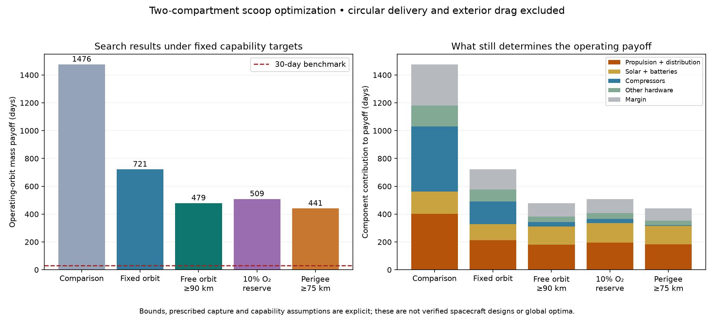

# Conditional multivariable optimization

The independent implemented variables are identified in `system.Design` and
[PARAMETERS.md](../primary/PARAMETERS.md). This study searches **17 design coordinates with
orbit fixed**, and **19 with orbit adjustable**, holding hardware, performance,
cryogenic process capabilities and the atmospheric scenario fixed.

The objective is **dry mass / net useful product per day in the operating orbit**.
It includes oxygen consumed replacing captured-air momentum and a complete
conditional hardware ledger. It does **not** include circular-apogee delivery,
return or external/closed-mouth drag. Accordingly these are operating mass-payoff
times, not the requested final mission payoff or a demonstrated vehicle.

## Results

| Case | Perigee × apogee | Dry mass | Intake/pass | Net product/pass | Net/day | Operating mass payoff |
|---|---:|---:|---:|---:|---:|---:|
| Comparison inputs | 100.0 × 2000 km | 1,344 t | 84.8 kg | 67.1 kg | 0.91 t/day | 1,476.4 days |
| Fixed orbit optimized | 100.0 × 2000 km | 2,135 t | 286.3 kg | 218.2 kg | 2.96 t/day | 721.5 days |
| Orbit adjustable, perigee ≥90 km | 90.0 × 937 km | 11,478 t | 2,063.0 kg | 1,578.8 kg | 23.96 t/day | 479.1 days |
| Same range, 10% oxygen reserve | 90.0 × 964 km | 12,351 t | 2,034.7 kg | 1,604.6 kg | 24.28 t/day | 508.7 days |
| Perigee range extended to 75 km | 75.0 × 1014 km | 59,701 t | 11,712.1 kg | 8,988.8 kg | 135.49 t/day | 440.6 days |

The variable-orbit search improves this objective by
3.08× relative to the comparison inputs.
The lower-perigee extension gains only another
8.0% in payoff
while greatly increasing batch mass and installed power at its chosen size.
There is no imposed dry-mass ceiling. These runs do not approach the 30-day
benchmark under the fixed capability targets.

Changing aperture mostly scales throughput and equipment together. It is not a
free improvement in payoff, although shell/fixed overheads give a slight incentive
to larger apertures. Absolute masses should therefore be read together with the
selected dimensions; no unique economically optimal scale has been established.

## What the oxygen reserve means

For the 90 km-and-above candidate, retained gas provides
482.1 kg of oxygen per pass and reboost consumes
482.1 kg. Almost all oxygen becomes propellant; nitrogen and
the other useful retained gas still become product. A 10% reserve constraint
requires expelling no more than 90% of recovered oxygen, leaving one-tenth of the
oxygen unused as propellant. It is not a 10% collection loss or 10% of the whole batch.

The optimizer trades propellant against electricity: a lower exhaust velocity
uses more oxygen but less reboost energy. Leaving oxygen unused as propellant forces higher
exhaust velocity and a larger power budget. That explains the change from
479 to 509 days.
The remaining oxygen counts as available product; this constraint does not
model a permanent emergency stock or substitute for exterior-drag calculation.

## A concrete result from the 90 km-and-above search

| Quantity | Calculated value |
|---|---:|
| Mouth diameter | 30.00 m |
| Physical front depth / bore | 25.00 m / 30.00 m |
| Physical rear depth / diameter | 26.52 m / 20.78 m |
| Total axial allowance | 71.52 m |
| Compressor inlet gas | 710.3 K |
| Metal cold / hot endpoints | 298.0 / 660.3 K |
| Gas/metal approach | 50.0 K |
| Metal thickness | 2.00 mm |
| Intermediate pressure | 5.81 kPa |
| Warm radiator temperature | 360.0 K |
| Isp | 3322 s |
| Collection duration | 219.5 s |
| Closed recovery duration / fraction removed | 600 s / 99.0% |
| Whole orbit | 94.9 min |
| Fully deployed coast / sunlight | 63.9 / 26.3 min |
| Solar panels | 1,259,730 m² |
| Warm radiator panels, two emitting faces | 23,728 m² |
| Metal sheets, two emitting faces | 20,893 m² |
| Solar generation | 314.9 MW |
| Impulse-equivalent reboost peak | 1421 MW |
| Reboost energy per encounter | 118.5 MWh |
| Compressor mass | 720 t |

The optimizer opens earlier in the inbound pressure pulse: 10% of peak ram
instead of the comparison's 50%. Collection lasts about 3.7 minutes. The
300 s thrust burst remains an impulse-equivalent sizing assumption, not an
integrated orbit-restoration trajectory. The enormous arrays still use the same
five-minute deployment target; their mechanical feasibility is unresolved.

## Bounds and independent coordinates

The following are declared search bounds, **not** verified physical limits.
Geometry is additionally constrained to front bore >= mouth and overall length
<=520 m, a search family near the stated 500 m target. Rear rounded heads must
fit. Machinery allowance (20 m), radial clearance (0.85 m), hardware targets,
process capabilities and illumination orientation are fixed. Pump sizing is
automatic, so explicit pump capacity is not searched a second time.

| Design coordinate | Bounds | 90 km-and-above result | Position |
|---|---|---:|---|
| `front_depth_m` | 25–450 | 25 | lower bound |
| `rear_depth_m` | 10–100 | 26.5156 | interior |
| `mouth_diameter_m` | 10–30 | 30 | upper bound |
| `front_diameter_m` | 10–36 | 30.0002 | interior |
| `rear_diameter_m` | 6–36 | 20.778 | interior |
| `perigee_km` | 90–120 | 90 | lower bound |
| `apogee_km` | 500–10000 | 937.191 | interior |
| `opening_ram_fraction` | 0.1–0.8 | 0.1 | lower bound |
| `compressor_inlet_K` | 420–1200 | 710.326 | interior |
| `metal_cold_K` | 298–600 | 298 | lower bound |
| `gas_metal_approach_K` | 50–200 | 50 | lower bound |
| `foil_thickness_m` | 0.0001–0.002 | 0.002 | upper bound |
| `inlet_pressure_fraction` | 0.4–0.8 | 0.8 | upper bound |
| `intermediate_Pa` | 100–10000 | 5806.16 | interior |
| `recovery_s` | 300–600 | 599.98 | upper bound |
| `front_residual_fraction` | 0.01–0.3 | 0.01 | lower bound |
| `warm_radiator_K` | 280–360 | 360 | upper bound |
| `thrust_burst_s` | 60–300 | 300 | upper bound |
| `isp_s` | 3200–6000 | 3322.3 | interior |

The lower-perigee extension changes only its perigee search range to 75–100 km.
75 km is the atmosphere-table boundary. It does not represent a material limit.
The intended perigee envelope is set by actively cooled leading-edge heat flux,
temperature, stress, erosion and repeat-use lifetime; that engineering model
must determine how far this boundary can be pushed.
The oxygen-reserve run requires at least 10% of retained oxygen to remain after
reboost. This reserve is an explicit scenario constraint, not a new hardware
capability or calculated exterior drag.

## What the boundary results mean

- **25 m front depth:** the solver prefers the smallest allowed front chamber.
  Heat-exchanger conductance, shock accommodation and pressure loss are still
  missing constraints. This is not evidence that 25 m is sufficient.
- **298 K metal start and 50 K approach:** cooler starting metal reduces inventory,
  and a smaller approach allows better temperature utilization. The model checks
  ideal radiative recovery, but does not yet price exchanger conductance or
  passage geometry. The 298 K limit is the implemented material-property domain.
- **2 mm sheets:** increasing thickness reduces deployment area/mass. Radiation
  time is checked, but the reduced gas-side exchange area is not. A true optimum
  needs that conductance/pressure-loss relationship.
- **0.8 ram pressure target:** higher assumed acceptable pressure reduces suction
  volume. This is a prescribed control target, not a computed shock stability
  ceiling. The result cannot validate that chosen pressure.
- **300 s thrust burst:** the solver benefits from lower peak-power hardware mass.
  A finite-thrust trajectory must constrain how far this duration can increase.
- **360 K warm radiator:** higher rejection temperature trades refrigerator work
  against radiator size. The search stops at the declared temperature bound;
  the warm loop and components have not been qualified at this scale.
- **Nearly all oxygen consumed:** no-reserve cases choose Isp close to the oxygen
  balance boundary. They leave essentially no allowance for additional drag or
  other oxygen use. A separate 10% reserve result quantifies the cost without
  pretending to have calculated hull drag.

Approach, minimum front depth, sheet thickness and admissible pressure deserve
particular attention: their apparent improvements exploit costs/constraints
that the current model does not yet resolve. The output is useful for choosing
what physics to develop next, not for accepting a finished spacecraft.

## Algorithm, convergence and verification

SciPy differential evolution searches unit-normalized linear/log coordinates,
followed by bounded Powell refinement. Two random seeds are run for each study;
the second seed includes the first candidate as a warm start. A subsequent
coordinate check includes joint diameter scaling and a fixed-metal-hot-endpoint
thermal move to avoid traps at coupled constraints. Some runs reach the generation
limit; neither the seed agreement nor local checks prove a global optimum.

Search evaluations use 101 samples per phase. Winners are replayed with 1,601
and 3,201 samples, checked for constraints, and saved as standalone input files.
An exact interval update for linearly interpolated inflow replaces the adaptive
front-inventory integrator, using the same differential equation. Independent
ODE comparison tests verify it; this is a speed improvement, not changed physics.

| Search | Seed results before coupled follow-up (days) | Final (days) | Largest 1,601→3,201 relative output change |
|---|---|---:|---:|
| Fixed orbit optimized | 11: 723.758, 29: 721.500 | 721.463 | 1e-06 |
| Orbit adjustable, perigee ≥90 km | 11: 479.613, 29: 479.604 | 479.091 | 2.6e-06 |
| Same range, 10% oxygen reserve | 17: 508.792, 37: 508.788 | 508.740 | 2.6e-06 |
| Perigee range extended to 75 km | 17: 440.861, 37: 440.861 | 440.642 | 7e-06 |

These saved searches use mouth closure. The discrete mouth option and its
[mass/leakage comparison](../primary/MOUTH_CLOSURE.md) are separate from these
continuous searches. An open-mouth search omits the inactive residual-fraction
coordinate, giving 16 or 18 continuous coordinates. No open-mouth optimized
winner is presented in this report.

These resolution checks cover the numerical model, not omitted flow or hardware
physics. All final candidates pass the implemented system screens and the search
geometry/reserve constraints within the recorded numerical tolerance.

## Reproduce and modify

```sh
.venv/bin/python -m atmo_scoops.optimization.search --mode fixed_orbit --iterations 100 --seeds 11 29
.venv/bin/python -m atmo_scoops.optimization.search --mode free_orbit --iterations 120 --seeds 11 29
.venv/bin/python -m atmo_scoops.optimization.search --mode lower_perigee --seed-config results/optimization/free_orbit_config.json --iterations 120 --seeds 17 37
.venv/bin/python -m atmo_scoops.optimization.search --mode free_orbit --seed-config results/optimization/free_orbit_config.json --oxygen-reserve .1 --iterations 100 --seeds 17 37
.venv/bin/python -m atmo_scoops.optimization.review
MPLCONFIGDIR=/tmp/atmo-scoops-mpl .venv/bin/python -m atmo_scoops.optimization.report
```

`atmo_scoops/optimization/search.py` declares every bound. Saved studies contain fixed inputs,
random seeds, traces, search settings and verification. Replay a candidate with:

```sh
.venv/bin/python -m atmo_scoops --config results/optimization/free_orbit_config.json --samples 3201 --output results/optimization/replayed_system.json
```

The comparison configuration is unchanged; none of these candidates silently
replaces it as the reference. Full files are in `results/optimization/`.



