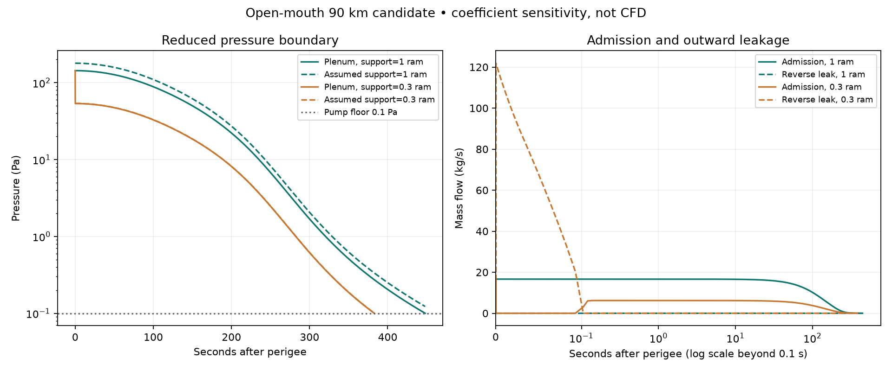

# Mouth closure comparison

Mouth closure is an explicit design option. The same inlet, physical depths,
compressor capacity and capability targets are used for each paired comparison;
dependent tank, heat, propulsion, solar and battery requirements are recalculated.
Consequently these are redesigned hardware budgets at fixed independent inputs,
not a claim that an installed vehicle can process twice its rated batch.
The open variant has **not** been reoptimized. Circular delivery is excluded.

The closed variant ends admission at perigee, then pumps residuals. The open
variant keeps its collection suction running into the outbound atmosphere until
its inlet reaches 0.1 Pa. The pressure floor is a capability assumption, not a
measured pump map. The timeout is the input recovery duration; a timeout above
the floor fails a screen. Rear tanks are isolated when the pump stops.

## Cycle and hardware comparison

| Input set | Mouth | Admitted / pass | Stored / pass | Lost / pass | Dry mass | Net product / day | Operating payoff | System screens |
|---|---|---:|---:|---:|---:|---:|---:|---|
| Comparison inputs | Closes | 84.83 kg | 84.22 kg | 0.612 kg | 1,344.3 t | 0.911 t | 1476.4 days | pass |
| Comparison inputs | Stays open | 195.73 kg | 195.71 kg | 0.023 kg | 2,249.4 t | 2.120 t | 1061.2 days | pass |
| 90 km search candidate | Closes | 2063.05 kg | 2062.92 kg | 0.124 kg | 11,477.7 t | 23.957 t | 479.1 days | pass |
| 90 km search candidate | Stays open | 4190.84 kg | 4190.83 kg | 0.009 kg | 22,281.2 t | 48.671 t | 457.8 days | pass |
| 90 km / 10% oxygen reserve candidate | Closes | 2034.71 kg | 2034.58 kg | 0.125 kg | 12,351.3 t | 24.278 t | 508.7 days | pass |
| 90 km / 10% oxygen reserve candidate | Stays open | 4133.26 kg | 4133.25 kg | 0.009 kg | 24,059.0 t | 49.322 t | 487.8 days | pass |

Lost mass includes outward leakage during pumping and the final front residual.
The open mouth admits more mass because collection continues after perigee.
Any apparent payoff benefit combines that longer collection window and removal
of the door; it is not solely the door's mass saving. A closure-equipped design
could also close later: closure time is not yet a searched coordinate.

The nominal boundary uses support pressure equal to `rho*u²` and discharge
coefficient 0.8. In these nominal cases, pumping keeps the plenum below the
assumed support until the pressure floor: reverse flow is zero. That is a
conditional result of this reduced boundary, not proof against inlet unstart
or three-dimensional spillage. The weaker-support cases below show reverse flow.

### 90 km search candidate: component outputs

| Quantity | Closes at perigee | Stays open |
|---|---:|---:|
| Front depth | 25.00 m | 25.00 m |
| Rear depth | 26.52 m | 26.52 m |
| Compressors | 720.06 t | 720.09 t |
| Solar panels | 1,259,730.19 m² | 2,558,748.52 m² |
| Warm radiator panels | 23,727.75 m² | 48,170.50 m² |
| Metal sheets | 20,892.78 m² | 42,481.69 m² |
| Propellant per pass | 482.07 kg | 979.22 kg |
| Recovered oxygen per pass | 482.07 kg | 979.64 kg |
| Oxygen remaining per pass | 0.00 kg | 0.42 kg |
| Post-perigee pumping duration | 600.0 s | 448.0 s |
| Closure hardware, before margin | 7.07 t | 0 t |

Physical radiator/sheet areas have two emitting faces; solar area is collecting
area. The post-perigee duration is a result for the open case. Both retain the
compressor wall and rear isolation hardware.

## Pressure support and pump-floor sensitivity

These change only the 90 km search candidate's outbound boundary and pressure
floor, with no door. Inbound full-capture assumptions remain prescribed. This
is a boundary sensitivity, not a self-consistent fluid prediction of either leg.
Weak-support rows below the inbound plenum/ram ratio also fail the inbound
support screen. They deliberately start from the same prescribed inbound state;
their leakage is predominantly a short initial pressure-relaxation burst, not
proof of a late-outbound instability. Their inflow/outflow curves are diagnostic
boundary tests, not self-consistent complete passes. A negative oxygen balance
also fails the oxygen-only reboost screen. Failed-row payoff arithmetic is shown
only for diagnosis.

| Support / ram | Pump floor | Stop after perigee | Reverse leak | Final residual | Net kg/pass | Oxygen margin | Payoff | Screens |
|---|---:|---:|---:|---:|---:|---:|---:|---|
| 1.0 | 0.1 Pa | 448.0 s | 0.000 kg | 0.009 kg | 3207.4 | 0.419 kg | 457.8 days | pass |
| 1.0 | 1 Pa | 320.4 s | 0.000 kg | 0.087 kg | 3203.4 | 0.182 kg | 457.8 days | pass |
| 1.0 | 10 Pa | 235.2 s | 0.000 kg | 0.867 kg | 3173.7 | -0.110 kg | 458.1 days | FAIL |
| 0.8 | 0.1 Pa | 446.2 s | 0.000 kg | 0.009 kg | 3190.2 | 0.392 kg | 457.9 days | pass |
| 0.8 | 1 Pa | 319.3 s | 0.000 kg | 0.087 kg | 3186.2 | 0.160 kg | 457.9 days | pass |
| 0.8 | 10 Pa | 234.2 s | 0.000 kg | 0.867 kg | 3156.5 | -0.127 kg | 458.2 days | FAIL |
| 0.6 | 0.1 Pa | 426.0 s | 2.526 kg | 0.009 kg | 2784.3 | -0.306 kg | 461.3 days | FAIL |
| 0.6 | 1 Pa | 307.9 s | 2.526 kg | 0.087 kg | 2780.6 | -0.484 kg | 461.4 days | FAIL |
| 0.6 | 10 Pa | 222.5 s | 2.526 kg | 0.867 kg | 2750.1 | -0.741 kg | 461.7 days | FAIL |
| 0.3 | 0.1 Pa | 382.8 s | 6.724 kg | 0.009 kg | 2175.6 | -1.438 kg | 468.9 days | FAIL |
| 0.3 | 1 Pa | 282.3 s | 6.724 kg | 0.087 kg | 2172.4 | -1.528 kg | 468.9 days | FAIL |
| 0.3 | 10 Pa | 189.1 s | 6.724 kg | 0.867 kg | 2137.0 | -1.829 kg | 469.6 days | FAIL |

## Closure mass sensitivity

The door allowance covers skin, supports, seals and actuation. It is separate
from the permanent compressor bulkhead. No detailed closure design supports
these coefficients yet. The following holds the closed candidate unchanged:

| Door specific mass | Installed door, before margin | Whole dry mass | Operating payoff |
|---|---:|---:|---:|
| 10 kg/m² | 7.07 t | 11,477.7 t | 479.1 days |
| 100 kg/m² | 70.69 t | 11,557.2 t | 482.4 days |
| 1000 kg/m² | 706.86 t | 12,352.4 t | 515.6 days |

The default 10 kg/m² is a target, not evidence that such a large reusable cooled
door can be built at that mass. Open-mouth protection, early-entry heating and
drag are also missing design costs. Those omissions prevent selecting a winner.

## Validation and reproduction

Both variants are checked for mass/energy conservation and 1,601→3,201-sample
convergence. The port helper has an independent analytic vacuum-leak/pump test,
including its sonic limit. These verify the implementation, not the support
coefficient or real shock behavior. Saved inputs and all signed margins are in
`results/mouth_closure.json`.

```sh
MPLCONFIGDIR=/tmp/atmo-scoops-mpl .venv/bin/python -m atmo_scoops.studies.mouth_closure
.venv/bin/python -m atmo_scoops --config configs/reference.json --no-mouth-closure --output results/open_mouth.json
```

See [model equations](MODEL.md), [independent inputs](PARAMETERS.md),
[fluid analysis](../fluid/README.md) and the
[improvement list](../../docs/MODEL_IMPROVEMENTS.md).



