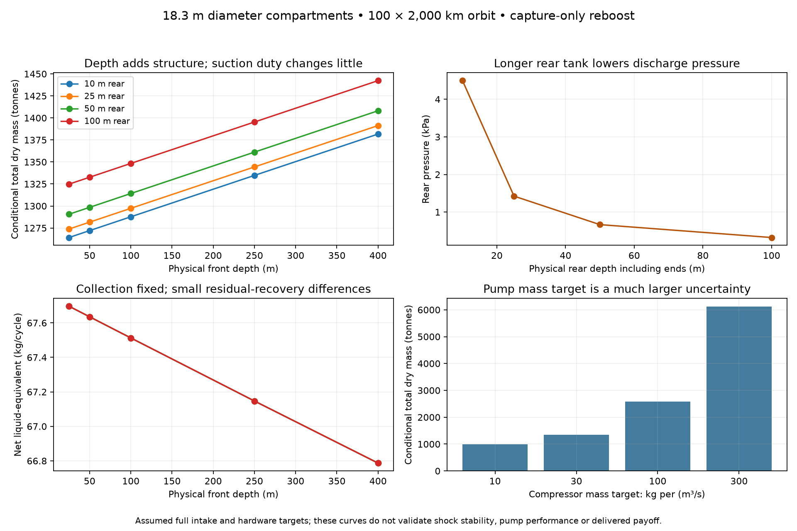

# Physical depths, complete-cycle duties, and conditional spacecraft mass

The comparison layout has **18.3 m clear diameter in both compartments**,
matching the 18.3 m mouth. Front depth means mouth
plane to compressor bulkhead. Rear depth is the entire axial tank length,
including two 2:1 ellipsoidal heads, each 4.575 m deep. No equivalent depth is
used in the tables. The rear tank needs at least 9.15 m for those heads alone.

Comparison point: 250 m front + 25 m rear + 20 m machinery/layout allowance = 295 m,
inside a 20 m outer-diameter shell. The sweep allows the overall length to
change; shell/TPS mass changes with it. It does not leave an empty 500 m shell
around every case. The 20 m machinery allowance is not a verified equipment
packing plan. Fore/aft cowling and support details still need layout work.
**250 m has no optimization justification.** It is a reproducible comparison
coordinate. Shorter fronts score better in this model because shock accommodation,
heat-transfer conductance and pressure-loss requirements do not yet impose a
minimum usable length. No row is a selected spacecraft design.

Use the configurable [Python API and CLI](../../README.md) and the independent
input ledger in [PARAMETERS.md](PARAMETERS.md). The [precooling trade](PRECOOLING_TRADE.md)
varies compressor inlet temperature and derives the metal's hot endpoint.

The orbit remains **100 × 2,000 km**. Full geometric capture while open is a
requirement assumption. Total drag in these tables is **captured-air momentum
only**. Exterior/closed-door drag has not been calculated. The output is a
conditional installed-mass estimate with explicit allowances for all main
subsystems, not a validated structural design or delivered-mass payoff.

## One full cycle

Times below are measured from mouth closure at perigee. Reboost overlaps the
encounter; the 180 s thrust burst is an impulse-equivalent sizing assumption,
not an integrated thrust trajectory.

| Phase | Timing | Gas / equipment state |
|---|---|---|
| Open collection | −81.3 to 0 s | 84.83 kg enters; 78.72 kg already transferred aft |
| Sealed residual recovery | 0–450 s | Transfer another 5.51 kg; front pump capacity 336 m³/s |
| Reopen front, isolate rear, deploy | 450–750 s | Vent 0.612 kg front residual; deploy attached metal sheets, arrays and warm radiators |
| Fully deployed coast | 12.50–94.33 min | 81.83 min processing/radiation, including 42.71 min sunlight |
| Retract | 94.33–99.33 min | Five-minute mechanism allowance; then prepare next entry |
| Next mouth opening | 104.83 min | Next inbound collection window begins |
| Next perigee | 106.19 min | Cycle repeats |

After recovery the front is at about 2.67 Pa, and
rear storage at 1.424 kPa and 340 K. The batch retained
aft is **84.22 kg**. The 4,000 s Isp capture-only reboost uses
**16.99 kg oxygen**. Including the 0.1% first-cycle rear gas
heel, useful liquid-equivalent remaining is **67.15
kg/cycle**, or **911 kg/day** continuously at
this orbit. These are operating-orbit production numbers, before circular
apogee delivery. The rear heel is retained, not repeatedly destroyed; subsequent
cycles differ by less than 0.1 kg with this small carryover assumption.
Reboost burns oxygen prepared on the preceding coast; it does not require the
current hot intake to become thruster propellant immediately. Startup therefore
needs a charged battery and an initial oxygen inventory.

Gas compressors draw 2.26 MW at peak and
41.6 kWh per encounter. Coast refrigeration draws
115.3 kW for 8.11 kW of cold duty.
Reboost needs 6.05 MWh and an impulse-equivalent
121.0 MW burst. This large peak is why propulsion hardware,
batteries and electrical distribution matter in the mass ledger.

## The three deployed systems

| System | Physical deployed panel/sheet area | Emitting area | Main duty |
|---|---:|---:|---|
| Solar arrays | 39,228 m² | — | 9.81 MW in usable sunlight at 250 W/m² |
| Warm ammonia-loop radiators | 1,590 m² | 3,181 m² | Two exposed emitting faces, 320 K |
| Hot metal absorbers/radiators | 5,571 m² | 11,142 m² | Two exposed faces; 500–900 K thermal cycle |

The warm radiator area assumes both faces have the modeled view factor. A
single-sided implementation needs twice this physical panel area. Installed
warm-radiator mass remains 5 kg per square metre of emitting area (10 kg per
square metre of double-sided panel), so halving physical area does not halve
mass. Hot sheets are 0.25 mm thick. Deployment booms and spacing make the actual
spatial footprint larger than panel area; no football-field spacing geometry
has been solved. The iron heat-capacity proxy is not a selected flight alloy.
The metal holds about 2.72 GJ. If its full two-face area is
exposed with the assumed emissivity and background, cooling from 900 to 500 K
takes only 28 seconds in the ideal sheet calculation.
Deployment, mutual shadowing and hot-spot equilibration can take longer. Metal
sheets can be recovered independently after cooling; keeping them exposed for
the entire coast would cool them below the assumed 500 K cycle starting point.
Solar and warm radiators retain the long deployed-coast schedule in this model.

## Compressor mass: an explicit development target

A compressor mass cannot be obtained uniquely from mass flow and pressure.
The installed compressor model uses an explicit capability target:

    M_bank = max(alpha × required suction capacity, peak electrical power / beta)

Reference alpha = **30 kg/(m³/s)** and beta = **1,000 W/kg**. Each coefficient
applies to a complete bank, including its stages, motors, housings and immediate
manifolds. Hot, warm, and coast feed banks are sized separately. The hot bank
serves both collection and recovery: its mass uses the larger of their capacities,
not their sum. No rotor speed, blade chord, pump mechanism or module count has
been silently selected. Losses/conductance must ultimately fit this installed
performance target. Equivalent-isothermal efficiency remains a 50% target.

For an evidence anchor, Leybold lists **650 kg and 9,800 m³/hour** nominal speed
for the WH 7000 at its highest listed frequency: about **239 kg/(m³/s)** for that
booster alone. Nominal displacement is not delivered speed with backing pumps;
adding stages can worsen the installed ratio. That machine is neither a 1,000 K
space pump nor the required spacecraft design. Our 30 target asks for about an
eightfold improvement over its nominal bare-booster ratio, despite including
stages. R&D may change topology and remove terrestrial vacuum-housing burdens,
but this source does not prove that improvement. The 10–300 sweep below is an
engineering sensitivity, not a confidence interval or physical lower bound.
[Manufacturer data](https://www.leybold.com/content/dam/brands/leybold/downloads/brochures/product-brochures-fore-vacuum/mechanical-booster-pumps/3611019802_RUVAC%20WH_web.pdf).

| Compressor target alpha | All three compressor banks | Total dry mass, incl. margin |
|---:|---:|---:|
| 10 kg/(m³/s) | 142 t | 991 t |
| 30 kg/(m³/s) | 425 t | 1,344 t |
| 100 kg/(m³/s) | 1,415 t | 2,582 t |
| 300 kg/(m³/s) | 4,245 t | 6,120 t |

At the reference target the compressor mass is **425 t**,
and the whole installed dry-mass estimate is **1,344 t**.
There is no mass ceiling or feasibility rejection attached to these values.
A separate 795 kg circulating-fluid allowance is
wet inventory. Hot metal, installed PCM and deployment hardware count as dry.
The 500 kg liquid-system allowance covers one-cycle storage/plumbing, not an
arbitrarily large export inventory or a delivery vehicle.

## Whole-system mass ledger

| Component | Reference mass |
|---|---:|
| hot metal | 10.961 t |
| shell TPS allowance | 74.142 t |
| solar | 65.380 t |
| battery | 82.210 t |
| warm radiator | 15.903 t |
| warm buffer | 15.005 t |
| refrigerator | 1.273 t |
| compressor hot | 411.802 t |
| compressor warm | 12.464 t |
| compressor coast | 0.244 t |
| rear tank and supports | 8.268 t |
| propulsion hardware | 242.093 t |
| power distribution | 123.314 t |
| hot sheet deployment | 5.571 t |
| compressor bulkhead | 2.630 t |
| mouth closure | 2.630 t |
| warm aftercooler | 0.054 t |
| product heat exchangers | 0.005 t |
| separator | 0.028 t |
| liquid storage valves plumbing | 0.500 t |
| avionics attitude | 1.000 t |
| design margin | 268.869 t |
| **Total dry** | **1,344.3 t** |

All new coefficients are saved in `results/physical_cycle.json` under
`hardware_inputs`. Principal additional targets: propulsion 2 kg/kW of peak
input power; distribution 1 kg/kW of peak bus power; hot-sheet deployment
1 kg/m² of sheet; 1 mm minimum aluminum tank gauge with 150 MPa allowable,
1.5× design pressure, 50% support allowance and 1 kg/m² insulation; shell/TPS
4 kg/m²; 25% additive mass margin. These are engineering allowances, not measured
hardware capabilities. The propulsion target alone is 242 t at the reference
121 MW burst. Its sensitivity is saved separately. Array and warm-radiator
specific masses include their deployment/support allowances; they are not
added a second time. Power conversion losses use the existing lumped electrical
path efficiencies; no independent detailed PMAD circuit has been modeled.

Thermal exchange, actuator energy, rotor spin-up, structural modes, oxygen
compatibility, hot pump clearances and actual deployment mechanisms still need
design. Ten kilowatts auxiliary power is an allowance, not a mechanism solution.
The margin does not validate these capabilities or bound their mass errors.

## Physical depth sweep

Fixed mouth, orbit, temperatures, open suction capacity and 450 s/90% residual
recovery. All rows ingest 84.8 kg. More front depth leaves more gas at closure;
the fixed 90% recovery rule leaves slightly more vent loss. It does not mean a
long chamber intrinsically captures less; a different recovery policy changes
that outcome. Total lengths span 55–520 m including the 20 m layout allowance;
500 m is an approximate design target, not a sharp feasibility cutoff. Both
gas-space diameters are 18.3 m.

| Front depth | Rear depth, incl. ends | Total length allowance | Rear pressure | Compressors | Total dry mass | Net liquid-equivalent per cycle | Net per day |
|---:|---:|---:|---:|---:|---:|---:|---:|
| 25 m | 10 m | 55 m | 4.526 kPa | 424.4 t | 1,264 t | 67.70 kg | 918 kg/day |
| 25 m | 25 m | 70 m | 1.433 kPa | 424.6 t | 1,274 t | 67.70 kg | 918 kg/day |
| 25 m | 50 m | 95 m | 0.670 kPa | 424.8 t | 1,291 t | 67.70 kg | 918 kg/day |
| 25 m | 100 m | 145 m | 0.324 kPa | 425.4 t | 1,325 t | 67.70 kg | 918 kg/day |
| 50 m | 10 m | 80 m | 4.523 kPa | 424.4 t | 1,272 t | 67.64 kg | 917 kg/day |
| 50 m | 25 m | 95 m | 1.432 kPa | 424.6 t | 1,282 t | 67.64 kg | 917 kg/day |
| 50 m | 50 m | 120 m | 0.670 kPa | 424.8 t | 1,298 t | 67.64 kg | 917 kg/day |
| 50 m | 100 m | 170 m | 0.324 kPa | 425.4 t | 1,333 t | 67.64 kg | 917 kg/day |
| 100 m | 10 m | 130 m | 4.517 kPa | 424.4 t | 1,288 t | 67.51 kg | 916 kg/day |
| 100 m | 25 m | 145 m | 1.430 kPa | 424.6 t | 1,297 t | 67.51 kg | 916 kg/day |
| 100 m | 50 m | 170 m | 0.669 kPa | 424.8 t | 1,314 t | 67.51 kg | 916 kg/day |
| 100 m | 100 m | 220 m | 0.324 kPa | 425.4 t | 1,348 t | 67.51 kg | 916 kg/day |
| 250 m | 10 m | 280 m | 4.497 kPa | 424.3 t | 1,335 t | 67.15 kg | 911 kg/day |
| 250 m | 25 m | 295 m | 1.424 kPa | 424.5 t | 1,344 t | 67.15 kg | 911 kg/day |
| 250 m | 50 m | 320 m | 0.666 kPa | 424.8 t | 1,361 t | 67.15 kg | 911 kg/day |
| 250 m | 100 m | 370 m | 0.322 kPa | 425.3 t | 1,395 t | 67.15 kg | 911 kg/day |
| 400 m | 10 m | 430 m | 4.478 kPa | 424.3 t | 1,382 t | 66.79 kg | 906 kg/day |
| 400 m | 25 m | 445 m | 1.418 kPa | 424.4 t | 1,391 t | 66.79 kg | 906 kg/day |
| 400 m | 50 m | 470 m | 0.663 kPa | 424.7 t | 1,408 t | 66.79 kg | 906 kg/day |
| 400 m | 100 m | 520 m | 0.321 kPa | 425.3 t | 1,442 t | 66.79 kg | 906 kg/day |

This is a depth sweep, not a physical optimum. Shortening the front removes
shell mass in this model, but the model has not established the length needed
for the shock/diffuser, heat exchange or survivable surfaces. Making the rear
longer reduces required discharge pressure, while adding minimum-gauge tank
skin, insulation, supports and hull. It also increases the coast feed pump's
volumetric duty. Minimum-gauge construction dominates these low-pressure tanks.
A wider/deeper gas store is therefore not free even when membrane stress is low.

## What front depth does to pumping and shock control

For constant temperature, the cooled front compartment obeys

    V/(R T) × dp_front/dt = mdot_in − mdot_pump
    mdot_pump = p_front S/(R T).

Depth sets V, which changes how much imbalance can be buffered. For slowly
changing p, mdot_pump must approach mdot_in regardless of depth. For a chosen
pressure trajectory, required pumping is mdot_in − V/(RT) dp/dt. This permits a
real control trade; it does not permit arbitrary removal through finite openings.

I solved for the minimum *constant* suction capacity that keeps the modeled
plenum below 0.7 rho u² throughout the collection window, assuming full intake.
That 0.7 remains a control-screen target, not a validated shock stability limit.
The minimum has no reserve; it is a sensitivity calculation, not a controller
recommendation.

| Physical front depth | Minimum constant suction capacity | Front acoustic transit | Front turnover at that capacity |
|---:|---:|---:|---:|
| 25 m | 13,726 m³/s | 0.040 s | 0.48 s |
| 50 m | 13,724 m³/s | 0.081 s | 0.96 s |
| 100 m | 13,717 m³/s | 0.161 s | 1.92 s |
| 250 m | 13,664 m³/s | 0.404 s | 4.81 s |
| 400 m | 13,566 m³/s | 0.646 s | 7.76 s |

Going from 25 m to 400 m reduces that required constant capacity only about
1.2%. In this length range, storage buffers seconds of flow while collection
lasts 81 seconds. The instantaneous peak rate is 13,727 m³/s
at the front gas conditions; it is not the amount of atmosphere collected.

For the 250 m front, sound speed at the cooled 1,000 K state is approximately
619 m/s; one-way acoustic travel is
0.40 s and gas turnover is 4.79 s.
If pumping stops at peak inflow, pressure initially rises about
5.6 Pa/s. Thus control and reserve matter on
subsecond-to-second timescales. This sound speed is calculated from gas
properties; it is not a blade-speed assumption.

There is also a finite-flow test. A cooled stagnant plenum feeding compressor
ports has a sonic mass-flow ceiling. Using the local gas gamma, a discharge
coefficient of 0.8, and the current required suction capacity, the total clear
port area must be at least **47.5 m²**.
The illustrative 30%-open bulkhead supplies **78.9
m²**, with a suction-equivalent sonic limit of
22,785 m³/s. This necessary geometric check passes.
Mean port-flow dynamic pressure is about
5.3% of plenum pressure
under a low-Mach estimate; actual contraction/exchanger loss still needs a map.
[NASA mass-flow relation](https://www.grc.nasa.gov/www/k-12/airplane/mflchk.html).

That check does **not** prove the hypersonic shock stays between mouth and
compressor. Backpressure can move a shock system upstream and cause inlet
unstart. Stable shock position depends on inlet area profile, boundary layers,
heat extraction, losses and pump response. Existing NASA inlet/isolator work
shows unstart predictions are sensitive to the boundary treatment and modeling;
its Mach-4 geometry is not a validation of this scoop.
[NASA inlet/isolator study](https://ntrs.nasa.gov/citations/20240016426).

The next resolving calculation is a coupled inlet/exchanger calculation with
finite pump suction curves and valve response, measuring shock location and
captured mass. Until then, the depth sweep gives duties conditional on full
capture, rather than silently assuming an unconstrained controller proves it.

## Pressure-control reserve sensitivity

Lowering the chosen front-pressure target increases required suction capacity.
This is a mass/control trade, not a new CFD limit. The same 30%-open bulkhead is
used in the access check; a failed check calls for more port area or a changed
operating point, not an automatic rejection of the whole concept.

| Target front pressure / ram | Suction capacity | Required clear port area | Total dry mass | 30%-open access check |
|---:|---:|---:|---:|---|
| 0.4 | 24,022 m³/s | 83.2 m² | 1,732 t | needs more clear area |
| 0.5 | 19,217 m³/s | 66.6 m² | 1,551 t | passes |
| 0.7 | 13,727 m³/s | 47.5 m² | 1,344 t | passes |

Reproduce in the local venv:

```sh
.venv/bin/python -m atmo_scoops.physical_cycle
MPLCONFIGDIR=/tmp/atmo-scoops-mpl .venv/bin/python -m atmo_scoops.studies.physical
```



