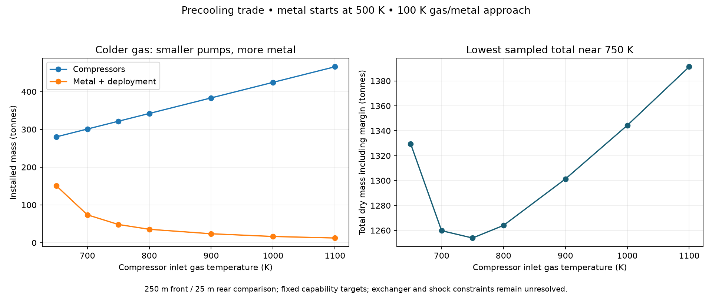

# Precooling: metal rack versus compressor mass

This is a one-variable sweep of compressor inlet gas temperature, with the
current two-compartment architecture and all other input choices held fixed.
Physical front/rear depths are 250/25 m,
with 18.3 m front diameter. **The 250 m comparison depth is not
an optimized choice.** No temperature row is a validated spacecraft optimum.

Metal starts at **500 K**. The chosen minimum gas-to-metal
approach is **100 K**, so:

    metal hot endpoint = compressor inlet temperature - approach
    metal heat capacity per kg = integral Cp(T) over the metal temperature swing
    metal mass = net absorber heat / capacity per kg

Cooling to a lower gas endpoint requires a lower metal hot endpoint. A warmer
passive rack cannot supply a colder outlet at the end of the encounter. This is
a uniform-rack endpoint screen; a distributed or thermally stratified rack could
have a different temperature profile and must be modeled explicitly.

Compressor suction capacity scales approximately with gas temperature at the
same pressure target. Its mass follows the same explicit installed-capacity
coefficient in every row: 30 kg/(m³/s). Efficiency is held fixed across the sweep,
which is a requirement for future pump development, not a verified pump map.

| Compressor inlet | Metal hot endpoint | Metal capacity | Metal mass | Compressor mass | Metal deployment mass | Total dry mass | Net product/cycle |
|---:|---:|---:|---:|---:|---:|---:|---:|
| 650 K | 550 K | 27.1 kJ/kg | 99.80 t | 280.30 t | 50.72 t | 1,329.57 t | 66.82 kg |
| 700 K | 600 K | 55.3 kJ/kg | 48.97 t | 300.91 t | 24.89 t | 1,259.79 t | 66.89 kg |
| 750 K | 650 K | 84.5 kJ/kg | 32.04 t | 321.52 t | 16.28 t | 1,253.91 t | 66.95 kg |
| 800 K | 700 K | 114.9 kJ/kg | 23.58 t | 342.12 t | 11.98 t | 1,264.00 t | 67.00 kg |
| 900 K | 800 K | 172.3 kJ/kg | 15.74 t | 383.32 t | 8.00 t | 1,301.29 t | 67.08 kg |
| 1000 K | 900 K | 247.8 kJ/kg | 10.96 t | 424.51 t | 5.57 t | 1,344.34 t | 67.15 kg |
| 1100 K | 1000 K | 328.2 kJ/kg | 8.28 t | 465.70 t | 4.21 t | 1,391.36 t | 67.20 kg |

The lowest sampled total is **750 K**, at **1,253.9 t**.
Compared with 1,000 K, compressor mass decreases by
**103.0 t**, while metal increases by
**21.1 t** and its deployment
allowance increases by **10.7 t**.
The full mass ledger, including all other duty changes and margin, decreases by
**90.4 t**.

As gas temperature approaches the cold-metal-plus-approach limit, the metal's
usable temperature swing shrinks and its required mass rises steeply. The model
rejects 600 K and below with these fixed cold/approach inputs:
there would be no positive metal temperature swing.

The rack absorbs approximately the same few gigajoules throughout. Lower inlet
gas temperature removes more initial gas heat but also reduces hot-compressor
work and associated heat. The dominant metal penalty here is **less thermal
capacity per kilogram**, not a large increase in atmospheric energy.

## Deployed areas and duties

| Gas inlet | Solar panels | Warm radiator panels (two faces) | Metal sheets (two faces) | Compressor electricity | Net absorber heat |
|---:|---:|---:|---:|---:|---:|
| 650 K | 39,143 m² | 1,577 m² | 50,725 m² | 28.6 kWh/pass | 2.704 GJ |
| 700 K | 39,155 m² | 1,579 m² | 24,890 m² | 30.4 kWh/pass | 2.706 GJ |
| 750 K | 39,168 m² | 1,581 m² | 16,284 m² | 32.3 kWh/pass | 2.708 GJ |
| 800 K | 39,180 m² | 1,583 m² | 11,984 m² | 34.1 kWh/pass | 2.709 GJ |
| 900 K | 39,204 m² | 1,586 m² | 8,001 m² | 37.8 kWh/pass | 2.713 GJ |
| 1000 K | 39,228 m² | 1,590 m² | 5,571 m² | 41.6 kWh/pass | 2.716 GJ |
| 1100 K | 39,252 m² | 1,594 m² | 4,210 m² | 45.3 kWh/pass | 2.719 GJ |

All cases retain the same orbit, opening/closure rule and presumed intake.
Small net-output differences come from gas left in the front chamber under the
same 90% recovery rule. Capture is not revalidated at each temperature.

The temperature/port-area/oxygen/radiation screens pass for these rows. Missing
constraints include actual gas-to-metal conductance, flow/rack pressure loss,
shock position, available pump maps and structural/deployment design. These can
move or remove the apparent minimum. Changing cold metal temperature, approach,
material properties or compressor mass target also changes the result; the
input file permits those capability/design sensitivities explicitly.

Metal heat capacities use [NIST solid iron properties](https://webbook.nist.gov/cgi/cbook.cgi?ID=C7439896&Mask=2&Units=SI).
The 100 K approach and mass coefficients are chosen engineering targets.

Reproduce:

```sh
.venv/bin/python -m atmo_scoops --config configs/reference.json --sweep-precooling 650 700 750 800 900 1000 1100 --output results/precooling_trade.json
MPLCONFIGDIR=/tmp/atmo-scoops-mpl .venv/bin/python -m atmo_scoops.studies.precooling
```



