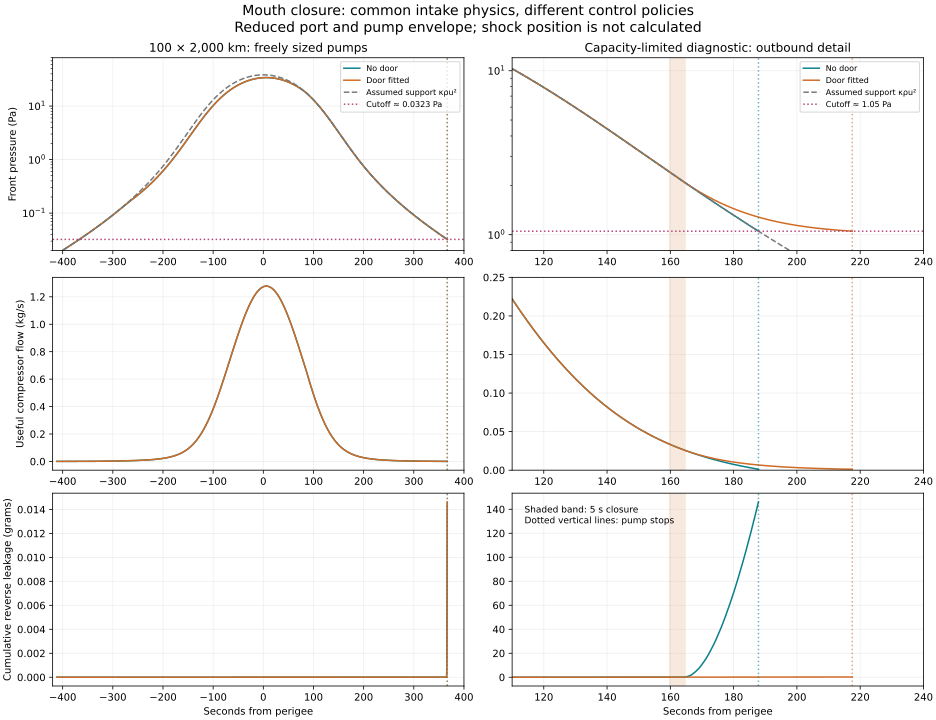

# Mouth closure: analysis supporting the accepted decision

**The freely sized cases favor removing the closure. A deliberately pump-limited case gives a small conditional benefit to keeping it.** These are operating-orbit payoff results from a common continuous inlet law. Actual scoop leakage and compressor performance remain unvalidated; the small positive door result is especially sensitive to those assumptions.

The inlet and compressor wall remain. “No door” removes only the pressure-retaining closure, its supports, seals and actuation allowance. Rear storage is isolated when pumping ends.

## Equal treatment of both options

Both start with an empty front chamber at inbound 200 km and use the same bidirectional boundary throughout the encounter. Both can collect after perigee. Each branch searches installed suction capacity and commanded cutoff; the door branch also searches closure time and may leave the door unused. Both pay for all dependent hardware, electrical energy and heat rejection. Closing at perigee is not imposed.

Geometry, orbit, gas temperature, staging and technology assumptions are held fixed within each pair. This is a bounded control/capacity search, **not a whole-vehicle or global optimum**. Suction multipliers span 0.5–1.5, cutoff spans 1.05 times effective ultimate pressure to at least 10 Pa, and closure commands span 0–900 s after perigee. A paired coarse grid and two bounded coordinate passes are followed by cross-seeding controls and 1,601/3,201-sample replays. The capacity-limited diagnostic fixes suction at 0.5.

## Results

| Fixed design / capability scenario | No-door payoff | Door payoff | Door command before pump stops? | Break-even door hardware |
|---|---:|---:|---|---:|
| 100 × 2,000 km comparison | 988.32 d | 989.70 d | No; door unused | ≈ 0 (numerical/search tolerance) |
| 90 × 937 km geometry | 511.13 d | 511.30 d | No; door unused | ≈ 0 (numerical/search tolerance) |
| Comparison, support 0.6 ρu² | 1,089.92 d | 1,091.31 d | No; door unused | ≈ 0 (numerical/search tolerance) |
| Comparison, 1 Pa pump limit | 1,030.36 d | 1,031.79 d | No; door unused | ≈ 0 (numerical/search tolerance) |
| 450 m front, fixed half-capacity pumps | 1,859.65 d | 1,859.44 d | Yes | 2,888 kg |

The first four cases use **4,000 s Isp**. The 90 km case borrows the saved search geometry (25 m front, 26.52 m rear, 30 m mouth), but changes its Isp to 4,000 s and uses this continuous encounter. It is not a replay of the earlier 3,322 s optimization. The other comparison geometry has an 18.3 m mouth and bore, 250 m front and 25 m rear. The diagnostic instead uses a 450 m front and 5,500 s Isp so its reduced capture still passes the oxygen-only propellant screen. It is a different scenario, not an improvement over the comparison craft.

In the freely sized cases, the fitted door is best left open until useful pumping has ended. Its extra mass buys essentially no recovered gas. At the configured 10 kg/m², hardware mass is 2.63 t for the 18.3 m mouth or 7.07 t for the 30 m mouth, plus the shared 25% dry-mass margin. Small signed break-even values near zero reflect search/integration tolerances, not a physical negative door mass.

### Complete paired budgets

| Case / option | Admitted | Stored | Reverse leak | Final front vent | Dry mass | Net liquid / day | Compressor mass |
|---|---:|---:|---:|---:|---:|---:|---:|
| 100 × 2,000 km comparison / open | 220.532 kg | 220.524 kg | 0.000014 kg | 0.007397 kg | 2,356.15 t | 2,383.99 kg | 336.14 t |
| 100 × 2,000 km comparison / closed | 220.536 kg | 220.528 kg | 0.000015 kg | 0.007396 kg | 2,359.49 t | 2,384.04 kg | 336.18 t |
| 90 × 937 km geometry / open | 4,255.028 kg | 4,255.023 kg | 0.000000 kg | 0.005158 kg | 26,561.60 t | 51,966.06 kg | 592.12 t |
| 90 × 937 km geometry / closed | 4,255.028 kg | 4,255.023 kg | 0.000000 kg | 0.005157 kg | 26,570.43 t | 51,966.06 kg | 592.12 t |
| 450 m front, fixed half-capacity pumps / open | 147.849 kg | 147.270 kg | 0.146117 kg | 0.432909 kg | 2,893.97 t | 1,556.19 kg | 214.84 t |
| 450 m front, fixed half-capacity pumps / closed | 147.849 kg | 147.416 kg | 0.000205 kg | 0.432909 kg | 2,897.32 t | 1,558.17 kg | 214.84 t |

Stored mass is before oxygen propulsion and processing losses; daily net liquid is after them. All listed cases pass the implemented screens. Zero predicted reverse flow does not imply zero spillage: rejected intake is distinct from gas that entered and then escaped. Gas still in the front at cutoff is counted as lost, even with a door, because the mouth must reopen for sheet deployment.

| Case / option | Rated hot suction | Cutoff | Pump stops after perigee | Closure command | Solar area | Warm radiator panels | Metal sheets |
|---|---:|---:|---:|---:|---:|---:|---:|
| 100 × 2,000 km comparison / open | 10,781 m³/s | 0.0323 Pa | 366.8 s | unused | 101,141 m² | 4,115 m² | 14,547 m² |
| 100 × 2,000 km comparison / closed | 10,782 m³/s | 0.0323 Pa | 366.8 s | unused | 101,141 m² | 4,115 m² | 14,547 m² |
| 90 × 937 km geometry / open | 19,390 m³/s | 0.0595 Pa | 505.1 s | unused | 3,105,871 m² | 56,986 m² | 43,063 m² |
| 90 × 937 km geometry / closed | 19,390 m³/s | 0.0595 Pa | 505.1 s | unused | 3,105,871 m² | 56,986 m² | 43,063 m² |
| 450 m front, fixed half-capacity pumps / open | 6,863 m³/s | 1.0500 Pa | 187.9 s | unused | 136,322 m² | 5,116 m² | 9,735 m² |
| 450 m front, fixed half-capacity pumps / closed | 6,863 m³/s | 1.0500 Pa | 217.5 s | 159.7 s | 136,331 m² | 5,118 m² | 9,740 m² |

Radiator and sheet areas are physical panel areas, with two emitting faces. Solar area is collecting area. The comparison orbit takes 106.19 minutes; the 90 km geometry’s orbit takes 94.90 minutes.

## When can the door help?

The capacity-limited diagnostic has more front inventory relative to installed pumping. Its best door command is about +159.7 s, taking 5 s to close. It then pumps to +217.5 s; the open craft reaches its cutoff at +187.9 s. The door saves about **0.146 kg per pass** from reverse leakage, while both leave about 0.433 kg at the 1.05 Pa cutoff. It improves payoff by only **0.207 day (about five hours) on a roughly 1,860-day payoff**.

For these fixed policies, the door hardware breaks even at about **2.89 t, or 10.98 kg/m² of mouth** before margin. The assumed door is 10 kg/m². A roughly 10% increase in door allowance erases the benefit. Allowing larger pumps is another competing design response; this example is not evidence that a capacity-limited craft should be selected. The cutoff reaches the imposed 1.05-times-ultimate lower search bound, so the result is conditional on that operating margin too.

### Seal sensitivity, same diagnostic controls

These are fixed-policy replays; the closure time and pumps are not reoptimized for each seal. The equivalent leak aperture is a fraction of mouth area, not an estimate of a real seal gap.

| Equivalent seal area / mouth | Reverse leak | Pump stop | Door payoff | Difference from no door | Screens |
|---|---:|---:|---:|---:|---|
| 0e+00 | 0.000080 kg | +217.5 s | 1859.440 d | -0.209 d | pass |
| 1e-05 | 0.000205 kg | +217.5 s | 1859.442 d | -0.207 d | pass |
| 1e-04 | 0.001320 kg | +217.2 s | 1859.460 d | -0.189 d | pass |
| 1e-03 | 0.011525 kg | +214.2 s | 1859.626 d | -0.023 d | pass |
| 1e-02 | 0.067941 kg | +200.9 s | 1860.537 d | +0.887 d | pass |



The comparison curves nearly coincide: the fitted door is unused. The diagnostic zoom shows why sealing can help: falling external support allows reverse flow while the open compressor is still recovering gas. Closing suppresses that path, but useful pump speed continues falling toward its ultimate pressure. The chart shows pressure, not the position of a shock.

## Implemented flow and cutoff equations

For front volume V at prescribed cooled temperature T:

```text
p_front = M_front R T / V
p_support = κ ρ∞ u²
dM_front/dt = admission − reverse leakage − useful pump flow
dM_rear/dt = useful pump flow
p_ultimate = max(capability floor, intermediate pressure / maximum compression)
useful pump flow = S_rated × max(p_front − p_ultimate, 0) / (R T)
```

Admission is the smaller of geometric interception and ideal compressible-port flow from support to front pressure. Reverse leakage uses that same port in the opposite direction, including choking. A closing door reduces its effective area continuously; a finite seal aperture remains. The nominal support is ρu² (twice dynamic pressure q), discharge factor 0.8, closure duration 5 s and closed leak area 10⁻⁵ of mouth area. These are declared scenarios, not measured scoop coefficients. Optional support-response lag is available but uncalibrated and zero here.

The finite-backflow pump envelope has S_effective/S_rated = max(1 − p_ultimate/p, 0). Effective ultimate pressure is 0.03 Pa nominally, with a maximum hot-train compression ratio of 10⁶. Useful pumping therefore approaches zero continuously; it is not constant suction abruptly switched off at a magic pressure. Internal backflow compression work and a 5% reference-power idle allowance remain charged while enabled. The commanded cutoff must be strictly above ultimate pressure, and stops pumping on the outbound downward crossing. A 1,200 s timeout is a failed completion screen, not a successful recovery. Rear check/isolation valves prevent pump-mediated tank reflux.

This envelope is motivated by finite internal leakage in vacuum pumps, but it is **not a measured pump map** at the required temperature, size or gas composition. Constant efficiency and the compressor mass coefficients remain development targets. Suction scale sizes installed hardware; it is not free control authority. The primary pressure target only defines the reference suction scale in this experiment; actual admission is then calculated.

### Heat, momentum and fair accounting

- Integrated admitted gas, rear inventory, outward leakage and final residual satisfy mass conservation. Oxygen is transported separately. Incoming enthalpy, compression work, stored energy and escaping-gas enthalpy close the thermal ledger. Peak aftercooler duty sizes the shared exchanger allowance.
- Captured gas incurs its encounter impulse even if it later leaks. Upstream escape adds a conditional nozzle-recoil estimate. Rejected air and the closed face are also charged: the nominal scenario transfers one incident momentum flux over the projected mouth area throughout the atmospheric window. Closing a door cannot make intercepted air disappear from the propulsion budget.
- This projected-mouth drag scenario does not resolve hull/fins, skin friction, unstart spillage direction or actual closed-door forces. Additional post-cutoff heat deposition and door-specific thermal protection are unresolved. Both hardware budgets are conditional on the same omissions.

The physical reasons for differences from the general requirement-model outputs are the common inbound/outbound boundary, start at 200 km, finite-backflow/idle pump penalties, rejected/blocked-air momentum and peak aftercooler sizing. The earlier prescribed-inbound, perigee-closure calculation must not be used as an architecture verdict.

## Numerical verification versus physical accuracy

All winners were replayed at 1,601 and 3,201 environmental samples with adaptive LSODA integration. Maximum relative change across admitted mass, stored mass, dry mass and compressor energy is 4.23e-06. Tests cover identical pre-closure behavior, an unused door changing only mass, finite-backflow analytic pumpdown, finite seal leakage, conservation, sonic port limits, cutoff rejection and timeouts. This establishes numerical consistency within the assumed model.

**Accurate expected leakage still requires offline inlet and compressor calibration.** The reduced port does not locate the shock, predict start/unstart hysteresis, resolve the cooler pressure drop, or establish an effective reverse-flow area. The conditional decision is therefore: removing the door is favored across the freely sized scenarios tested; a sufficiently light, well-sealed door can help when pumping capacity is constrained, but the demonstrated gain is smaller than unresolved engineering uncertainty.

## Evidence and reproduction

The accepted design decision is to omit the closure: it does not improve payoff
in the freely sized cases studied. The imposed-capacity exception above remains
part of the evidence, but does not justify retaining the option in the active
model. This is a decision within the tested engineering assumptions, not a
claim that sealing can never help any hypothetical spacecraft.

[Resolved case summaries](results.json) retain all winning inputs, controls,
component budgets, cutoff results and resolution checks.
[Seal sensitivity](seal_sensitivity.json) retains those fixed-policy replays.
[reproduction.tar.gz](reproduction.tar.gz) is a frozen source/data snapshot of
the comparison, including full histories, search traces, the prior model,
configurations, tests, atmosphere tables and dependency lock. Its hash is in
[SHA256.txt](SHA256.txt). It is outside the active import and optimizer paths.

To reproduce, extract the archive into a separate directory, create a local
venv in `snapshot/`, install the snapshot's requirements-lock.txt, and run from `snapshot/`:

```sh
.venv/bin/python -m atmo_scoops.studies.fair_closure --case all
MPLCONFIGDIR=/tmp/atmo-scoops-mpl .venv/bin/python -m atmo_scoops.studies.mouth_closure
```

The snapshot's other reports preserve the provenance of older geometry studies;
they are not current-model outputs. The active simulation has no closure input,
closure mass allowance, actuation schedule or alternate recovery branch.

Sources: [NASA compressible mass flow](https://www.grc.nasa.gov/www/BGH/mflchk.html),
[Pfeiffer vacuum-generation principles](https://www.pfeiffervacuum.com/no/en/knowledge/vacuum-technology/knowledge-book/4-vacuum-generation/),
and [Leybold Fundamentals of Vacuum Technology](https://www.leybold.com/content/dam/brands/leybold/downloads/brochures/general-brochures/Fundamentals_of_Vacuum_Technology_EN.pdf).
These support limiting relationships, not the selected scoop coefficients.
