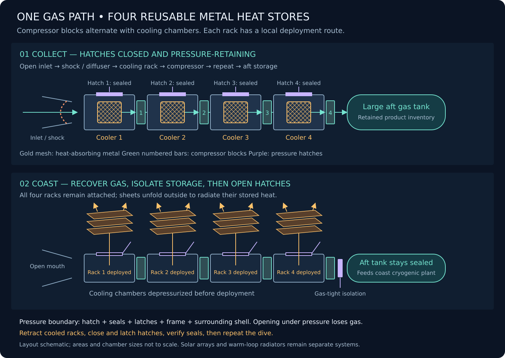

# Spacecraft design

This page describes the integrated v1 architecture. The
[version roadmap](VERSION_ROADMAP.md) records planned v1.0.1 accuracy work,
v1.1 fixed coolant tubes in higher-pressure volumes with retained front SiC
racks, and the v2.0 propulsion-free diver/tether-mothership split. Those plans
do not change the frozen v1.0 numerical reference.

The [current v1.0.1 working layout](images/v1_perigee_scale.svg) restores the
125 m valve-connected aft reserve. Its [restoration plan](V1_0_1_RESTORE_PLAN.md)
contains the algebraic orbit screen and fixed-input audit. The 275.7-day boosted
reserve candidate is [rejected and archived](design_archive/v1.0.1_rejected_boosted/README.md);
the replacement constrained solution gives **306.4 days operating-orbit payoff**; see [numerical evidence](../investigations/valve_reserve/README.md).


## Purpose and architecture

This design develops the concept first published on AlanCoding's
[Atmospheric Scoop Divers page](https://alancoding.github.io/concepts/atmospheric-scoop-divers/).
That page introduces the idea; this repository supplies its engineering
description, quantitative model and design studies.

Collect atmospheric gas during repeated perigee passes, remove its encounter
energy, store it aft, and liquefy useful products during coast. Reboost uses a reserved fraction of the collected atmospheric gas. The mission payoff counts useful
liquid delivered to circular apogee; the present numerical package resolves the
operating cycle and has yet to add delivery and return.

The vehicle has a mouth and shock/diffuser region, a solid metal precooling rack
in a low-pressure front compartment, successive compressor/cooling chambers,
and separate rear gas tanks. Compressors move gas out of the front while the
inlet admits it. The active coupled model resolves five gas/cooler volumes and four dive compressor
blocks. The 30 m bore and 317 m outside length are fixed in this study; the aft
receiver gets the volume remaining after other chambers and installed packages.
Rear depth includes rounded ends. Required hardware mass is an output. The
two-compartment diagram below is a simplified functional overview.


Metal racks absorb entry heat and, between compressor blocks, compression heat.
Their attached sheets deploy during coast to radiate directly to space; the
staged layout provides dedicated pressure-retaining deployment hatches.
Separate solar panels
supply electricity and a warm-loop radiator rejects remaining compressor,
refrigeration and electrical losses. Gas storage, refrigeration/heat exchange,
liquid storage, batteries, air-propellant thrusters and power distribution have separate
entries in the mass and energy ledgers.


The condenser is the cold-side product heat exchanger. The refrigerator supplies
its cold sink using electrical work; the warm loop must reject the extracted
heat plus that work. The solid absorber follows a separate path: store heat in
the dive, then expose its own surface to space. This separation is essential to
sizing each system and avoids treating a condenser as the entire thermal plant.

Active thermal management is central to the concept. Minimum usable perigee is
an engineering result to be determined from cooled leading-edge temperature,
heat flux, coolant/absorber capacity, oxidation/erosion, thermal stress and
repeat-use life. A numerical atmosphere-table boundary is not that result.
Bulk rack temperature limits do not qualify the leading edge.

## Staged compression and cooling with deployable metal racks

The collection train alternates **metal cooling chamber → compressor block**,
starting with three or four blocks and ending in a large intermediate-pressure
aft receiver. Each block may contain multiple blade rows or parallel machines.
Each chamber has its own metal rack; its volume, rack geometry and mass, and
compressor capacity are design variables. Intermediate storage can shift some
compression into coast. Gas states follow compression and finite heat transfer,
rather than prescribed isothermal endpoints.



The attached racks deploy through local pressure-retaining hatches during coast.
Recover chamber gas, isolate aft storage and depressurize the deployment chamber
before opening its hatch. The same metal unfurls to radiate, then retracts;
hatches close, latch and are checked before the next dive. Delaying chamber
emptying also delays its rack's cooldown. Frames, seals, actuators, isolation,
residual losses and repeated deployment all belong in the hardware budget.

A smaller coast compressor feeds a process buffer and the liquefaction train,
with product accumulating in liquid tanks. The final process pressure is to be
selected from the liquefaction requirements. The metal racks are gas coolers;
cryogenic condensation and refrigeration remain distinct operations.

The numerical model resolves real-fluid compression-block states, finite front
and interstage metal cooling, and a conditional geometry-based compressor mass
budget. Front gas and metal energies evolve during the pass; intermediate racks
use quasi-steady series flow with explicit pore inventory and residual loss.
Large independent intermediate storage and calibrated compressor maps remain
unresolved. See the [finite-rack model](../modeling/metal_coolers/FINITE_RACK_MODEL.md).

## Orbit and phase timing


This illustration uses the 100 × 2,000 km comparison orbit and the open-mouth
variant from the continuous-inlet control/capacity search. The Kepler period is
106.2 minutes. The encounter starts at inbound 200 km, about 6.86 minutes before
perigee; substantial collection occupies a shorter interval near perigee.
The searched 0.0323 Pa cutoff ends pumping about 6.11 minutes afterward. The model waits for 200 km altitude before starting
its five-minute deployment; the fully deployed coast lasts about 82.5 minutes.
Only 43.4 of those minutes are sunlit under the current orientation assumption.
Reboost is near perigee; its finite-duration trajectory is not integrated here.

The outer dashed circle has the apogee radius. The ideal tangential velocity
increment to circularize there is about 456 m/s for this orbit. This is a
kinematic comparison, not a complete delivery budget: export hardware, propulsion,
changed mass and any return trajectory still have to be included. A spacecraft
that circularizes no longer returns to atmospheric perigee on that orbit.

Regenerate the SVG and its machine-readable timing record with:

```sh
MPLCONFIGDIR=/tmp/atmo-scoops-mpl .venv/bin/python -m atmo_scoops.studies.orbital_diagram
```

## Why the front chamber needs active transfer

The [column analysis](../modeling/primary/ATMOSPHERIC_COLUMN.md) gives a simple
volume argument. In the comparison orbit, the selected inbound window crosses
639 km of atmosphere, equivalent to 520 km at perigee density. At 1,000 K and
the stated pressure allowance, a density ratio of about 146 leaves 3.57 km of
required unpumped depth if the chamber and mouth have equal cross-sections.
A compressor makes the front volume a flow-through buffer instead of the
storage vessel for the entire pass. Cooling reduces its required suction
volume and the burden on that transfer system.


These numbers explain a scaling constraint, not a chosen craft length. They
assume a nitrogen-equivalent ideal gas, no added coolant mass and supported
pressure at perigee. Physical front/rear depths in the cycle model remain
independent design variables.

## Operating cycle

The design omits a mouth closure following the [payoff comparison](../investigations/mouth_closure/ANALYSIS.md).

1. **Prepare for entry.** Retract arrays, warm radiators and every attached metal
   rack. Close, latch and verify deployment hatches. Charge batteries and reserve
   reboost propellant and any mixing coolant.
2. **Collect.** The open inlet admits air through its shock/diffuser and metal
   rack. Successive compressor blocks and metal coolers transfer gas into rear
   tanks, with all deployment hatches closed. The continuous model
   computes admission and reverse leakage on both legs of the atmospheric pass.
3. **Finish recovery.** Continue pumping as external pressure falls. Useful
   pumping declines toward the hardware ultimate pressure. Stop at a commanded
   pressure above that limit; the remaining front gas is counted as lost.
4. **Isolate and deploy.** After atmospheric clearance, recover gas from the
   cooling chambers, isolate rear storage and depressurize each deployment
   chamber. Open its hatch and unfurl the attached metal rack. Account for
   residual gas losses. Unfold solar arrays and warm radiators.
5. **Process in coast.** Radiate stored heat, recharge batteries, separate and
   liquefy the retained gas. Restore any injected LN2 inventory before counting
   net new product. All metal stays attached and is reused next orbit.
6. **Repeat and deliver.** Reserve the next reboost's gas. Circular-apogee
   export and return still need trajectory and hardware budgets.

## Optional phase-change cooler cores

Deployable metal coolers may contain sealed phase-change cores: the core melts
while collecting heat and freezes while the attached panel radiates during
coast. Solid metal skins and internal heat spreaders retain the liquid and
provide gas-contact and radiating surfaces. Thin cells need expansion space,
compatible liners and cyclic pressure/thermal qualification.

Different stages may use different cores and radii. The optional model now tracks
separate casing/core temperatures, melting, finite conduction, displacement and
coast refreezing. Solid-metal racks remain the reference: the tested PCM cases
do not beat a similarly retuned solid-metal design. See the
[comparison](../investigations/pcm_racks/ANALYSIS.md),
[model equations](../modeling/metal_coolers/PCM_MODEL.md) and
[material survey](PHASE_CHANGE_COOLERS.md).

## Optional fixed-tube liquid cooling

A third thermal architecture uses fixed heat-exchanger tubes in the compressor
chambers. Cold liquid flows once through during collection into a separate warm
inventory, without mixing into the air. A shared tank may use an insulated
moving separator between cold and warm sections. During coast, a radiator and,
when required, a solar-powered heat pump restore the cold inventory. The tubes
stay installed; only radiator and solar panels deploy.

Solid-metal storage, PCM cores and pumped liquid remain available concepts and
can serve different temperature bands. A hot first cooler plus a refrigerated
terminal cooler deserves separate treatment from refrigerating the entire ram
heat load. Coolant flow, cold/warm endpoints, fluid, pressure and per-stage
exchanger allocation become design variables. Coolant tank volume and line fill
must be charged explicitly.

The optional [integrated ammonia model](../modeling/liquid_cooling/INTEGRATED_MODEL.md)
now couples tube heat transfer and controlled coolant flow to the inlet and each
compressor block. Available inventory, wall boiling, pumping, coast regeneration
and added packing/deployment are included. Its initial
[payoff comparison](../investigations/liquid_cooling/INTEGRATED.md) remains
conditional on the exchanger and machinery approximations.

## Propellant accounting and reboost

The working v1.0.1 layout uses the final **125 m of the hull as a valve-connected
mixed-gas reserve**. It supplies pre-entry thrust; the valve opens when main
receiver pressure catches reserve pressure, then isolates the reserve before
coast liquefaction draws down the main receiver. Propellant bypasses liquefaction.
There is no reserve refill compressor or separate high-pressure storage bank.
The [restoration plan](V1_0_1_RESTORE_PLAN.md) records the implemented changes,
including finite valve flow, thermal/species closure and the low-pressure
thruster-feed interface that still needs validation.

The coupled model now implements that valve-connected architecture. A
[46-variable constrained solution](../investigations/valve_reserve/README.md)
passes the cycle constraints and has completed COBYLA termination.
The historical boosted implementation remains available only for reproduction
and is [rejected](design_archive/v1.0.1_rejected_boosted/README.md). Its older
[feed mechanism diagram](images/feed_racks.svg) does not depict the current
valve-connected reserve; use the current scale drawing for that layout.

The working reference uses **flow-aligned parallel plates**, SiC in front and
aluminum downstream. Each stage has independently sized full thickness, clear
gap, metal inventory and initial temperature. Finite heat exchange, displaced
gas volume, rack envelope, deployment and radiation remain in the cycle.
Plane-Poiseuille wall friction is charged at **100%** as additional compressor
electricity and warm-loop heat, without changing suction pressure. This is an
energy approximation, not a resolved hydraulic pressure field.

The [plate investigation](../investigations/plates/README.md) documents the actual
33-variable constrained COBYLA solve and the approximately **278-day operating-orbit
reference**, checked at three integration resolutions. Older rod and reduced-loss
studies remain reproducible but no longer define the working design.

A separate [power-only resistance experiment](../investigations/staged_refinement/POWER_OPTIMIZATION.md)
tests pitch and radius by charging losses to motor, electrical and warm-loop
budgets without lowering suction pressure. It is an energy trade study, not
hydraulic validation of the selected geometry.

For capture-only momentum, propellant/admitted mass is approximately encounter
speed/exhaust speed. Lower exhaust velocity saves electrical hardware but consumes
more product. A requested oxygen reserve is a constraint on oxygen consumption,
not a capture-efficiency statement. Nitrogen-capable configurations need their own
qualified propulsion performance map.

The [reboost investigations](../investigations/reboost/README.md) compare Isp and
direct-solar burns before stowing and after deployment. The latter must restore
both orbital energy and angular momentum, and leave enough processing time.
It remains an investigated operating option rather than the primary thrust model.

## Incremental coolant mixing

Mixing remains a supported design variable pending better compressor physics.
Zero injection is the current reference setting, not a final selection.

Optional LN2 injection upstream of the compressors can supplement the solid
rack. The model balances mixing enthalpy, compression, coolant losses and coast
reliquefaction; circulating nitrogen is not counted as new product. In the
coupled numerical model, compressor shaft work enters the downstream gas; motor
and friction-surcharge losses enter the warm loop. Each finite rack exchanges
heat using its evolving gas/metal temperature difference.
The [incremental mixing study](../investigations/incremental_mixing/ANALYSIS.md)
contains the quantitative trade. Film-cooling requirements and a calibrated
compressor-temperature map remain separate engineering work.

## Close-pass volume allocation

Each compressor block needs a physical envelope and an independently sized
cooling chamber. During the atmospheric pass, solar wings and warm radiators
occupy their protected stowed packages; metal coolers occupy their working gas-
contact geometry. Accessible pore gas and solid material must be accounted for
without overlap. Batteries, drives, liquid tanks, piping, hatches and deployment
paths also consume space. Rear storage uses the remaining connected volume.

The numerical package derives rack envelopes, metal-displaced front gas volume,
compressor package volumes and folded equipment allocations. The previous fixed
100 m machinery bay is not used in this path. Solar, warm radiator and metal-rack
travel times scale with the square root of deployed footprint at a reference
10 m/s; no full-power/full-radiation credit is taken before deployment finishes.
The [implementation and capability assumptions](../modeling/deployment/IMPLEMENTED_VOLUME.md)
distinguish a volume screen from a complete installed layout. The updated
[constraint-driven investigation](../investigations/altitude_sensitivity/FINITE_RACK_LIMITS.md)
reports numerical limits without claiming a survivable perigee.

The [external skin-friction screen](../investigations/skin_friction/ANALYSIS.md) now adds a configurable hull shear impulse. Calibrated aerothermal loads and fin/base/shape pressure drag remain pending.

## Numerical status

The [coupled cycle model](../modeling/primary/TRANSIENT_IMPLEMENTATION.md) now
follows five gas/rack volumes, four finite dive compressor blocks, a finite coast
train and liquefaction plant, battery/solar power and thermal recovery. SiC is
used in front and aluminum downstream. Installed hardware occupies a fixed
317 m hull; the aft receiver receives the remaining length. A variable-duration
steered burn replaces the arbitrary 300 s rating assumption.

Each design candidate is integrated once. Periodic state residuals, species and
energy conservation, capacity and material limits determine acceptance. The
[current numerical investigation](../investigations/transient/README.md) contains
results and assumptions; the older scalar program remains available for
reproduction. Payoff still ends in the operating orbit. Circular-apogee delivery
is not included, and no saved candidate is an approved final vehicle.

The pump map, vent/hatch hardware, external drag, structural qualification and
refrigeration package still need refinement. Parallel-plate friction is an electricity surcharge; rarefied channel transport,
entry effects and coupled hydraulic pressure losses remain pending. The [improvement list](MODEL_IMPROVEMENTS.md) records
the remaining work; detailed CFD and stability studies remain outside the cycle
optimizer.

### Parallel-plate cooler geometry

Gas flows between parallel faces. Full thickness sets metal inventory per face;
clear gap controls hydraulic diameter and shear resistance. The optimizer can
trade these independently while respecting the chamber envelope. Plates retract
through the cooler hatches and spread during coast to expose both radiating
faces. See [equations and limitations](../modeling/metal_coolers/PLATES.md).

Packaging and mass distribution will be resolved before a v1.0 Blender snapshot;
see the [layout requirements and proposed solar location](PACKAGING_AND_BLENDER_PLAN.md).
The planned v1.1 architecture replaces downstream extracted racks with fixed
coolant-tube exchangers, eliminating their pressure-sealed deployment doors.
The front SiC rack retains direct deployment through the open mouth. The
[roadmap](VERSION_ROADMAP.md#v11--retain-the-open-mouth-cooler-change-downstream-heat-storage)
defines the thermal and packaging accounting still required; this conversion
is not implemented or credited in the numerical reference.

The v1.0 publication snapshot uses a [provisional axial mass register](../investigations/v1_layout/MASS_REGISTER.md): about 33 m dry CM from the mouth, with heavy equipment ahead of the long aft receiver. The intended orbit is [dawn–dusk sun-synchronous](../investigations/v1_layout/SUN_SYNCHRONOUS.md), approximately 99.35° inclination by a first-order J2 screen. Seasonal illumination and 3D orbit maintenance have not been added to the saved payoff calculation. The [publication kit](publication/V1_0.md) selects current figures and tables; publication precedes Blender and further sensitivity studies.
