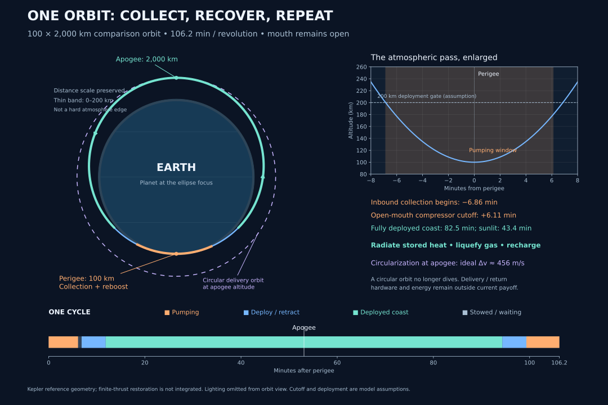

# Spacecraft design


## Purpose and architecture

This design develops the concept first published on AlanCoding's
[Atmospheric Scoop Divers page](https://alancoding.github.io/concepts/atmospheric-scoop-divers/).
That page introduces the idea; this repository supplies its engineering
description, quantitative model and design studies.

Collect atmospheric gas during repeated perigee passes, remove its encounter
energy, store it aft, and liquefy useful products during coast. Reboost uses
oxygen separated from the collected air. The mission payoff counts useful
liquid delivered to circular apogee; the present numerical package resolves the
operating cycle and has yet to add delivery and return.

The vehicle has a mouth and shock/diffuser region, a solid metal precooling rack
in a low-pressure front compartment, successive compressor/cooling chambers,
and separate rear gas tanks. Compressors move gas out of the front while the
inlet admits it. The staged arrangement is detailed below; the existing
two-compartment diagram and numerical model lump the compressor train.
Physical front and rear depths and all three diameters are independent inputs;
rear depth includes rounded ends. Required hardware mass is an output.


Metal racks absorb entry heat and, between compressor blocks, compression heat.
Their attached sheets deploy during coast to radiate directly to space; the
staged layout provides dedicated pressure-retaining deployment hatches.
Separate solar panels
supply electricity and a warm ammonia-loop radiator rejects remaining compressor,
refrigeration and electrical losses. Gas storage, refrigeration/heat exchange,
liquid storage, batteries, oxygen thrusters and power distribution have separate
entries in the mass and energy ledgers.


The condenser is the cold-side product heat exchanger. The refrigerator supplies
its cold sink using electrical work; the warm loop must reject the extracted
heat plus that work. The solid absorber follows a separate path: store heat in
the dive, then expose its own surface to space. This separation is essential to
sizing each system and avoids treating a condenser as the entire thermal plant.

Active thermal management is central to the concept. Minimum usable perigee is
an engineering result to be determined from cooled leading-edge temperature,
heat flux, coolant/absorber capacity, oxidation/erosion, thermal stress and
repeat-use life. A numerical atmosphere-table boundary is not that result.
Bulk rack temperature limits do not qualify the leading edge.

## Staged compression and cooling with deployable metal racks

The collection train alternates **metal cooling chamber → compressor block**,
starting with three or four blocks and ending in a large intermediate-pressure
aft receiver. Each block may contain multiple blade rows or parallel machines.
Each chamber has its own metal rack; its volume, rack geometry and mass, and
compressor capacity are design variables. Intermediate storage can shift some
compression into coast. Gas states follow compression and finite heat transfer,
rather than prescribed isothermal endpoints.


The attached racks deploy through local pressure-retaining hatches during coast.
Recover chamber gas, isolate aft storage and depressurize the deployment chamber
before opening its hatch. The same metal unfurls to radiate, then retracts;
hatches close, latch and are checked before the next dive. Delaying chamber
emptying also delays its rack's cooldown. Frames, seals, actuators, isolation,
residual losses and repeated deployment all belong in the hardware budget.

A smaller coast compressor feeds a process buffer and the liquefaction train,
with product accumulating in liquid tanks. The final process pressure is to be
selected from the liquefaction requirements. The metal racks are gas coolers;
cryogenic condensation and refrigeration remain distinct operations.

The numerical model now resolves real-fluid compression-block inlet/outlet states
and a conditional geometry-based compressor mass budget. It still lumps chamber
inventories and prescribes interstage cooling targets; finite metal intercooling,
calibrated compressor maps and deployment costs remain to be resolved. Detailed
[compressor research](../modeling/compressor/README.md),
[metal-cooler research](../modeling/metal_coolers/README.md), and
[deployment interfaces](../modeling/compressor/DEPLOYMENT.md) support the planned
model replacement.

## Orbit and phase timing



This illustration uses the 100 × 2,000 km comparison orbit and the open-mouth
variant from the continuous-inlet control/capacity search. The Kepler period is
106.2 minutes. The encounter starts at inbound 200 km, about 6.86 minutes before
perigee; substantial collection occupies a shorter interval near perigee.
The searched 0.0323 Pa cutoff ends pumping about 6.11 minutes afterward. The model waits for 200 km altitude before starting
its five-minute deployment; the fully deployed coast lasts about 82.5 minutes.
Only 43.4 of those minutes are sunlit under the current orientation assumption.
Reboost is near perigee; its finite-duration trajectory is not integrated here.

The outer dashed circle has the apogee radius. The ideal tangential velocity
increment to circularize there is about 456 m/s for this orbit. This is a
kinematic comparison, not a complete delivery budget: export hardware, propulsion,
changed mass and any return trajectory still have to be included. A spacecraft
that circularizes no longer returns to atmospheric perigee on that orbit.

Regenerate the SVG and its machine-readable timing record with:

```sh
MPLCONFIGDIR=/tmp/atmo-scoops-mpl .venv/bin/python -m atmo_scoops.studies.orbital_diagram
```

## Why the front chamber needs active transfer

The [column analysis](../modeling/primary/ATMOSPHERIC_COLUMN.md) gives a simple
volume argument. In the comparison orbit, the selected inbound window crosses
639 km of atmosphere, equivalent to 520 km at perigee density. At 1,000 K and
the stated pressure allowance, a density ratio of about 146 leaves 3.57 km of
required unpumped depth if the chamber and mouth have equal cross-sections.
A compressor makes the front volume a flow-through buffer instead of the
storage vessel for the entire pass. Cooling reduces its required suction
volume and the burden on that transfer system.


These numbers explain a scaling constraint, not a chosen craft length. They
assume a nitrogen-equivalent ideal gas, no added coolant mass and supported
pressure at perigee. Physical front/rear depths in the cycle model remain
independent design variables.

## Operating cycle

The design omits a mouth closure following the [payoff comparison](../investigations/mouth_closure/ANALYSIS.md).

1. **Prepare for entry.** Retract arrays, warm radiators and every attached metal
   rack. Close, latch and verify deployment hatches. Charge batteries and reserve
   reboost oxygen and any mixing coolant.
2. **Collect.** The open inlet admits air through its shock/diffuser and metal
   rack. Successive compressor blocks and metal coolers transfer gas into rear
   tanks, with all deployment hatches closed. The continuous model
   computes admission and reverse leakage on both legs of the atmospheric pass.
3. **Finish recovery.** Continue pumping as external pressure falls. Useful
   pumping declines toward the hardware ultimate pressure. Stop at a commanded
   pressure above that limit; the remaining front gas is counted as lost.
4. **Isolate and deploy.** After atmospheric clearance, recover gas from the
   cooling chambers, isolate rear storage and depressurize each deployment
   chamber. Open its hatch and unfurl the attached metal rack. Account for
   residual gas losses. Unfold solar arrays and warm radiators.
5. **Process in coast.** Radiate stored heat, recharge batteries, separate and
   liquefy the retained gas. Restore any injected LN2 inventory before counting
   net new product. All metal stays attached and is reused next orbit.
6. **Repeat and deliver.** Reserve the next reboost's oxygen. Circular-apogee
   export and return still need trajectory and hardware budgets.

## Optional phase-change cooler cores

Deployable metal coolers may contain sealed phase-change cores: the core melts
while collecting heat and freezes while the attached panel radiates during
coast. Solid metal skins and internal heat spreaders retain the liquid and
provide gas-contact and radiating surfaces. Thin cells need expansion space,
compatible liners and cyclic pressure/thermal qualification.

Different temperature sections may use different cores. Hot upstream cells can
radiate efficiently at high temperature; colder terminal cells must preserve
the compressor-inlet temperature approach. This is a design option, not yet a
credited mass improvement. The [material and cycle investigation](PHASE_CHANGE_COOLERS.md)
compares candidate salts/metals, complete-cell capacity and radiative/freezing
limits. Sensible-metal racks remain the baseline until finite heat transfer and
repeatable recovery establish a benefit.

## Oxygen accounting

Available oxygen means oxygen recoverable from the retained gas, including
recombined atomic oxygen. Reboost consumes part of it as propellant. Net product
subtracts propellant from the liquefied batch; nitrogen remains useful product.

For capture-only momentum, roughly `m_propellant / m_admitted = u / v_exhaust`.
At about 7.6 km/s encounter speed and 32.6 km/s exhaust, propellant is about 23%
of admitted air. Since retained air in the candidate is also about 23% oxygen,
almost all its oxygen is used for reboost. This is not a 23% capture efficiency.

Lower exhaust velocity saves electricity but consumes more oxygen. The current
optimizer often chooses the lowest exhaust velocity the oxygen balance allows.
A **10% oxygen reserve** requires `m_propellant <= 0.9 * m_oxygen_recovered`.
It leaves one-tenth of recovered oxygen unused as propellant, not 10% of the entire batch.
That oxygen is included in net available product; a permanent onboard reserve
inventory is a separate mission choice. Exterior drag is not calculated by this
reserve rule.

## Incremental coolant mixing

Mixing remains a supported design variable pending better compressor physics.
Zero injection is the current reference setting, not a final selection.

Optional LN2 injection upstream of the compressors can supplement the solid
rack. The model balances mixing enthalpy, compression, coolant losses and coast
reliquefaction; circulating nitrogen is not counted as new product. In the
current numerical model, compressor heat goes to the warm loop because mixed
gas can be cooler than the rack. The staged refinement must resolve each rack's
gas/metal temperature difference before crediting heat absorption.
The [incremental mixing study](../investigations/incremental_mixing/ANALYSIS.md)
contains the quantitative trade. Film-cooling requirements and a calibrated
compressor-temperature map remain separate engineering work.

## Close-pass volume allocation

Each compressor block needs a physical envelope and an independently sized
cooling chamber. During the atmospheric pass, solar wings and warm radiators
occupy their protected stowed packages; metal coolers occupy their working gas-
contact geometry. Accessible pore gas and solid material must be accounted for
without overlap. Batteries, drives, liquid tanks, piping, hatches and deployment
paths also consume space. Rear storage uses the remaining connected volume.

The numerical package does not yet solve this allocation or independent
interstage inventories. The former 25 m front / 100 m machinery split is a
placeholder and must not establish a geometry-limited reference. The
[close-pass volume research](../modeling/deployment/CLOSE_PASS_VOLUME.md) defines
the replacement and records reference packaging evidence.

## Numerical status

The single current specification is this document plus the
[input definitions](../modeling/primary/PARAMETERS.md). The
[primary equations](../modeling/primary/MODEL.md) state which behavior is solved
and which is prescribed. Studies explore those inputs under fixed capability
assumptions; no saved winner is an approved final vehicle. No pump mechanism,
rotor speed, module count, detailed throat geometry or stability arrangement is
selected. The [improvement list](MODEL_IMPROVEMENTS.md) is the development agenda.
