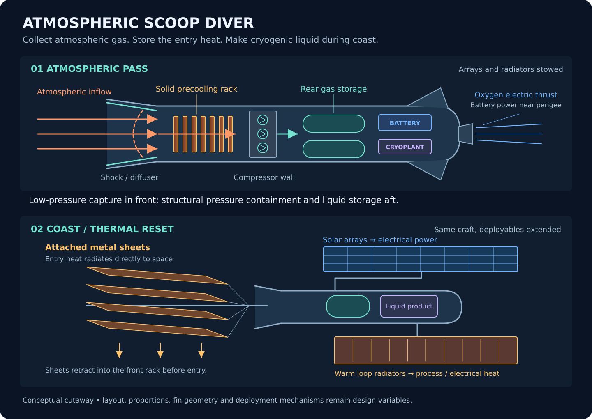
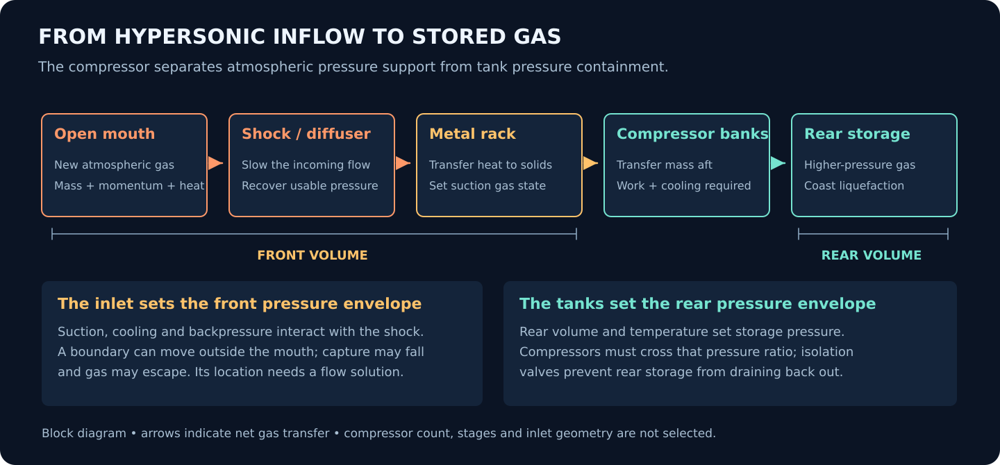
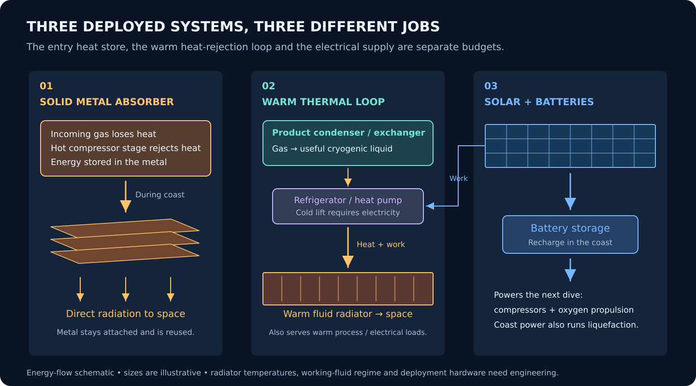
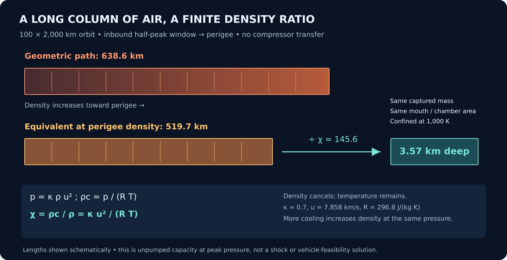

# Spacecraft design

## Purpose and architecture

This design develops the concept first published on AlanCoding's
[Atmospheric Scoop Divers page](https://alancoding.github.io/concepts/atmospheric-scoop-divers/).
That page introduces the idea; this repository supplies its engineering
description, quantitative model and design studies.

Collect atmospheric gas during repeated perigee passes, remove its encounter
energy, store it aft, and liquefy useful products during coast. Reboost uses
oxygen separated from the collected air. The mission payoff counts useful
liquid delivered to circular apogee; the present numerical package resolves the
operating cycle and has yet to add delivery and return.

The vehicle has a mouth and shock/diffuser region, a solid metal precooling rack
in a low-pressure front compartment, a compressor wall, and separate rear gas
tanks. The compressor moves gas out of the front while the inlet admits it.
Physical front and rear depths and all three diameters are independent inputs;
rear depth includes rounded ends. Required hardware mass is an output.

The metal rack absorbs entry heat before compression. Its attached sheets later
extend through the mouth to radiate directly to space. Separate solar panels
supply electricity and a warm ammonia-loop radiator rejects compressor,
refrigeration and electrical losses. Gas storage, refrigeration/heat exchange,
liquid storage, batteries, oxygen thrusters and power distribution have separate
entries in the mass and energy ledgers.

The condenser is the cold-side product heat exchanger. The refrigerator supplies
its cold sink using electrical work; the warm loop must reject the extracted
heat plus that work. The solid absorber follows a separate path: store heat in
the dive, then expose its own surface to space. This separation is essential to
sizing each system and avoids treating a condenser as the entire thermal plant.

Active thermal management is central to the concept. Minimum usable perigee is
an engineering result to be determined from cooled leading-edge temperature,
heat flux, coolant/absorber capacity, oxidation/erosion, thermal stress and
repeat-use life. A numerical atmosphere-table boundary is not that result.
Bulk rack temperature limits do not qualify the leading edge.

## Why the front chamber needs active transfer

The [column analysis](../analysis/primary/ATMOSPHERIC_COLUMN.md) gives a simple
volume argument. In the comparison orbit, the selected inbound window crosses
639 km of atmosphere, equivalent to 520 km at perigee density. At 1,000 K and
the stated pressure allowance, a density ratio of about 146 leaves 3.57 km of
required unpumped depth if the chamber and mouth have equal cross-sections.
A compressor makes the front volume a flow-through buffer instead of the
storage vessel for the entire pass. Cooling reduces its required suction
volume and the burden on that transfer system.

These numbers explain a scaling constraint, not a chosen craft length. They
assume a nitrogen-equivalent ideal gas, no added coolant mass and supported
pressure at perigee. Physical front/rear depths in the cycle model remain
independent design variables.

## Mouth option and operating cycle

The illustrations show the open-mouth arrangement. The numerical model retains
`design.mouth_closure` as the switch for a pressure-retaining closure so it can
be tested against removing that hardware.
The compressor bulkhead and rear isolation valves are required in both variants.
Door skin, supports, seals and actuators have an explicit area-based mass target;
this is not yet a pressure/thermal/mechanism design. A separate entry shield,
if required by the permanently open variant, is not included for free.

1. **Prepare for entry.** Retract arrays, warm radiators and absorber sheets.
   Charge batteries and reserve oxygen for the next reboost. Startup requires
   carried oxygen. A closure-equipped vehicle can protect its mouth until the
   selected inbound opening time. With no door, that time represents inlet
   start/collection onset; earlier open-mouth heating and drag remain unresolved.
2. **Collect inbound.** Gas crosses the shock/diffuser and metal rack before
   compression into rear storage. Suction controls front pressure. A lumped
   pressure target is currently a requirement, not a predicted shock location.
3. **Continue past perigee.** With closure, seal the mouth and evacuate residuals
   toward a specified remaining fraction, subject to the pump pressure floor.
   Without closure, continue at collection suction capacity: outbound air may
   still enter, or gas may reverse through the mouth as pressure support falls.
   Stop pumping at the low-pressure capability floor; exceeding the configured
   maximum recovery time fails the open-cycle completion screen. Propulsion
   overlaps the atmospheric pass in either case.
4. **Isolate and deploy.** Seal rear storage; reopen the door if fitted and vent
   remaining front gas. Deploy attached absorber sheets through the mouth and
   deploy the solar/warm-radiator systems after atmospheric clearance.
5. **Process in coast.** Radiate stored heat, recharge batteries, separate useful
   species, liquefy and store products. Restore all thermal systems before the
   next pass. Metal is retained, not jettisoned.
6. **Repeat and deliver.** Reserve the next reboost's oxygen. Export and return from
   circular apogee still require a trajectory and hardware budget.

## Oxygen accounting

Available oxygen means oxygen recoverable from the retained gas, including
recombined atomic oxygen. Reboost consumes part of it as propellant. Net product
subtracts propellant from the liquefied batch; nitrogen remains useful product.

For capture-only momentum, roughly `m_propellant / m_admitted = u / v_exhaust`.
At about 7.6 km/s encounter speed and 32.6 km/s exhaust, propellant is about 23%
of admitted air. Since retained air in the candidate is also about 23% oxygen,
almost all its oxygen is used for reboost. This is not a 23% capture efficiency.

Lower exhaust velocity saves electricity but consumes more oxygen. The current
optimizer often chooses the lowest exhaust velocity the oxygen balance allows.
A **10% oxygen reserve** requires `m_propellant <= 0.9 * m_oxygen_recovered`.
It leaves one-tenth of recovered oxygen unused as propellant, not 10% of the entire batch.
That oxygen is included in net available product; a permanent onboard reserve
inventory is a separate mission choice. Exterior drag is not calculated by this
reserve rule.

## Planned qualitative design decisions

The [architecture-study plan](DESIGN_STUDIES_PLAN.md) defines two controlled
comparisons: removing the mouth closure, and injecting cold nitrogen upstream
of the compressors. It requires a continuous inlet model, declining-pressure
compressor performance and a closed coolant-recovery budget before treating
those comparisons as design conclusions. Film cooling, if required by local
thermal limits, supplies a minimum injection requirement rather than an
assumption that bulk mixing is automatically beneficial. Cold gaseous feed and
LN₂ vaporization are separate thermodynamic paths. These are planned extensions;
no coolant-injection loop is included in the present cycle outputs or drawings.

## Numerical status

The single current specification is this document plus the
[input definitions](../analysis/primary/PARAMETERS.md). The
[primary equations](../analysis/primary/MODEL.md) state which behavior is solved
and which is prescribed. Studies explore those inputs under fixed capability
assumptions; no saved winner is an approved final vehicle. No pump mechanism,
rotor speed, module count, detailed throat geometry or stability arrangement is
selected. The [improvement list](MODEL_IMPROVEMENTS.md) is the development agenda.
