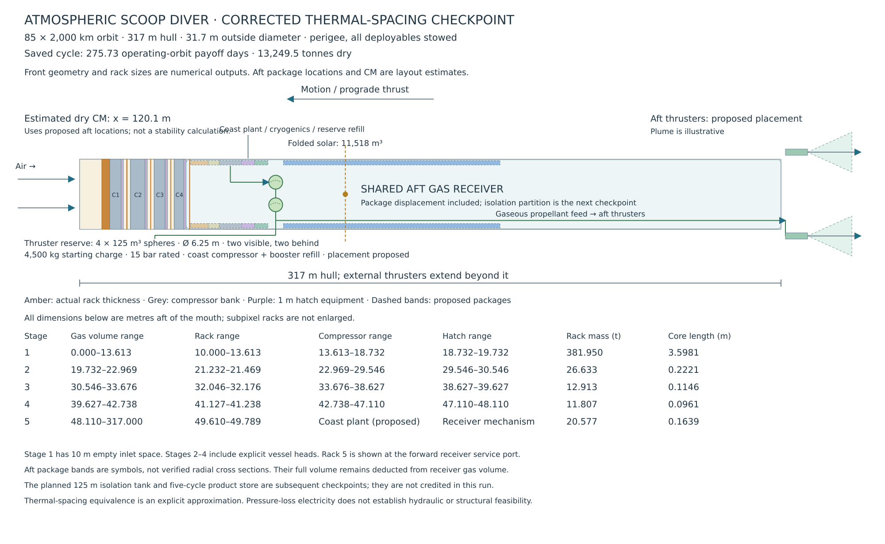

# v1.0.1 candidate — rejected boosted-reserve design

**Rejected by the owner.** This is an archive, not the current design.

The numerical checkpoint `e88f733` used four 125 m³ gas-reserve spheres,
15 bar structural rating, a separate 5 MW-rated refill booster, and a shared
coast compressor feeding both refill and liquefaction. It produced approximately
275.7 operating-orbit payoff days under that architecture's assumptions.

The agreed design instead uses a large aft compartment connected to the main
receiver by an isolation valve. The boosted candidate introduced unwanted tank
and refill-compressor sizing choices and retained fixed orbital/compressor
settings that were not reconciled with the intended tank allocation. Its payoff
is not a result for the valve-connected design.

[PNG](scale.png) · [Exact inputs](inputs.json) · [Manifest and checksums](manifest.json)
· [Detailed timing/power evidence](../../../investigations/staggered_stage_a/RESERVE_REFILL.md).

The archive preserves the drawing as reviewed, including its proposed equipment
placements and estimated CM. The old title is retained inside the image for
provenance; this page supplies its rejected status. The replacement working
layout is separate and has no new simulated payoff yet.
