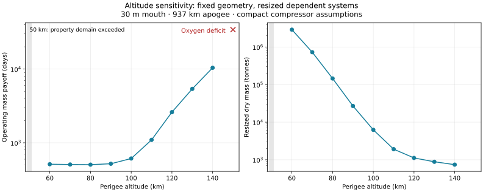

# Altitude sensitivity: 50–150 km

Generated by `.venv/bin/python -m atmo_scoops.studies.altitude_sensitivity` and `.venv/bin/python -m atmo_scoops.studies.altitude_report`. Exact inputs and complete cases are in [results](../../results/altitude_sensitivity/summary.json).

See [mechanisms, mass breakdown and apogee checks](MECHANISM.md) for why the curve behaves this way.

## Controlled comparison

Only perigee changes. The base is the compact-compressor candidate from the compressor study: 30 m mouth, 25 m front depth, 26.516 m rear depth (20.778 m rear diameter), 100 m machinery allowance, 937.191 km apogee, 710.326 K first inlet, four cooled dive banks, 0.5 m modules, 350 m/s tip speed, 75% isentropic efficiency and 0.1 Pa pumping cutoff. No mixing. Solar, batteries, thermal hardware, propulsion and compressors are resized by the existing model. These are different sized vehicles sharing geometry/capabilities, not one fixed installed craft flown at every altitude. No geometry, control or apogee optimization was performed.

The atmosphere table and orbit/API domain now start at 50 km instead of 75 km. This samples NRLMSIS directly, without downward density extrapolation. [NASA CCMC](https://kauai.ccmc.gsfc.nasa.gov/instantrun/nrlmsis/) supports NRLMSIS 2.1 profiles over 0–1,000 km. This is an atmospheric-model domain extension, not a survivable-altitude claim.

## Results

| Perigee (km) | Operating payoff (days) | Dry mass (t) | Compressor mass (t) | Net product (kg/pass) | Implemented screens |
|---:|---:|---:|---:|---:|---|
| 50 | — | — | — | — | Compressor property domain exceeded: 1.01133e+07 Pa, 956.44 K |
| 60 | 512.4 | 2,893,287.6 | 3,587.5 | 370,861.53 | Pass |
| 70 | 507.6 | 728,416.7 | 1,530.3 | 94,360.17 | Pass |
| 80 | 505.6 | 145,502.6 | 944.9 | 18,945.03 | Pass |
| 90 | 520.1 | 26,992.5 | 861.2 | 3,420.42 | Pass |
| 100 | 612.7 | 6,262.3 | 836.3 | 674.30 | Pass |
| 110 | 1,095.6 | 1,914.4 | 690.8 | 115.40 | Pass |
| 120 | 2,604.5 | 1,119.4 | 573.8 | 28.42 | Pass |
| 130 | 5,387.0 | 883.9 | 495.7 | 10.86 | Pass |
| 140 | 10,415.1 | 742.1 | 424.8 | 4.72 | Pass |
| 150 | 34,217.8 | 613.6 | 347.3 | 1.19 | FAIL: oxygen_kg |

## Interpretation and limits

Among sampled cases passing the implemented screens, 80 km has the shortest payoff: about 506 days. The 60–80 km band is nearly flat. Falling altitude greatly raises throughput, but dependent propulsion, electrical and thermal mass rises with it. This creates diminishing payoff returns rather than a route to one-month payoff in this model. The enormous lower-altitude equipment masses also expose unresolved packing, structure and deployment assumptions; numerical screens do not qualify these vehicles.

Above 100 km, declining production increasingly fails to amortize compressor and other hardware. The 150 km arithmetic payoff is not a sustainable oxygen-only cycle: it has approximately 0.186 kg/pass oxygen deficit. Do not treat its plotted cross as a feasible design.

At 50 km a compressor state exceeds the declared 10 MPa pressure domain (the first rejected evaluation is approximately 10.113 MPa, 956 K). This is a software/property-envelope boundary, not a material or atmospheric floor. A valid 50 km payoff requires extending and verifying that property/receiver regime, or changing chamber size or operating policy. No extrapolated payoff is reported.

Coast feed above one bar now uses a regulator bypass until tank pressure falls below feed pressure. No expansion-work credit is taken. Compression work is integrated only over the remaining below-feed-pressure portion, and bypass flow does not size compressor banks. The exponential withdrawal schedule is retained; valve mass, real-fluid throttling temperature and coupled coast heat transfer remain unresolved.

All values remain operating-orbit mass payoffs, excluding circular-apogee export. Low-Re compressor maps, finite gas-to-metal cooling, inlet/shock calibration, exterior drag, finite-thrust trajectories and reusable leading-edge temperatures are unresolved. Fixed thermal endpoints and surface allowances do not prove that deep dives are survivable.

## Numerical checks

Each main case uses 401 encounter and thermodynamic samples. Checks at 1,601 samples change payoff by less than 0.015% at 60 and 80 km. Reproduce with `altitude_sensitivity --verify` (using the same Python module invocation). These checks are saved separately in [convergence.json](../../results/altitude_sensitivity/convergence.json). Unit tests include the coast bypass integral across its pressure transition and a case entirely above feed pressure.
