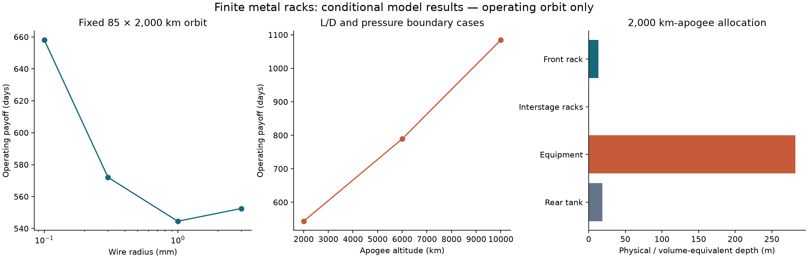

# Finite metal racks and the constrained reference

**Scope:** current reduced model, L/D ≤ 10 and rear storage ≤ 110 kPa. These are conditional package/thermal screens, not demonstrated flight feasibility or a global optimization. Payoff is in the operating orbit; circular-apogee delivery remains unimplemented.

## What changed

The front chamber now integrates gas and metal energy with finite convection. Each of the three interstage racks has independent mass, finite heat capacity, convection, pore volume and residual gas loss. The lattice sets minimum chamber dimensions. Pressure loss through the metal is intentionally omitted. Compressor blocks use real-fluid isentropic-efficiency states at the resulting time-dependent inlet temperatures. Folded hardware contributes explicit volume; deployment and retraction take finite time at 10 m/s. The fixed machinery bay is gone.

Equations, assumptions and approximation limits: [finite racks](../../modeling/metal_coolers/FINITE_RACK_MODEL.md), [folded volume/timing](../../modeling/deployment/IMPLEMENTED_VOLUME.md), [compressor mass evidence](../../modeling/compressor/COMPARABLE_SYSTEMS.md).

## Constraint-driven cases

Common geometry: 30 m inner/mouth diameter, 31.7 m outer diameter, maximum length 317 m. Radius/pitch = 0.10, so metal occupies 3.14% of each lattice envelope. These cases use 1 mm wire radius, selected from the discrete comparison below. Four rack masses use the explicit capacity-based sizing rule and independent multipliers of 1.5. Each is overridable through `racks.masses_kg`.

For each of three fixed apogees, the search varied perigee and rear depth toward the simultaneous length and storage-pressure boundaries. Final cases step slightly inside the boundaries and are re-evaluated with 801 samples. All implemented screens pass. No material survivability boundary has been supplied; the altitude limits here arise from the stated numerical hardware/packaging assumptions.

| Apogee km | Perigee km | Rear depth m | Total length m | Storage bar | Dry tonnes | Net tonnes/pass | Operating payoff days |
|---:|---:|---:|---:|---:|---:|---:|---:|
| 2,000 | 83.30 | 18.60 | 314.52 | 1.082 | 56,172 | 7.612 | 543.3 |
| 6,000 | 81.12 | 18.78 | 314.59 | 1.083 | 56,619 | 7.553 | 789.2 |
| 10,000 | 80.51 | 18.62 | 314.70 | 1.083 | 56,834 | 7.364 | 1084.6 |

Higher apogee allows a somewhat deeper pass, but does not improve payoff in these samples. The rate of useful production per day falls with the longer orbit while power hardware remains expensive. Neither a globally best apogee nor a fully optimized rack allocation is claimed.

## The long rear tank is still available

A separate **85 × 2,000 km** case fits a **95 m physical rear vessel** into **316.28 m total length**, with storage at **12.20 kPa**. It yields **5.678 tonnes/pass**, weighs **41,956 tonnes dry**, and gives **544.1 days** operating payoff. All implemented screens pass. Warm storage below the nitrogen triple-point pressure is allowed because the coast compressor subsequently feeds the separate approximately 1 bar liquefaction train.

Thus the short rear vessel in the deepest cases is a result of this particular boundary objective and package allocation, not an imposed 100 m equipment bay. A longer rear vessel and shallower pass have almost the same payoff under these coefficients.

## Wire thickness has an actual thermal trade

Fixed 85 × 2,000 km orbit, 16 m rear depth, the same mass-sizing rule and r/p. Holding r/p fixes metal fraction and working envelope at a given metal mass; changing radius changes surface area, heat transfer, deployment footprint and cooler radiation time.

| Wire radius mm | Peak pumping inlet K | Dry tonnes | Net tonnes/pass | Payoff days |
|---:|---:|---:|---:|---:|
| 0.1 | 554 | 50,658 | 5.668 | 658.1 |
| 0.3 | 557 | 44,035 | 5.668 | 572.1 |
| 1 | 602 | 41,918 | 5.668 | 544.5 |
| 3 | 933 | 41,477 | 5.527 | 552.5 |

Very fine wires give excellent cooling but require a much larger deployed mesh footprint and more deployment hardware under the current area-based mechanism allowance. At 3 mm, gas heating and reduced collection offset the remaining mass saving. A 1 mm radius is the best of these four samples, not a fitted universal optimum.

## Detailed 2,000 km-apogee boundary case

The orbit lasts **106.0 minutes**. Full deployment takes **204.1 s**; the fully deployed coast interval is **84.5 min**. Retraction takes the same time. Strong collection follows the atmospheric pulse; the program does not impose a rectangular one-minute scoop.

| Allocation | Physical/equivalent depth m |
|---|---:|
| Front working rack/chamber | 13.17 |
| Three interstage rack chambers, total | 0.69 |
| Equipment packages plus installation space | 282.06 |
| Rear tank including heads | 18.60 |

Equipment equivalent depth is volume divided by bore area, not a CAD-certified axial arrangement. Each rack chamber contains gas in its pores, not an empty space added on top of the rack envelope.

| Deployed system | Physical footprint m² | Travel time s |
|---|---:|---:|
| Solar | 4,163,268 | 204.0 |
| Warm radiator | 98,264 | 31.3 |
| Metal wire planes | 979,741 | 99.0 |

Solar generation is withheld until all systems finish the conservative common deployment schedule. This charges no benefit for partial unfolding. Metal footprint includes gaps between wires; effective emitting area is separately calculated from wire surface and view factor.

| Rack | Metal tonnes | Working depth m | End temperature K | Peak-flow Re | Peak-flow Kn |
|---|---:|---:|---:|---:|---:|
| 0 | 2,301.48 | 13.169 | 552.1 | 7.52 | 0.01628 |
| 1 | 40.29 | 0.231 | 524.6 | 6.34 | 0.005707 |
| 2 | 40.29 | 0.231 | 444.5 | 7.53 | 0.001264 |
| 3 | 40.29 | 0.231 | 412.0 | 8.05 | 0.0003361 |

Front-rack properties are at peak admission; intermediate properties are at peak gross compressor flow. Rarefaction matters at the wire scale even though the craft is much larger than the mean free path. Axial temperature gradients and mesh-bank correlations remain unvalidated.

| Compressor block | Inlet Pa | Inlet K | Outlet Pa | Outlet K | Installed tonnes | Peak electric MW |
|---|---:|---:|---:|---:|---:|---:|
| 1 | 375.9 | 538.1 | 1,445.8 | 850.4 | 582.2 | 19.9 |
| 2 | 1,445.8 | 404.9 | 4,839.7 | 620.7 | 105.3 | 14.3 |
| 3 | 4,839.7 | 350.9 | 16,200.7 | 540.4 | 37.4 | 12.1 |
| 4 | 16,200.7 | 340.8 | 54,231.3 | 525.3 | 21.0 | 11.6 |

State columns are at the common peak-flow instant. Bank mass and motor columns use each bank’s time-envelope maxima, which need not occur simultaneously. The existing NASA-inspired blade/disk/case accounting now sees the calculated finite-cooling states; this is not a new empirical validation of low-density compressor mass or maps.

Total dive plus coast compressor mass is **747.0 tonnes**, versus **56,172 tonnes dry** overall. Peak reboost electric power is **8.19 GW** over the declared 300 s burst; solar bus power is **1.04 GW**.

| Mass contribution | Tonnes |
|---|---:|
| propulsion hardware | 16,385.4 |
| design margin | 11,234.4 |
| power distribution | 8,256.3 |
| solar | 6,938.8 |
| battery | 6,115.7 |
| hot metal | 2,422.3 |
| warm buffer | 1,672.4 |
| warm radiator | 982.6 |
| hot sheet deployment | 979.7 |
| compressor hot | 582.2 |
| compressor warm | 163.6 |
| rear tank and supports | 152.9 |
| refrigerator | 142.5 |
| shell TPS allowance | 125.3 |
| compressor bulkhead | 7.1 |
| warm aftercooler | 4.1 |
| separator | 3.4 |
| compressor coast | 1.1 |
| avionics attitude | 1.0 |
| product heat exchangers | 0.5 |
| liquid storage valves plumbing | 0.5 |

The large mass is principally an electric-propulsion/power-system result, not a condenser or compressor result. The retained assumptions include 2 kg/kW of thruster hardware, 1 kg/kW of distribution, and 1.5 kW/kg battery power capability. These are explicit unvalidated scoop-system capability assumptions. Short, high-power reboost makes them expensive.

## How much of the length limit is a packaging assumption?

Keep the boundary design and all mass/power coefficients fixed, but change the provisional bulk envelope density used for plant, motors, propulsion/distribution and deployment packages. These are sensitivity scenarios, not three proven hardware options.

| Bulk envelope density kg/m³ | Total length m | Operating payoff days |
|---:|---:|---:|
| 100 | 627.9 | 544.8 |
| 250 | 314.5 | 543.3 |
| 1000 | 157.8 | 542.5 |

This large length variation means the nominal deepest perigee is **not established independently of package design**. The 250 kg/m³ coefficient must not acquire the authority of the discarded 100 m bay. It is visible, adjustable, and bracketed here. Solar packing has a published reference; folded radiator stack pitch and complete plant/propulsion envelopes still need component designs.

Intermediate gas is explicitly accounted for, but only in a small-holdup approximation: current series-flow states do not optimize independent compressor schedules or significant storage in intermediate chambers. Cases above 1% maximum intermediate hold-up are rejected from this reduced-model family. Full transient stage matching, shock stability, reusable heating limits, structural/hatch design, and circular-orbit export remain unresolved.

## Reproduction and verification

```sh
.venv/bin/python -m atmo_scoops --config configs/finite_rack_reference.json
.venv/bin/python -m atmo_scoops.studies.rack_radius_trade
.venv/bin/python -m atmo_scoops.studies.finite_rack_limits
.venv/bin/python -m atmo_scoops.studies.refresh_finite_racks
.venv/bin/python -m atmo_scoops.studies.long_rear_reference
.venv/bin/python -m atmo_scoops.studies.finite_rack_validation
MPLCONFIGDIR=/tmp/atmo-scoops-mpl .venv/bin/python -m atmo_scoops.studies.finite_rack_report
.venv/bin/python -m pytest -q
.venv/bin/python -m atmo_scoops.audit
```

Saved JSON contains exact inputs, states, component budgets and constraint margins. See [results](../../results/finite_rack_limits/reference_1mm/summary.json) and [additional convergence checks](../../results/finite_rack_limits/verification.json). The general audit retains its strict conservation/resolution checks; new tests cover lattice geometry, rarefaction, the zero-conductance limit, finite capacity, gas displacement, deployment feedback and removal of the arbitrary bay.


