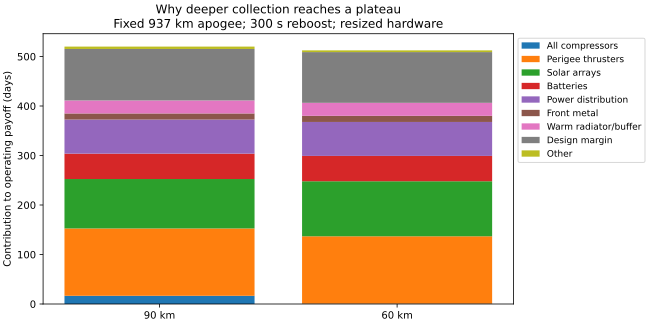

# Why the altitude sweep plateaus, and what apogee changes

This explains the [altitude sweep](ANALYSIS.md), not a universal optimum. The previous sweep held apogee at 937.191 km, kept front/rear geometry and temperature/control choices fixed, and resized dependent equipment. The additional apogee runs change apogee alone. Neither experiment jointly optimizes chamber volumes, stage maps, cooling, thrust duration and orbit.

## The low-pressure bank does not see a fixed downstream pressure

The current model accumulates the larger captured batch in the same rear volume at the same receiver temperature. Consequently rear pressure rises approximately in proportion to atmospheric density, as does front pressure. The four block pressures are allocated between those endpoints; they are not fixed absolute intermediate-pressure targets. The historical `intermediate_Pa` field is inactive for real-gas compression.

| Perigee | Front pressure near perigee | Final rear pressure | Rear/front ratio* | Nominal suction | First-bank Re |
|---:|---:|---:|---:|---:|---:|
| 60 km | 14,410.950 Pa | 6,437,913.8 Pa | 446.7 | 23,567 m³/s | 46,727 |
| 80 km | 820.437 Pa | 328,681.0 Pa | 400.6 | 23,628 m³/s | 2,661 |
| 90 km | 143.753 Pa | 59,324.7 Pa | 412.7 | 23,657 m³/s | 466 |
| 100 km | 28.780 Pa | 11,694.6 Pa | 406.3 | 23,688 m³/s | 93 |
| 140 km | 0.180 Pa | 87.4 Pa | 485.1 | 23,617 m³/s | 1 |

*Front perigee and final rear pressure are different-time diagnostics, not an instantaneous compressor pressure ratio. Saved `peak_flow_states` supply simultaneous block states. At peak flow the first bank is approximately 144→464 Pa at 90 km versus 14,411→47,278 Pa at 60 km: nearly the same bank ratio.

For a similar capture fraction and cooled temperature, `m_dot ~ rho_inf A v`, while `p_front ~ C rho_inf v²` and `rho_front ~ p_front/(R T)`. Therefore `Q_front = m_dot/rho_front ~ A R T/(C v)`. Density cancels. The first bank handles far more kilograms at lower altitude, but almost the same cubic metres per second. That explains the nearly unchanged annulus requirement. It is not evidence that higher inlet pressure is useless.

With fixed downstream pressure, higher inlet pressure really would lower head and could eliminate earlier banks. To preserve downstream pressure while collecting the larger batch, the rear volume must grow, or the collection window/mouth area/batch must change. A jointly designed machine could also use different stage counts, speeds and bank bypasses. None is allowed in this sweep.

Two additional modeling restrictions matter: (1) installed first-bank volume flow is bounded below by the computed nominal suction even when realized flow is lower; (2) a minimum overall compression ratio of 100 is imposed at startup and excess pressure throttled. The bank masses are sized from maximum flow/head/power over the entire pass, so the low-pressure recovery tail can set head. This is not adaptive stage selection. These are explicit engineering assumptions to revisit, not first-principles requirements.

The first-bank Reynolds number improves from about 466 at 90 km to 46,727 at 60 km. Yet efficiency remains 75% in both cases. The model therefore does not credit improved aerodynamic efficiency or a different viable rotor design at higher density. Conversely, it has not established that 75% is possible at the lower Re. That uncertainty can change the comparison.

## Where the dry mass goes

| Component | 90 km mass (t) | 60 km mass (t) | 90 km payoff contribution (days) | 60 km contribution (days) |
|---|---:|---:|---:|---:|
| All compressors | 861.2 | 3,587.5 | 16.6 | 0.6 |
| Perigee thrusters | 7,062.5 | 768,771.8 | 136.1 | 136.2 |
| Solar arrays | 5,181.9 | 627,836.9 | 99.8 | 111.2 |
| Batteries | 2,661.2 | 289,079.7 | 51.3 | 51.2 |
| Power distribution | 3,576.0 | 387,311.0 | 68.9 | 68.6 |
| Front metal | 640.4 | 69,792.7 | 12.3 | 12.4 |
| Warm radiator/buffer | 1,361.4 | 148,419.3 | 26.2 | 26.3 |
| Design margin | 5,398.5 | 578,657.5 | 104.0 | 102.5 |

A component contribution is its mass divided by net production/day, so contributions add to total payoff when every component is included. The table groups the major terms; smaller terms are omitted. Compressor fraction falls from ~3.19% to ~0.124% of dry mass. The first bank dominates compressor mass at 90 km, not whole-craft mass; at 60 km even the later banks collectively outweigh the first.

The specific mechanism is the reboost budget. The implemented equations are `J ~ m_air v`, `m_prop = J/v_e`, `E_prop = J v_e/(2 eta)`, and `P_prop = E_prop/t_burn`. At 4,000 s Isp the exhaust is 39.23 km/s; a representative 8 km/s encounter with eta=0.6 requires about 262 MJ (72.6 kWh) per kg of intercepted air for capture-only restoration. Extra impulse and leakage affect actual values.

With a 300 s burn and thruster mass 2 kg/kW, the pulse requires about 1,743 kg of thruster hardware per kg of captured air. This is the model coefficient propagated through the impulse and energy balance, not a measured mass for this spacecraft. Power distribution adds 1 kg/kW. A battery at 150 Wh/kg, 80% usable and 95% discharge efficiency needs about 637 kg per kg of captured air just for that example reboost energy. A larger batch multiplies these hardware masses almost linearly.

In the saved runs, reboost electricity rises from 294 MWh/pass at 90 km to 32,032 MWh/pass at 60 km; compressor electricity is only 3.18 and 271 MWh/pass respectively. The fixed 300 s window makes the corresponding thruster powers 3.53 GW and 384 GW. These conditional pulse-power assumptions, not the compressor, dominate the deep-dive payoff. Finite-thrust trajectory integration and validated propulsion specific mass are therefore central next steps.

Mathematically, if `M_dry ≈ M_fixed + alpha * m_batch` and net product is `beta * m_batch`, then `payoff ≈ period * [M_fixed/(beta*m_batch) + alpha/beta]`. The first term improves as collection rises; the second reaches a density-independent floor for fixed period and capabilities. That is the plateau in this sweep.

## Apogee: more energy per installed solar area, fewer passes

The prior sweep did hold apogee fixed. It was not an altitude/apogee optimization. The model compensates for deeper dives by adding arrays, not by requiring a longer orbit. Increasing coast duration is an alternative way to supply per-pass energy and reduce processing power. It does not by itself shrink the energy the battery must deliver while stowed or the thrust required in the same 300 s window.

| Perigee | Apogee | Orbit (h) | Deployed sunlight (h) | Dry mass (t) | Net product (kg/pass) | Payoff (days) | Screens |
|---:|---:|---:|---:|---:|---:|---:|---|
| 60 | 937 | 1.576 | 0.393 | 2,893,288 | 370,862 | 512.4 | Pass |
| 60 | 2,000 | 1.763 | 0.675 | 1,892,744 | 265,037 | 524.5 | Pass |
| 60 | 10,000 | 3.368 | 2.048 | 1,158,434 | 159,171 | 1,021.5 | Pass |
| 60 | 35,786 | 10.472 | 7.920 | 1,028,596 | 131,157 | 3,422.1 | FAIL oxygen |
| 80 | 937 | 1.580 | 0.422 | 145,503 | 18,945 | 505.6 | Pass |
| 80 | 2,000 | 1.766 | 0.698 | 96,262 | 13,456 | 526.5 | Pass |
| 80 | 10,000 | 3.373 | 2.064 | 59,345 | 8,049 | 1,036.2 | Pass |
| 80 | 35,786 | 10.479 | 7.939 | 52,730 | 6,628 | 3,473.7 | FAIL oxygen |
| 90 | 937 | 1.582 | 0.438 | 26,992 | 3,420 | 520.1 | Pass |
| 90 | 2,000 | 1.768 | 0.710 | 18,199 | 2,422 | 553.6 | Pass |
| 90 | 10,000 | 3.375 | 2.072 | 11,470 | 1,446 | 1,115.6 | Pass |
| 90 | 35,786 | 10.482 | 7.948 | 10,218 | 1,190 | 3,749.3 | FAIL oxygen |

For example, at 80 km, moving apogee from 937 to 10,000 km reduces solar mass from 29,743 to 3,140 t and total mass from 145,503 to 59,345 t. However, net collection per pass falls from 18,945 to 8,049 kg and the period grows from 1.580 to 3.373 h. The more eccentric orbit crosses the dense altitude band faster and its higher encounter speed raises impulse/energy per captured kg. Per-pass collection is an integrated atmospheric column, not simply peak density times an unchanged minute.

The larger apogee does help array and coast-plant sizing, just not enough to offset the other terms in these fixed-design cases. At 35,786 km apogee the oxygen balance also fails at fixed Isp, so those arithmetic payoff values are not sustainable-cycle predictions. Nothing here rules out a better joint solution with different throat/mouth, receiver volumes, cooling, thrust policy and compressor maps.

An idealized solar-only term illustrates the trade: `M_solar ~ E_pass/(specific_power * sunlight_per_orbit)`. Multiplying by orbital period for payoff largely cancels the benefit of longer coast when sunlight fraction is unchanged. A better sunlight fraction can still help; eclipse geometry and deploy/retract dead time are included in these runs. Pulse hardware and storage terms generally do not enjoy that cancellation.

## Reproduction and scope

Run `.venv/bin/python -m atmo_scoops.studies.apogee_diagnostic`, then `.venv/bin/python -m atmo_scoops.studies.altitude_mechanism`. The [saved apogee cases](../../results/altitude_sensitivity/apogee/summary.json) retain complete inputs and constraints. Their integration horizon is limited to the 999 km atmosphere altitude when necessary; every reported completed case reaches pressure cutoff before that horizon. No density above the atmosphere table is extrapolated.

The apogee diagnostics use 401 samples and are screening runs, not a globally optimized or independently converged family. The original altitude convergence checks remain in the main report. No model physics or capability coefficients were changed for this investigation. Operating-orbit payoff excludes circular-apogee delivery. PCM coolers are a separate [design investigation](../../docs/PHASE_CHANGE_COOLERS.md), with no numerical credit here.

## Limit-case reference: L/D and storage pressure

**Packing status correction:** this is a preserved assumption study, not a geometry-feasible reference. The 25 m front and 100 m machinery allocations were not derived from component volumes; independent interstage chambers and stowed equipment are missing. See [close-pass volume accounting](../../modeling/deployment/CLOSE_PASS_VOLUME.md) and the [reference packing screen](../../modeling/deployment/PACKING_SCREEN.md). The stated perigee boundary is not a validated L/D-limited vehicle result.

This case adopts the requested limits explicitly: **length/diameter ≤10** and **warm rear storage pressure ≤110,000 Pa absolute**. “Ten diameters long” is the interpretation of the requested ratio. The bore/mouth remains 30 m; with the existing 0.85 m radial allowance, outside diameter is 31.7 m and total permitted length is 317 m. No dry-mass ceiling is imposed.

The pressure is 10% above the existing numerical process feed of 1 bar, not 10% above the nitrogen triple-point pressure. One bar is a conventional low-pressure liquefaction benchmark, not a universal thermodynamic minimum or a complete mixed-air process specification. The pure products liquefy near 77 K (nitrogen) and 90 K (oxygen) at about atmospheric pressure; see [NIST phase data](https://webbook.nist.gov/cgi/cbook.cgi?ID=C7727379&Mask=5) and [NIST boiling-point compilation](https://nvlpubs.nist.gov/nistpubs/TechnicalNotes/NIST.TN.2126.pdf). At 1.10 bar, CoolProp gives saturated pure-liquid temperatures of 78.06 K for N2 and 90.98 K for O2. Separation, finite exchanger approaches and pressure losses still require process development. The numerical plant retains its existing 1-bar N2-equivalent duty.

| Longitudinal allocation | Length |
|---|---:|
| Front collection/precooling chamber | 25 m |
| Compressor/intercooler machinery allowance | 100 m |
| Rear tank, including two end heads | 192 m |
| Total | 317 m |

Rear bore is enlarged from the earlier 20.778 m to 30 m. Its two ellipsoidal heads are 7.5 m deep each, leaving a 177 m cylindrical barrel. Usable geometric gas volume is 132,183 m³; expressed as a same-bore flat cylinder it is 187 m deep. At 380 K and 1.10 bar this holds approximately 133 tonnes of gas. The front/machinery allocations are inherited allowances, not optimized minimum lengths; this is a geometric envelope, not a solved packing layout for all the huge deployed systems.

The artificial minimum overall compressor ratio is changed from 100 to **1**. Discharge follows required receiver pressure; there is no imposed 100:1 startup overcompression. The four-bank architecture, 75% efficiency, compact module geometry, automatic suction sizing, 0.1 Pa inlet cutoff and 300 s reboost remain unchanged. Their masses are recalculated. We do not silently remove a bank or claim a calibrated stage-bypass map.

For each listed apogee, solve for the perigee at which the complete encounter fills the tank to its pressure ceiling. Then move 0.01 km upward and recompute with 1,601 encounter and thermodynamic samples to remain just inside the boundary. Final rear pressure is the peak in this model because tank inventory increases monotonically during collection. All provided results are subject to the existing local constraints, including oxygen supply.

| Apogee (km) | Perigee just inside cap (km) | Rear pressure (bar abs.) | Orbit (h) | Dry mass (t) | Compressor mass (t) | Net liquid (kg/pass) | Operating payoff (days) | Screens |
|---:|---:|---:|---:|---:|---:|---:|---:|---|
| 937 | 69.144 | 1.09840 | 1.578 | 823,684 | 2,430 | 107,051 | 505.9 | Pass |
| 2,000 | 66.812 | 1.09847 | 1.764 | 753,500 | 2,438 | 106,194 | 521.5 | Pass |
| 10,000 | 63.315 | 1.09849 | 3.369 | 742,493 | 2,317 | 102,586 | 1,016.1 | Pass |
| 15,000 | 62.801 | 1.09852 | 4.535 | 751,341 | 2,269 | 101,476 | 1,399.1 | FAIL: oxygen_kg |

The 937 km apogee row is the direct limit-case reference against the previous fixed-apogee study. Larger apogees are separate diagnostics that permit a deeper complete pass before reaching the same storage capacity. They are not an apogee optimization. A lower pressure at perigee is not itself proof of better payoff: per-pass impulse, oxygen demand and orbit period change with eccentricity.

### Reference cycle and deployed equipment

| Quantity, 937 km apogee | Result |
|---|---:|
| Stored gas | 133,080.93 kg/pass |
| Reboost propellant | 25,897.30 kg/pass |
| Front pressure near perigee | 4,363.47 Pa |
| Nominal compressor suction | 23,595.04 m³/s |
| Compressor electricity | 36,063.43 kWh/pass |
| Reboost electricity | 9,224.27 MWh/pass |
| Solar collecting area | 104,536,920.42 m² |
| Warm radiator physical panel area | 1,836,617.96 m² |
| Metal cooler physical panel area | 1,275,257.90 m² |

Panel areas are physical areas, not doubled emitting-face areas. Metal coolers still use sensible storage; no PCM credit is included.

| Major dry-mass term, 937 km apogee | Tonnes |
|---|---:|
| propulsion hardware | 221,382.5 |
| solar | 174,228.2 |
| battery | 82,888.0 |
| power distribution | 111,090.4 |
| compressor hot | 645.8 |
| compressor warm | 1,762.5 |
| compressor coast | 21.4 |
| hot metal | 20,072.6 |
| rear tank and supports | 1,262.0 |
| design margin | 164,736.8 |

### What “as low as possible” means here

This is the **lowest full-encounter perigee allowed by tank capacity for each tested apogee and retained collection policy**. It is not a universal minimum altitude. If compressors stop earlier when the tank fills, collection is throttled or the admitted window shrinks, still lower perigees could respect the same tank cap. Exterior/rejected-air drag, heating and recovery would then need to be integrated for that changed policy. This calculation intentionally does not count an overflowing tank or truncate its inventory after the fact.

The larger tank prevents the previous multi-megapascal receiver from driving the result, and removing the minimum ratio lets the compressor respond to the lower required discharge. The still-large installed masses remain consequences of the inherited propulsion, battery and array capabilities. A pressure/geometry cap does not by itself constrain their mass or demonstrate that their stowed volumes fit. These are limits on a numerical reference, not structural or thermal flight qualification. Circular-apogee export remains excluded.

Reproduce with `.venv/bin/python -m atmo_scoops.studies.limited_reference` and `.venv/bin/python -m atmo_scoops.studies.limited_reference_report`. [Complete inputs, solver evaluations and summaries](../../results/altitude_sensitivity/limited_reference/summary.json) retain pressure/length margins and ordinary constraint failures. Source hashes are saved alongside the results.

### Coupled pressure and oxygen boundary

Solving tank pressure = 110,000 Pa and oxygen balance = 0 simultaneously gives **63.088 km perigee / 11,709.3 km apogee**. This is the lowest-perigee boundary found along the fixed-design, full-encounter pressure-limit family before the oxygen-only reboost constraint fails. It is a local boundary calculation, not a proof of a global optimum across all control schedules or hardware.

The saved reference moves 20 m upward in perigee and 10 km downward in apogee, and is reevaluated at 1,601 samples: **63.108 × 11,699.3 km**. Rear pressure is **1.09721 bar absolute**, and the oxygen margin is only **2.33 kg/pass**. This deliberately approaches zero reserve; it is a numerical limit case, not a robust operating point.

| Deepest boundary reference | Result |
|---|---:|
| Orbit period | 3.752 h |
| Stored warm gas | 132.936 t/pass |
| Net useful liquid | 102.034 t/pass |
| Total dry mass | 744,753 t |
| Compressors | 2,298 t |
| Front pressure near perigee | 13,620.8 Pa |
| Operating payoff | 1,141.2 days |

The approximately 69.14 km perigee / 937 km apogee case gives a much shorter payoff (~506 days) while staying within the same two new limits. Choosing the deepest permissible pass does not minimize payoff under the retained fixed-burst propulsion and electrical capabilities. Both results are retained rather than calling the deeper one an economic optimum.

Runnable reference: [configs/limit_case_reference.json](../../configs/limit_case_reference.json). Use `.venv/bin/python -m atmo_scoops --config configs/limit_case_reference.json`. The ordinary CLI reports its existing constraints; the additional investigation pressure/length limits are checked and stored in [joint_boundary.json](../../results/altitude_sensitivity/limited_reference/joint_boundary.json). Reproduce the coupled solve with `.venv/bin/python -m atmo_scoops.studies.limited_reference_boundary`, after the fixed-apogee cases, then regenerate this section.

<!-- finite-rack-update -->

## Current finite-rack and package-constrained cases

The fixed 100 m bay is replaced by finite convection, working lattice volumes, equipment envelopes and area-dependent deployment. Detailed equations, the radius trade, mass drivers and packaging uncertainty are in the [finite-rack investigation](FINITE_RACK_LIMITS.md). These are conditional operating-orbit payoffs, not circular-delivery or survivability results.

| Apogee km | Perigee km | Rear depth m | Total length m | Storage bar | Dry tonnes | Net tonnes/pass | Operating payoff days |
|---:|---:|---:|---:|---:|---:|---:|---:|
| 2,000 | 83.30 | 18.60 | 314.52 | 1.082 | 56,172 | 7.612 | 543.3 |
| 6,000 | 81.12 | 18.78 | 314.59 | 1.083 | 56,619 | 7.553 | 789.2 |
| 10,000 | 80.51 | 18.62 | 314.70 | 1.083 | 56,834 | 7.364 | 1084.6 |

A longer-tank alternative at 85 × 2,000 km fits a **95 m rear tank**, **316.3 m total length**, and yields **544.1 days**.
