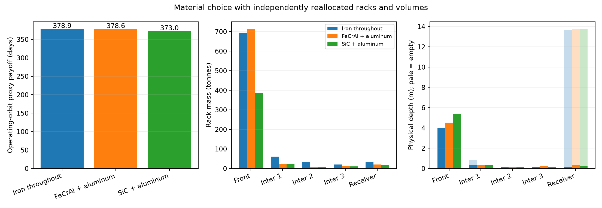
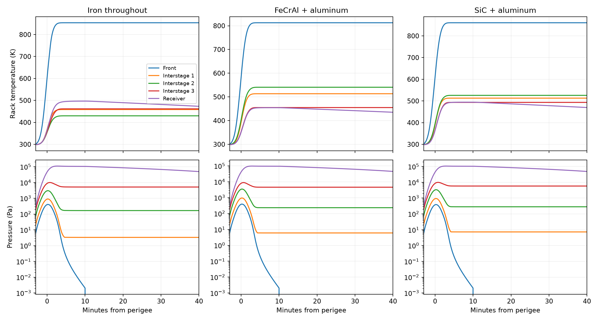

# Per-rack materials and allocation

This investigation reruns the **isolated transient mass/product proxy**, not the
primary payoff optimizer. It compares iron throughout with FeCrAl or SiC in front
and aluminum in all four downstream racks. Payoff ends in the operating orbit;
circular-apogee delivery remains uncharged. These are best sampled local layouts,
not global optima or qualified hardware.

## Comparison

| Materials | Proxy days | Proxy dry mass, t | Rack mass, t | Net useful batch, kg | Reset allowance used, min |
|---|---:|---:|---:|---:|---:|
| Iron throughout | 378.94 | 19798.5 | 838.1 | 3847.0 | 47.1 |
| FeCrAl + aluminum | 378.64 | 19780.0 | 777.9 | 3846.5 | 48.4 |
| SiC + aluminum | 372.96 | 19442.1 | 443.0 | 3838.3 | 42.8 |



| Case | Improvement versus refreshed iron | Extra material-specific hardware that erases advantage, t (before margin) |
|---|---:|---:|
| FeCrAl + aluminum | 0.08% | 12.7 |
| SiC + aluminum | 1.58% | 249.4 |

This allowance holds dynamics fixed and applies the existing 25% design margin. It is a sensitivity, not a support-mass prediction.

The main finding is a large rack-mass change with a modest whole-craft effect.
SiC/aluminum reduces rack mass by about 47%, but most hardware remains unchanged.
Its larger front rack adds deployment area, partly offsetting the material saving.
The SiC front is 5.42 m deep versus 3.97 m for iron, despite weighing much less.
Its front radiative cooldown is about 9.4 minutes versus 13.7 for iron under the
assumed surfaces. The FeCrAl/aluminum payoff difference is too small to establish
an engineering preference. Its downstream aluminum also approaches the provisional
550 K cap; a selected alloy and support design could change that allocation.

The previous isolated optimum was about 381 days. The refreshed iron search
itself improves that to 379; only the remaining difference is attributed here
to material choice. No comparison to the separate primary-model 371-day result
is implied.

Radius stays 1 mm, pitch 10 mm, bore 30 m and starting temperature 298 K.
Orbit, incident column, suction/head envelopes, withdrawal schedule, propulsion
and fixed hardware anchor are common. All five rack-envelope depths and five
additional empty depths are independently varied. Bounds: front rack 2–12 m,
three intermediate racks 0.015–0.8 m, receiver rack 0.015–1 m; empty depths 0–12 m
in the first four chambers and 2–100 m in the receiver. The former front bound
was 7 m; this search permits extra volume for lower volumetric heat capacity.
Each material case starts from the earlier selected geometry and a second seed
scaled to equal sensible heat capacity, then uses the same pattern search.

## Selected physical allocations

| Case | Chamber | Full depth, m | Rack depth, m | Rack mass, t | Displaced solid, m³ | Wetted area, m² | Peak rack K | Radiative cooldown, s |
|---|---|---:|---:|---:|---:|---:|---:|---:|
| Iron throughout | Front | 3.970 | 3.970 | 693.89 | 88.17 | 176337 | 853.6 | 820.3 |
| Iron throughout | Interstage 1 | 0.850 | 0.350 | 61.24 | 7.78 | 15563 | 458.3 | 613.0 |
| Iron throughout | Interstage 2 | 0.180 | 0.180 | 31.46 | 4.00 | 7995 | 429.8 | 564.4 |
| Iron throughout | Interstage 3 | 0.115 | 0.115 | 20.06 | 2.55 | 5097 | 461.5 | 617.8 |
| Iron throughout | Receiver | 13.627 | 0.180 | 31.46 | 4.00 | 7995 | 496.8 | 634.0 |
| FeCrAl + aluminum | Front | 4.532 | 4.532 | 714.57 | 100.64 | 201287 | 812.7 | 897.2 |
| FeCrAl + aluminum | Interstage 1 | 0.357 | 0.357 | 21.42 | 7.93 | 15866 | 513.3 | 458.1 |
| FeCrAl + aluminum | Interstage 2 | 0.135 | 0.135 | 8.07 | 2.99 | 5977 | 540.6 | 473.6 |
| FeCrAl + aluminum | Interstage 3 | 0.229 | 0.229 | 13.72 | 5.08 | 10161 | 455.0 | 411.4 |
| FeCrAl + aluminum | Receiver | 13.783 | 0.336 | 20.17 | 7.47 | 14943 | 454.3 | 389.5 |
| SiC + aluminum | Front | 5.419 | 5.419 | 386.29 | 120.34 | 240677 | 860.5 | 562.6 |
| SiC + aluminum | Interstage 1 | 0.357 | 0.357 | 21.42 | 7.93 | 15866 | 513.0 | 457.9 |
| SiC + aluminum | Interstage 2 | 0.148 | 0.148 | 8.88 | 3.29 | 6575 | 525.8 | 465.6 |
| SiC + aluminum | Interstage 3 | 0.172 | 0.172 | 10.29 | 3.81 | 7621 | 493.3 | 444.5 |
| SiC + aluminum | Receiver | 13.716 | 0.269 | 16.14 | 5.98 | 11954 | 494.3 | 425.4 |

Radiative cooldown is after gas processing, not concurrent external exposure of
racks inside pressurized chambers. The total reset allowance above includes
remaining drainage and deployment/retraction. Material energy, displaced volume,
gas-side transfer and material-specific cooldown are described in the
[property dossier](../../modeling/chambers/MATERIALS.md).



## Surface sensitivity at fixed selected geometry

Aluminum and SiC nominal emissivity 0.8 is a surface capability assumption;
FeCrAl uses 0.7 from its oxidized-wire datasheet. The following changes the
post-pass radiative reset only. The histories have no external radiation, so a
new transient integration is unnecessary. No extra radiator or coating mass is
silently added to rescue a failing reset. These rows are not reoptimized.

| Case | Aluminum emissivity | SiC emissivity | Reset used, min | Reset margin, min | Feasible |
|---|---:|---:|---:|---:|---|
| FeCrAl + aluminum | 0.8 | — | 48.4 | 7.6 | True |
| FeCrAl + aluminum | 0.6 | — | 48.4 | 7.6 | True |
| FeCrAl + aluminum | 0.4 | — | 51.9 | 4.2 | True |
| FeCrAl + aluminum | 0.2 | — | 101.2 | -45.1 | False |
| SiC + aluminum | 0.8 | 0.8 | 42.8 | 13.3 | True |
| SiC + aluminum | 0.6 | 0.6 | 46.4 | 9.7 | True |
| SiC + aluminum | 0.4 | 0.4 | 54.7 | 1.4 | True |
| SiC + aluminum | 0.2 | 0.2 | 104.8 | -48.8 | False |

## Numerical checks and interpretation limits

| Case | Screened layouts | Feasible | Numerical failures | Refined payoff change | Max Biot number |
|---|---:|---:|---:|---:|---:|
| Iron throughout | 82 | 39 | 31 | -0.0278 days | 0.00038 |
| FeCrAl + aluminum | 82 | 29 | 46 | -0.0034 days | 0.00135 |
| SiC + aluminum | 98 | 56 | 26 | -0.0436 days | 0.00037 |

Screening uses 8 s / 1e-4; selected cases use 2 s / 2e-6 and are verified at
1 s / 5e-7. Numerical timeouts remain unresolved, not physical rejections.
Property changes do not validate the common provisional low-pressure compressor
maps, well-mixed gas assumption or gas-to-wire correlation. Conductivity is
screened through Bi < 0.1; internal rod gradients are not resolved.

The mass proxy holds most installed hardware fixed, so savings are primarily
rack mass, deployment, thermal handling and changed retained product. It does
not completely redesign the booster, compressor bodies or plant. SiC needs a
credible segmented deployment/support design; aluminum needs a selected alloy
and durable emissive finish. Material-specific coating/support mass is not yet
modeled. No mesh pressure-drop or leading-edge survivability credit is inferred.

## Reproduce

```sh
.venv/bin/python -m atmo_scoops.studies.chamber_materials
.venv/bin/python -m atmo_scoops.studies.chamber_material_report
.venv/bin/python -m pytest -q
.venv/bin/python -m atmo_scoops.audit
```

Inputs, every search coordinate and failure, selected full histories, proxy ledgers
and tighter-resolution histories are in `results/chamber_materials/`. Each case's
`config.json` can be edited and run through `python -m atmo_scoops.chambers`.
