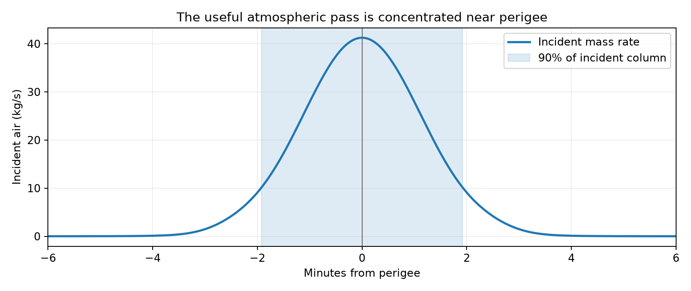
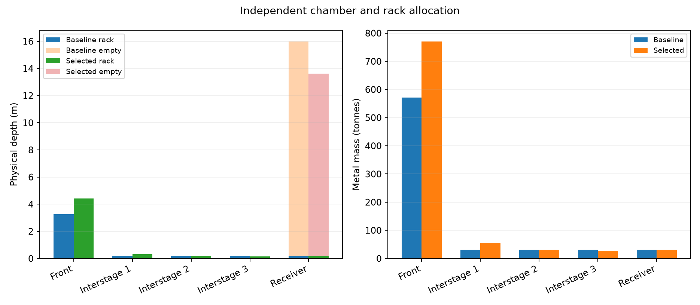
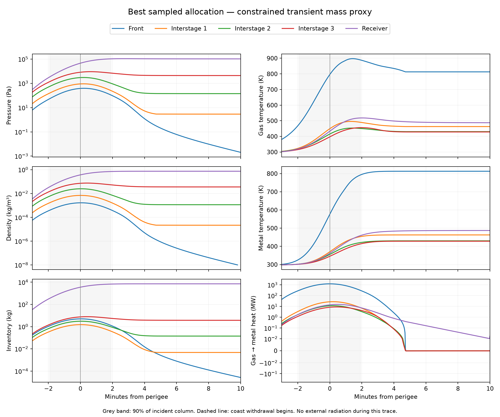
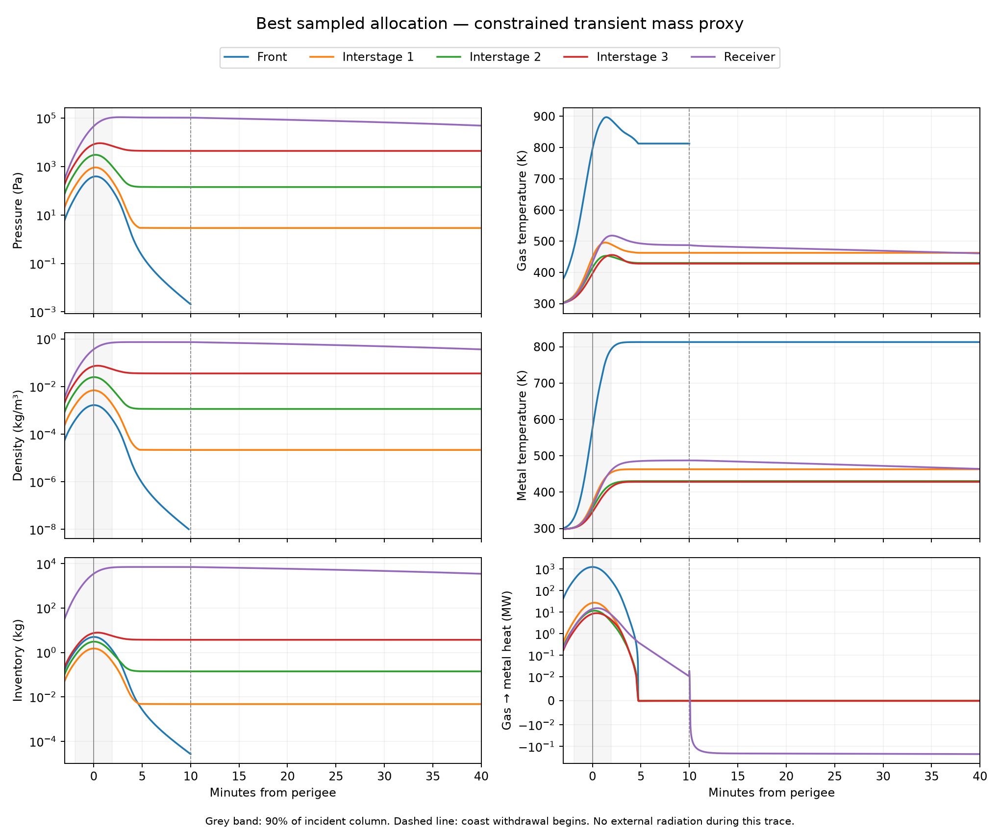

# Constrained transient allocation investigation

**Best sampled layout: 381.1 proxy days, versus 414.7
for the matched baseline (8.11% improvement).**
This is an explicitly approximate mass/product proxy, not the primary model's
payoff or proof of a global optimum. It is useful for ranking allocations within
the declared hardware/control assumptions. No circular-apogee delivery is charged.

## Atmospheric timing

Integration starts ten minutes before perigee, with atmospheric forcing extended
to cover that start. **90% of the incident column lies between -115 and
115 seconds from perigee.** The graphs emphasize this interval, not the long
nearly empty approach. There is no sudden entry switch at 200 km inside this window; the numerical
forcing is set to zero outside its ±600 s tabulation.



## Allocations

All chambers have 30 m bore; wires have 1 mm radius, 10 mm pitch and 298 K initial
temperature. Rack-envelope depth and additional empty depth are independent for
each chamber. Metal occupies only 3.14% of the rack envelope; its pores remain
part of the gas volume. Fixed compressor capacities and head limits are unchanged.

| Chamber | Baseline depth, m | Selected depth, m | Selected rack depth, m | Selected empty depth, m | Baseline metal, t | Selected metal, t |
|---|---:|---:|---:|---:|---:|---:|
| Front | 3.268 | 4.412 | 4.412 | 0.000 | 571.10 | 770.98 |
| Interstage 1 | 0.180 | 0.319 | 0.319 | 0.000 | 31.46 | 55.67 |
| Interstage 2 | 0.180 | 0.180 | 0.180 | 0.000 | 31.46 | 31.46 |
| Interstage 3 | 0.180 | 0.153 | 0.153 | 0.000 | 31.46 | 26.74 |
| Receiver | 16.000 | 13.627 | 0.180 | 13.447 | 31.46 | 31.46 |



Selected total metal is **916.3 tonnes**, versus
**696.9 tonnes** initially. Proxy dry mass is
**19,932 tonnes**, versus **19,532 tonnes**.
Useful batch after propulsion and counted purge is **3,851 kg**,
versus **3,468 kg**. These proxy batches include the remaining
receiver gas that the completion allowance assumes will be processed later.

Admitted air increases from **6,730 to
7,110 kg**, out of **7,114 kg** crossing
the geometric mouth column. Peak front gas temperature falls from
**1019 K to
897 K**. In this
fixed-hardware scenario, added upstream cooling recovers almost the entire column.
The retained product gain outweighs the extra metal and deployment mass.

Zero additional empty depth is a lumped-volume result, not a demonstrated
shock/diffuser clearance or literal placement of wires at the mouth. Intermediate
buffer space could have different value with adjustable compressor coast schedules.

## Pressure and temperature histories





Racks remain thermally coupled to gas throughout the plotted history. They do not
radiate externally during that history. The proxy subsequently charges a separate
finish-draining, purge, deployment, radiative-reset and retraction allowance. This
does not claim simultaneous gas contact and external deployment of the same rack.

| Chamber | Peak pressure, kPa | Peak metal temperature, K | Gas at +40 min, K |
|---|---:|---:|---:|
| Front | 0.389 | 812.8 | None |
| Interstage 1 | 0.908 | 462.9 | 462.9 |
| Interstage 2 | 3.018 | 430.3 | 430.3 |
| Interstage 3 | 9.113 | 428.3 | 428.3 |
| Receiver | 107.661 | 487.2 | 461.1 |

Required motor uprating adds 7.21 tonnes to the selected layout (4.68 tonnes to the matched baseline), plus packing and design margin. The final stage needs the uprating; reference motor power is not treated as unlimited.

## Proxy and constraints

The [complete equations and assumptions](../../modeling/chambers/OPTIMIZATION.md)
identify every fixed and variable charge. Fixed hardware comes from the existing
solid-rack optimized-Isp case. Recomputed items include metal, deployment,
shell/pressure-vessel allowances, stage-specific motor uprating, changes in compressor electrical energy and a
speculative 10 kg/MJ hot-feed handling surcharge. Most installed hardware is held
fixed, so this is a deliberately limited layout comparison.

All cases use 2 kg/s nominal coast withdrawal, with a plant-throughputput allowance.
The earlier 1.5 kg/s visual demonstration did not leave enough reset time under
this conservative completion schedule. Count purge and propellant losses in useful
product. Impose rack fit, L/D ≤10 including accounted equipment volume, pressure
≤110 kPa, metal ≤1042 K, supported gas temperatures, positive useful batch,
cycle-completion time, and mass/energy audits.

| Constraint margin | Selected value |
|---|---:|
| length_m | 199.56 |
| pressure_Pa | 2339.3 |
| metal_K | 229.17 |
| gas_K | 1102.7 |
| net_product_kg | 3851.2 |
| reset_time_s | 540.49 |
| mass_audit_kg | 9.9998e-06 |
| energy_audit_MJ | 9.9999e-05 |

## Search limits and sensitivity

The bounded pattern search evaluated **98 distinct layouts**, of which
**70 passed screening constraints**. **20 trials hit a numerical
timeout**; those are unresolved, not physically impossible. Two initial layouts
were compared before local refinement over all ten coordinates. This does not
establish an ideal global breakdown. Bounds and all failures are saved.

The following re-scores the sampled feasible layouts at different handling-cost
weights; it does not redo the dynamics or perform independent full searches.

| Hot-feed handling coefficient, kg/MJ | Best sampled trial | Proxy days |
|---|---:|---:|
| 0 | 88 | 380.84 |
| 5 | 88 | 380.95 |
| 10 | 88 | 381.06 |
| 20 | 88 | 381.28 |

| Fixed hardware multiplier | Best sampled trial | Proxy days |
|---|---:|---:|
| 0.5 | 66 | 207.06 |
| 1 | 88 | 381.06 |
| 2 | 88 | 727.89 |

At 1 s maximum step / 5e-7 tolerance, final receiver inventory changes by 0.000239% and gas temperature by 0.0005 K. The selected design still passes constraints.

Two timed-out front-depth cases were retried at tighter settings:

| Trial | Refined proxy days | Feasible |
|---|---:|---|
| 3 | 386.44 | True |
| 67 | 385.21 | True |

Both resolved retries are worse than the selected design; the other screening timeouts remain unresolved.

Screening used 8 s maximum step / 1e-4 relative tolerance; baseline and selected
histories above use 2 s / 2e-6. Numerical refinement must pass the same constraints.
The gas model is frozen-composition, temperature-dependent ideal gas; the low-flow
heat-transfer and compressor control laws remain provisional. Changing compressor
capacity, wire geometry, starting temperature, orbit or thermal-reset mechanism
can change the preferred allocation.

## Reproduce

```sh
.venv/bin/python -m atmo_scoops.studies.chamber_optimize
.venv/bin/python -m atmo_scoops.studies.chamber_optimization_validate
.venv/bin/python -m atmo_scoops.studies.chamber_optimization_report
.venv/bin/python -m atmo_scoops.chambers --config configs/chamber_transient_optimized.json --output results/chamber_optimization/replay.json
```

Full trial coordinates, proxy terms, constraint margins and selected histories are
in `results/chamber_optimization/`. The editable selected configuration is
`configs/chamber_transient_optimized.json`. This search is not wired into the main
payoff optimizer.
