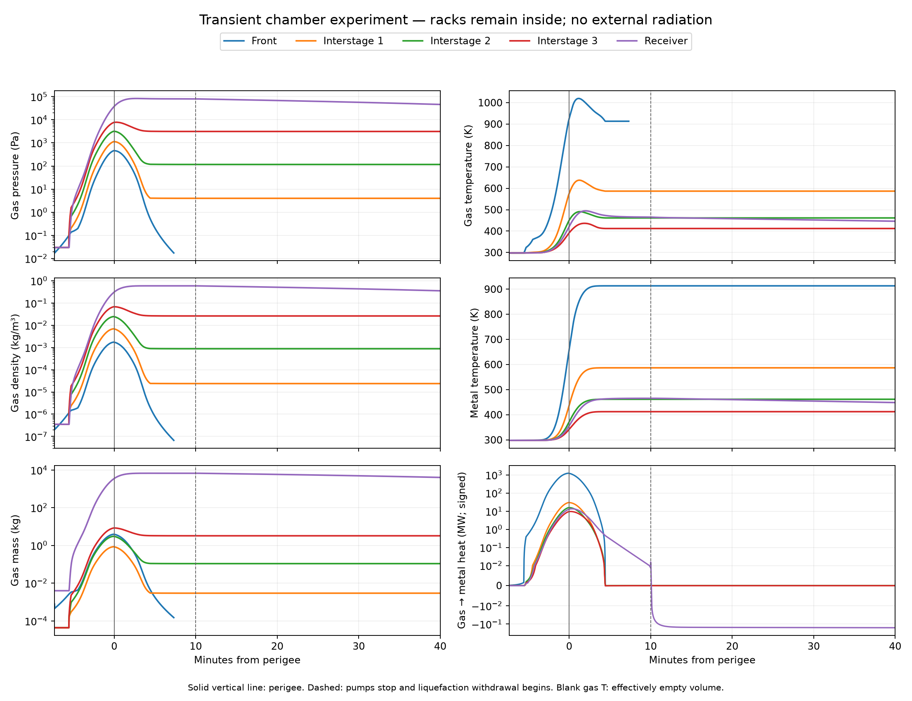
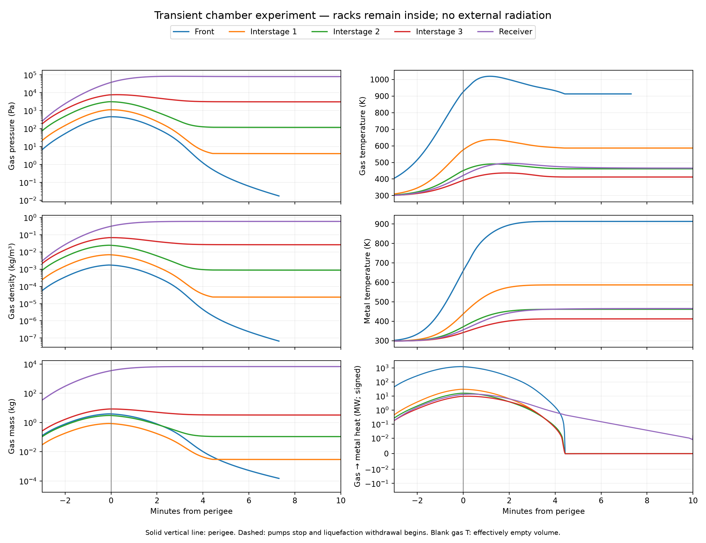
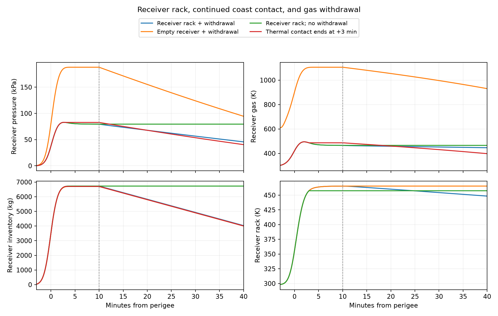

# Gas volumes and wire racks through the pass and coast

This is an isolated transient experiment, implemented in `atmo_scoops.chambers`.
It is not called by the primary payoff model or optimizer. Each chamber has its
own gas mass, internal energy and metal energy; compressor flows need not match.
Pressure, temperature and density are solved, not prescribed.





## Experiment definition

85 × 2,000 km orbit, 30 m mouth/bore, reference atmosphere; time zero is perigee.
The run starts 440 seconds before perigee and ends 40 minutes afterward. All
racks initially start at 298 K. Flow capacities and maximum shaft head are drawn
from the solid-rack Isp reference, but the dynamic pump control is a new declared
screening law, not its old equal-flow compressor approximation.

The first four rack envelopes match that reference. A fifth rack, equal to the
last intermediate rack, is **added** to the 16 m receiver for this experiment.
This is not a mass-neutral redistribution or a new optimized spacecraft. The
empty-receiver control reaches about 188 kPa, above the primary design's 110 kPa
cap; structural limits are not enforced in this diagnostic experiment. There
is no forced 340 K aftercooler: gas in the receiver finds its own temperature.

| Volume | Physical depth, m | Rack envelope depth, m | Free gas volume, m³ | Metal, tonnes |
|---|---:|---:|---:|---:|
| Front | 3.268 | 3.268 | 2,237.3 | 571.10 |
| Interstage 1 | 0.180 | 0.180 | 123.3 | 31.46 |
| Interstage 2 | 0.180 | 0.180 | 123.3 | 31.46 |
| Interstage 3 | 0.180 | 0.180 | 123.3 | 31.46 |
| Receiver | 16.000 | 0.180 | 11,305.7 | 31.46 |

Every rod has 1 mm radius and 10 mm pitch. Chamber depth and rack-filled depth
are independently editable, as are diameter, radius, pitch and initial gas/metal
states for every chamber. Rack-filled volume is mostly gas pore space.

Pumps stop at +600 s. Liquefaction withdrawal starts then, ramping its effective
flow toward 1.5 kg/s when receiver pressure is well above its 100 Pa floor.
The sink removes gas **and its enthalpy**. It does not calculate the cryoplant's
work, product yield or mass: this is its feed boundary, not free liquefaction.
The inlet remains open, with pressure-supported admission and reverse leakage.
Stopped compressor connections are assumed isolated by check valves.

## What happens in the receiver



| Case | Gas at +10 min, K | Gas at +40 min, K | Pressure at +10 min, kPa | Pressure at +40 min, kPa | Gas remaining at +40 min, kg |
|---|---:|---:|---:|---:|---:|
| Receiver rack + withdrawal | 465.6 | 446.2 | 79.52 | 45.68 | 4,031 |
| Empty receiver + withdrawal | 1105.7 | 930.4 | 188.06 | 94.52 | 4,003 |
| Receiver rack; no withdrawal | 465.6 | 465.4 | 79.52 | 79.50 | 6,727 |
| Thermal contact ends at +3 min | 486.5 | 397.6 | 82.77 | 40.43 | 4,004 |

The receiver rack absorbs compression heat during filling. Continued contact
can cool stored gas after pumping subsides, until gas and metal approach the
same temperature. It does not keep cooling indefinitely without an external
sink. During withdrawal, enthalpy leaves faster than internal energy per kilogram;
the residual gas cools and the rack can **return heat to the gas**. Negative values
in the signed gas-to-metal plot show this reversal.

In the reference, no rack is radiating externally. Its coast temperature changes
only by exchanging energy with gas. This deliberately separates retained-rack
cooling from deploying racks into space. The thermal-contact-off comparison
simply disconnects gas/metal exchange at +180 s, without pretending the rack is
physically removed or adding radiation; it is a controlled thermal ablation.

An effective emitting-area input exists for future thermal-link studies, but
its default is zero. A nonzero value requires a physical path to radiators outside
the closed pressure volume. The solver does not model opening a pressure hatch,
removing displaced solid volume or mechanically deploying racks while retaining gas.

## Equations and applicability

See [model equations and interfaces](../../modeling/chambers/README.md).
This experiment uses temperature-dependent frozen-air caloric properties with
an ideal-gas equation of state; it does not replace the main model's HEOS
compression. It also does not resolve shocks, reacting flow, spatial gas mixing,
manifold loss or measured compressor maps. Zero-throughflow gas-to-wire exchange
uses the current cylinder/free-molecular approximation, not a validated quiescent
microgravity chamber correlation. The well-mixed gas assumption needs spatial
validation before these histories can support optimization conclusions.

## Verification

Maximum mass ledger residual: **5e-11 kg**; energy residual: **1.8e-09 MJ**.

Halving maximum step from 2 to 1 s and tightening relative tolerance fourfold changes final receiver mass by **0.01%**, temperature by **0.0098 K**.

Tests separately check sealed-volume equilibration, withdrawal enthalpy,
compressor work, radiation, geometry validation and conservation. Gas temperatures
are omitted below 10 micrograms inventory; a vacuum temperature inferred from
numerical roundoff is not a meaningful plotted state. Raw minimum gas mass and
caloric/material domain flags remain in each output's `checks`.

## Reproduce and modify

```sh
.venv/bin/python -m atmo_scoops.chambers --config configs/chamber_transient_reference.json --output results/chamber_transient/reference.json
.venv/bin/python -m atmo_scoops.studies.chamber_transient
.venv/bin/python -m atmo_scoops.studies.chamber_report
```

Edit the configuration to change individual chamber/rack dimensions, rod geometry,
starting temperatures, pump capacity/head/cutoff/stop time, coast mixing assumption,
withdrawal rate/start, or effective radiation. Full time series, boundary forcing,
energy/mass ledgers and exact inputs are saved under `results/chamber_transient/`.

For independent rack/empty-depth search and atmospheric-window plots, see the [constrained allocation investigation](OPTIMIZATION.md). Its proxy and matched baseline are distinct from this initial demonstration.

[Material allocation comparison](MATERIALS.md) repeats the constrained transient
search with FeCrAl or SiC up front and aluminum downstream, including displaced
volume, finite heat transfer and radiative reset time.

[Mass audit](MASS_AUDIT.md) traces the mixed-material proxy to its full hardware
ledger and identifies frozen compressor, electrical and thermal coupling that
must be replaced before treating it as a fully recoupled spacecraft result.
