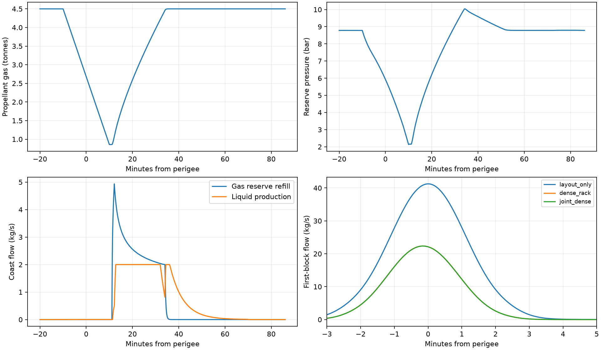

# Gas reserve and independently spaced racks

These are declared candidate comparisons, not a joint global optimum. All retain the 85 × 2,000 km orbit, 30 m bore, 317 m hull, 1,766 s Isp, 1,200 s symmetric burn, and effective external skin coefficient 0.002. Hardware is compiled once before each forward integration. Payoffs below end in the **operating orbit**, not circular-apogee delivery.

Gas bypass supports a smaller installed liquefier and gives a modest mass/payoff improvement in the zero-rack-loss comparison. The original dense transverse front rack is a much stronger concern: nominal resistance eliminates net liquid production in its completed liquid-feed comparison. This is evidence of sensitivity to the assumed rack geometry/law, not experimental evidence against passive cooling. A wider-spacing full-cycle result remains numerically unresolved; no optimized spacing or combined improved payoff is claimed.

## Coupled results

| Case | Dry mass (t) | Net liquid (kg/orbit) | Accepted payoff (days) | Constraint failures |
|---|---:|---:|---:|---|
| gas_reference | 14,557.2 | 3,465.3 | 309.31 | None |
| dense_rack | 14,493.6 | -156.1 | Rejected | reserve_kg, product_kg |
| layout_only | 14,493.6 | 3,461.9 | 308.27 | None |
| gas_smaller_plant | 14,315.5 | 3,463.6 | 304.32 | None |
| joint_dense | 14,557.2 | 629.7 | Rejected | periodic |
| wide | — | — | Unresolved | Numerically unresolved: stopped after >70,000 RHS evaluations; time advanced only 0.124 s over the last 10,000 evaluations near t=295 s. No physical rejection or payoff assigned. |

Additional saved proposals are not completed results: wide. No payoff or physical rejection is assigned to them.

The combined dense-rack/gas-feed case makes 629.7 kg of liquid but finishes 785.8 kg short of its initial gas reserve. Its positive liquid output is therefore **not a sustainable payoff**. The refill booster can bottleneck while the product branch continues; even redirecting all that liquid-equivalent mass would not recover the total reserve shortfall. The periodic inventory constraint correctly rejects it.

`layout_only` is the liquid-feed checkpoint with outlet-plane geometry but zero resistance. `gas_reference` changes only feed architecture. `gas_smaller_plant` additionally proposes 20 MW / 2 kg/s liquefaction instead of 40 MW / 4 kg/s before integration. `dense_rack` retains liquid feed with 10 mm pitch and nominal resistance. `wide` combines gas feed with 20 mm pitch and nominal resistance; `joint_dense` combines gas feed with 10 mm pitch and nominal resistance. Only completed trajectories have geometry/results rows below.

The liquid-feed reference is favorable to liquid storage: it does not resolve a vaporizer/regulator assembly. Gas feed is credited only for avoided processing and is charged for its own reserve hardware. The gas case also consumes its small argon fraction, whereas the historical liquid-feed case retains argon as product.

## Rack and volume geometry

| Case | Pitches (mm) | Actual rack depths (m) | Material mass (t) | Receiver depth (m) |
|---|---|---|---:|---:|
| gas_reference | 10, 10, 10, 10, 10 | 5.42, 0.40, 0.18, 0.20, 0.32 | 452.3 | 234.76 |
| dense_rack | 10, 10, 10, 10, 10 | 5.42, 0.40, 0.18, 0.20, 0.32 | 452.3 | 236.98 |
| layout_only | 10, 10, 10, 10, 10 | 5.42, 0.40, 0.18, 0.20, 0.32 | 452.3 | 236.98 |
| gas_smaller_plant | 10, 10, 10, 10, 10 | 5.42, 0.40, 0.18, 0.20, 0.32 | 452.3 | 236.33 |
| joint_dense | 10, 10, 10, 10, 10 | 5.42, 0.40, 0.18, 0.20, 0.32 | 452.3 | 234.76 |

Wider pitch at unchanged depth also removes metal and heat-transfer surface; it is not an isolated pressure-loss improvement. Rod radius remains 1 mm. The additional fixed-mass case, when present, scales front depth with pitch squared.

## Gas-feed physical specification

The reserve contains unseparated gas, with no cryogenic or separation duty on its branch. Its four 6.25 m outer-diameter spheres have 500 m³ combined internal volume and 1.5 MPa design pressure. A 10 m³/s, 5 MW booster and aftercooler refill them during coast. The existing warm loop supplies/absorbs tank heat; the burn uses the previous cycle's reserve. The branch hardware weighs 51.9 t before margin and occupies 1,099 m³ of package envelope before general packing clearance.



## Hydraulic interpretation and limits

Pressure loss is placed at the compressor suction and coupled to the finite map, not charged afterward as a wattage penalty. Each volume remains a blended thermal inventory. The outlet-plane layout uses actual withdrawal for forced convection; it does not assume inlet flow circulates through the receiver rack before withdrawal.

The independent-cylinder resistance law is a **provisional screening assumption**, not a validated multirow, rarefied-array correlation. Its nominal coefficient must not be interpreted as data establishing that a rack design succeeds or fails. Re, Kn and pore Mach are saved; the accepted-cycle low-Mach screen is 0.3. In particular, rod-scale slip can matter despite continuum flow on the spacecraft scale. See [equations and primary references](../../modeling/metal_coolers/TRANSVERSE_PLANES.md).

## Verification and reproduction

Full trajectories retain species/energy ledgers, path constraints, per-stage suction/loss states and gas-reserve closure. Conservation checks are numerical evidence, not validation of the component correlations. Gas reserve closure checks each species within 0.1 kg and energy within 1 MJ.

```bash
OPENBLAS_NUM_THREADS=1 .venv/bin/python -m atmo_scoops.transient --config configs/transient_gas_reference.json --output results/transient/gas_trial.json --samples 401
OPENBLAS_NUM_THREADS=1 .venv/bin/python -m atmo_scoops.transient --config configs/transient_rack_reference.json --output results/transient/rack_trial.json --samples 401
OPENBLAS_NUM_THREADS=1 .venv/bin/python -m atmo_scoops.transient.feed_pitch_study --workers 3
.venv/bin/python -m atmo_scoops.transient.feed_pitch_report
```

Geometry exports contain actual chamber/rack dimensions, bank envelopes and package volumes. They are a **concept-model specification**, not resolved mechanical packing: frame details, pressure-hatch placement, plumbing and global structure remain deferred. The selected gas reference export is not represented as a pressure-loss-optimized craft.

Future priority requested by the owner: integrate the cryogenic process with existing compressors, thermal loops, recuperators and propellant routing. Other proposed penalty refinements remain deferred.

## States at each stage’s peak withdrawal

| Case / stage | Flow (kg/s) | Bulk pressure (Pa) | Rack drop (Pa) | Rod Re | Rod Kn |
|---|---:|---:|---:|---:|---:|
| dense_rack / 1 | 22.36 | 454.81 | 301.32 | 2.62 | 0.0259 |
| dense_rack / 2 | 22.36 | 405.61 | 8.57 | 3.67 | 0.0109 |
| dense_rack / 3 | 22.35 | 1413.75 | 1.09 | 3.67 | 0.0031 |
| dense_rack / 4 | 22.35 | 3247.81 | 0.48 | 3.85 | 0.0012 |
| dense_rack / 5 | 4.00 | 1847.11 | 0.11 | 0.73 | 0.0020 |
| joint_dense / 1 | 22.35 | 453.30 | 300.53 | 2.62 | 0.0258 |
| joint_dense / 2 | 22.35 | 404.44 | 8.56 | 3.68 | 0.0109 |
| joint_dense / 3 | 22.34 | 1408.10 | 1.09 | 3.68 | 0.0031 |
| joint_dense / 4 | 22.35 | 3250.71 | 0.48 | 3.85 | 0.0012 |
| joint_dense / 5 | 5.22 | 1541.58 | 0.18 | 0.95 | 0.0024 |

## Controlled local hydraulic screen

These are **local pump calculations at the checkpoint peak first-stage state**, not full-cycle payoffs. Bulk pressure, temperature, discharge pressure and compressor hardware are held fixed. The fixed-metal comparison increases depth with pitch squared; it separates hydraulic geometry from removing thermal storage. Half/nominal/double resistance are illustrative coefficient variations, not confidence bounds.

| Front pitch (mm) | Allocation | Actual depth (m) | Flow at 0.5× loss (kg/s) | Flow at 1× (kg/s) | Flow at 2× (kg/s) |
|---:|---|---:|---:|---:|---:|
| 10 | fixed envelope | 5.42 | 18.12 | 12.30 | 7.92 |
| 20 | fixed envelope | 5.42 | 32.12 | 26.32 | 19.68 |
| 20 | fixed metal | 21.68 | 19.68 | 13.56 | 8.82 |
| 30 | fixed envelope | 5.43 | 37.00 | 33.29 | 27.85 |
| 30 | fixed metal | 48.78 | 20.18 | 13.97 | 9.11 |

## Resolution check

The reduced-plant gas case was repeated with max step 5 s, relative tolerance 2e-05, and Jacobian differencing step 1e-06. Feasible: True. Net-product change: -0.0255 kg; diagnostic payoff change: 0.0022 days. Only numerical settings change; hardware and physical coefficients are identical.

Reproduce from the complete `inputs` object in `results/transient/feed_pitch/gas_resolution.json.gz` (or the uncompressed CLI output). Two additional attempts at rtol=1e-5 (Jacobian steps 1e-6 and 1e-4) were stopped while making negligible time progress at small gas inventory. They are unresolved numerical trials, not physically rejected designs. The completed check halves the maximum time step at unchanged rtol; stronger tolerance-convergence evidence remains future work.
