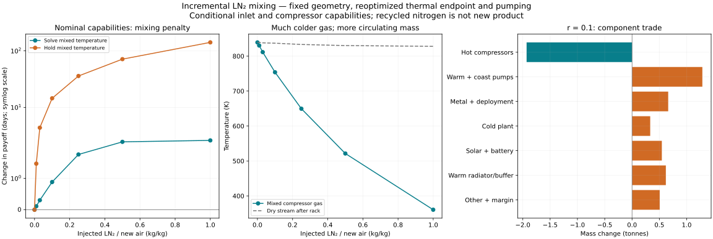

# Incremental LN₂ mixing

**Decision: retain mixing support in the active model.** Compressor physics remains a major unresolved item; the current study does not rule out benefits under realistic compressor capabilities. Zero injection is a reference setting, not a decision to eliminate mixing.

**Nominal result: incremental mixing does not improve payoff in the tested reference design, but its penalty can be very small. The compressor capability assumptions can reverse that sign.** Keep zero optional injection as the nominal numerical baseline; this is not a rejection of film cooling required for material survival. A flight mixing ratio needs the real thermal and compressor maps.

## What was compared

The reference geometry is an 18.3 m mouth/front/rear bore, a 250 m front and 25 m rear, in a 100 × 2,000 km orbit with 4,000 s Isp. Dry mass is an output, with no ceiling. Ratios r = 0, 0.01, 0.03, 0.1, 0.25, 0.5 and 1 mean **kg of injected LN₂ per kg of newly admitted atmospheric gas**, not coolant fraction of the total mixture.

- **Fixed rack endpoint:** precool the new air to a specified dry-stream temperature, then mix LN₂ and solve the colder compressor-inlet temperature from enthalpy. The metal endpoint remains tied to the dry stream.
- **Fixed mixed inlet:** hold the compressor-inlet temperature while injection replaces part of the metal cooling duty. Total compressed mass rises without a compensating gas-temperature reduction.

The first search family holds the thermal endpoint at 1,000 K. The second also searches it from 601 to 1,142 K, with metal cold temperature 500 K and approach 100 K. Every ratio gets the same suction-scale range 0.5–1.5 and cutoff range 0.0315–10 Pa. Both paths include actual admission/reverse flow, finite-backflow pumping and automatic hardware resizing. Geometry, orbit, staging, Isp and other capabilities stay fixed. These are coarse grids plus two bounded coordinate passes, **not a whole-vehicle or global optimum**.

## Payoff versus injected ratio

| LN₂ / new air | Fixed rack, 1,000 K dry stream | Fixed mixed inlet, 1,000 K | Rack endpoint also searched | Mixed inlet also searched |
|---:|---:|---:|---:|---:|
| 0 | 988.687 d | 988.687 d | 982.355 d | 982.355 d |
| 0.01 | 988.842 d | 990.410 d | 982.466 d | 983.822 d |
| 0.03 | 989.119 d | 993.834 d | 982.658 d | 986.725 d |
| 0.1 | 989.999 d | 1,005.826 d | 983.237 d | 996.819 d |
| 0.25 | 991.476 d | 1,031.592 d | 984.114 d | 1,018.235 d |
| 0.5 | 992.971 d | 1,074.732 d | 984.812 d | 1,053.594 d |
| 1 | 993.899 d | 1,231.643 d | 984.961 d | 1,123.352 d |

All are operating-orbit dry-mass payoffs, before circular-apogee delivery. All saved winners pass the implemented screens. A failed point is not ranked as a feasible improvement. The broad geometry optimizer has not been rerun with these changes.

With thermal endpoint and pumping free, the unmixed control is **982.355 days**. At r = 0.1 the result is **983.237 days**, a penalty of **0.882 day (0.090%)**. The mixed gas is much colder, but coolant mass also passes through the warm compressor and cryogenic plant.



### Cycle inventory and compressor behavior

| Ratio | Dry stream → mixed gas | New air admitted | LN₂ injected | Coolant replacement | Net new liquid | Hot suction | Total compressor mass |
|---:|---:|---:|---:|---:|---:|---:|---:|
| 0 | 839.1 → 839.1 K | 220.638 kg | 0.000 kg | 0.0000 kg | 175.906 kg | 9,329 m³/s | 292.574 t |
| 0.01 | 839.2 → 830.2 K | 220.638 kg | 2.206 kg | 0.0023 kg | 175.903 kg | 9,326 m³/s | 292.603 t |
| 0.03 | 837.9 → 811.3 K | 220.642 kg | 6.619 kg | 0.0069 kg | 175.902 kg | 9,305 m³/s | 292.253 t |
| 0.1 | 836.9 → 753.8 K | 220.655 kg | 22.066 kg | 0.0229 kg | 175.900 kg | 9,265 m³/s | 291.931 t |
| 0.25 | 833.2 → 649.4 K | 220.653 kg | 55.163 kg | 0.0574 kg | 175.863 kg | 9,128 m³/s | 289.774 t |
| 0.5 | 830.1 → 521.3 K | 220.685 kg | 110.342 kg | 0.1150 kg | 175.837 kg | 8,893 m³/s | 285.934 t |
| 1 | 827.9 → 360.5 K | 220.741 kg | 220.741 kg | 0.2308 kg | 175.777 kg | 8,378 m³/s | 276.968 t |

All masses in this table are per pass except installed compressor mass. Replacement includes reverse/front losses and the 0.1% coast-feed residual. It is reserved from captured nitrogen. Oxygen propulsion is checked against retained atmospheric oxygen, not diluted mixture mass.

### r = 0.1 versus no mixing: component budgets

| Quantity | No mixing | r = 0.1 | Change |
|---|---:|---:|---:|
| Whole dry mass | 2,343.325 t | 2,345.347 t | +2.022 t |
| Hot compressor bank | 279.873 t | 277.942 t | -1.931 t |
| Warm compressor bank | 12.460 t | 13.747 t | +1.287 t |
| Metal rack | 49.843 t | 50.281 t | +0.439 t |
| Refrigerator package | 3.309 t | 3.640 t | +0.331 t |
| Solar area | 101,036.691 m² | 101,336.423 m² | +299.732 m² |
| Warm radiator panel area | 4,188.778 m² | 4,250.035 m² | +61.257 m² |
| Metal sheet area | 25,332.982 m² | 25,556.032 m² | +223.050 m² |
| Compression electricity | 119.096 kWh/pass | 121.677 kWh/pass | +2.581 kWh/pass |
| Cryoplant electric power | 299.691 kW | 329.685 kW | +29.994 kW |

The warm radiator and metal-sheet areas are physical panels with two emitting faces. The hot-bank mass saving is real within the declared volume-rate model, but the warm-bank throughput, refrigeration, heat rejection and other costs consume it. The metal mass changes slightly because its endpoint is reoptimized; it is not held fixed in this table.

## What compressor improvement would make mixing worthwhile?

The model holds effective compression efficiency at 0.5 and volume-rate mass target at 30 kg/(m³/s). Those assumptions do not capture a real machine becoming lighter or more efficient at a lower inlet temperature. The following thresholds hold each searched mixed policy fixed and compare against the optimized unmixed control. They are required **additional** gains, beyond the volume-flow savings already counted. They are alternatives, not cumulative credits.

| Ratio | Additional whole-dry-mass saving needed | Equivalent extra hot-bank mass reduction before margin | Train efficiency needed instead of 0.5 |
|---:|---:|---:|---:|
| 0.01 | 264.4 kg | 0.076% | 0.5126 |
| 0.1 | 2,102.9 kg | 0.605% | 0.6221 |
| 0.25 | 4,194.9 kg | 1.225% | not reached ≤0.8 |
| 0.5 | 5,858.4 kg | 1.757% | not reached ≤0.8 |
| 1 | 6,211.2 kg | 1.977% | not reached ≤0.8 |

The efficiency threshold changes the effective hot/warm compression efficiency only in the mixed case; it does not assert a measured temperature response. The coast-feed and refrigerator efficiencies retain their separate assumptions. A measured benefit of this size could change the decision; applying it without a map would manufacture a conclusion.

### Reoptimized capability scenarios

These change the same capability for both r = 0 and r = 0.1, and repeat the thermal/suction/cutoff search.

| Shared capability | No mixing | r = 0.1 | Difference |
|---|---:|---:|---:|
| Compressor target 100 instead of 30 kg/(m³/s) | 1310.164 d | 1310.118 d | -0.046 d |
| Refrigerator 30% instead of 15% of Carnot | 979.910 d | 980.548 d | +0.638 d |

The heavier-compressor scenario reverses the sign, but by only about an hour on a multi-year payoff. This is a near tie, not engineering evidence for a preferred ratio. A 6,401-sample replay checks the numerical sign separately; bounded coordinate searches still do not certify a global minimum. These capability scenarios are not changes to the reference configuration.

## Physical explanation and balances

Cooling lowers temperature, but suction capacity depends on **total mass × specific gas constant × temperature**. For the same new-air rate and inlet pressure:

```text
S_mixed / S_dry = (1+r) (R_mixed/R_dry) (T_mixed/T_dry)
```

For equal-Cp ideal gases, cold gas alone satisfies `(1+r)T_mix = T_hot + r T_cold`; total suction volume increases despite the temperature drop. At 1,000 K hot gas, 80 K cold gas and r = 0.1, temperature becomes about 916 K but total suction volume is 1.008 times the original. This limiting result does not include LN2 latent heat.

LN2 absorbs roughly 200 kJ/kg through vaporization as well as sensible heat. That can lower the required hot-bank suction volume, as the calculated table shows. It also adds warm-stage throughput and a coolant-restoration duty. Recovered nitrogen must be reliquefied and reserved for the next orbit; nitrogen lost from the loop must be replaced.

```text
Fixed-rack mixing: h_air(T_dry) + r [h_LN2 + w_injection]
                   = (1+r) h_mix(T_mixed)
Mass: new_air + injected_LN2 = stored_mixture + reverse_leak + final_front
Net new liquid: 0.999 stored_mixture − injected_LN2 − propulsion
```

Liquid enthalpy is anchored to the gas enthalpy reference at 298.15 K using NIST sensible/latent heat, rather than extrapolating gas polynomials into the liquid domain. The actual molecular mixture determines R and heat capacity; atmospheric oxygen is transported separately. Injection is proportional to new admission, so coolant is never assigned atmospheric arrival momentum.

Both comparison branches route all compressor heat to the warm loop. A mixed stream can be colder than the metal rack, so assigning isothermal compressor heat to the hotter rack would be invalid. This shared thermal-accounting change means the unmixed control is recomputed here; numbers from the frozen prior decision study are not silently reused.

## Inputs, limitations and next decision

The injector/storage allowances are explicit: 0.15 kg of storage hardware per kg of startup LN2, 25 kg fixed injection hardware, 10 kg per kg/s peak injection flow, 1 MPa pressure work, 806 kg/m³ density proxy, 60% pump efficiency and 500 W/kg pump specific power. No added hardware is charged at r = 0. Dry mass excludes the circulating LN2 itself; it is reported separately with warm-loop inventory. These allowances are scenario targets, not qualified tanks or atomizers.

The reduced model assumes complete mixing/vaporization, a uniform molecular endpoint and a nitrogen-equivalent cryogenic plant. It does not resolve injector location, atomization, film heat transfer, rack conductance/pressure loss, pump thermal clearances or non-equilibrium chemistry. The fixed-inlet path uses the mixed-gas endpoint to set its conservative metal endpoint; it does not give a free hotter exchanger. The fixed-rack path represents injection after the rack has performed its assigned dry-stream cooling. Neither path establishes leading-edge cooling performance. Admission conductance is evaluated at the lumped cooled mixture state; the upstream diffuser/rack flow and injector location are not spatially resolved. Those inlet uncertainties can exceed the small nominal payoff differences.

The actionable result is that **optional bulk mixing needs little additional compressor benefit to break even**, while using injection merely to replace solid cooling at unchanged compressor temperature is substantially more expensive. Required film cooling must be evaluated against material survival and hardware saved, rather than rejected because a thermal-protection-free model prefers r = 0.

## Verification and reproduction

Tests cover the exact r = 0 limit, liquid-reference and mixer enthalpy, mass/species accounting, coolant replacement, no fictitious product or arrival momentum, hydraulic access, cutoff, and full thermal/power accounting. Winners are replayed at 1,601 and 3,201 environmental samples. Exact inputs, unsuccessful search points, margins and numerical errors are retained in [results/incremental_mixing](../../results/incremental_mixing); [thresholds and finer checks](../../results/mixing_thresholds.json) are separate.

```sh
.venv/bin/python -m atmo_scoops.studies.incremental_mixing --workers 4
.venv/bin/python -m atmo_scoops.studies.incremental_mixing --sensitivity --workers 4
MPLCONFIGDIR=/tmp/atmo-scoops-mpl .venv/bin/python -m atmo_scoops.studies.mixing_report
```

A frozen [source, inputs and results snapshot](reproduction.tar.gz), with [checksum](SHA256.txt), preserves this experiment independently of later model changes. Extract it into a separate directory, create a local venv in `snapshot/`, install `requirements-lock.txt`, and run the commands above there.

The implementation is [mixing.py](../../atmo_scoops/mixing.py) with the shared [cycle kernel](../../atmo_scoops/two_volume.py) and [continuous inlet](../../atmo_scoops/inlet.py). The same optional mixing inputs work through the public API and JSON configurations.

Sources: [NIST nitrogen gas heat capacity](https://webbook.nist.gov/cgi/cbook.cgi?ID=C7727379&Units=SI&Mask=1), [NIST nitrogen phase data](https://webbook.nist.gov/cgi/cbook.cgi?ID=C7727379&Units=SI&Mask=4), and [Leybold pump operating principles](https://www.leybold.com/en-us/knowledge/vacuum-fundamentals/vacuum-generation/how-does-a-roots-pump-work). The latter supports the need for backing-pressure/internal-backflow and thermal operating maps; it does not validate the scoop compressor. [Source qualifications](../../docs/SOURCES.md) and the [remaining engineering plan](../../local-issue-drafts/specifications/docs/DESIGN_STUDIES_PLAN.md) distinguish evidence from targets.
