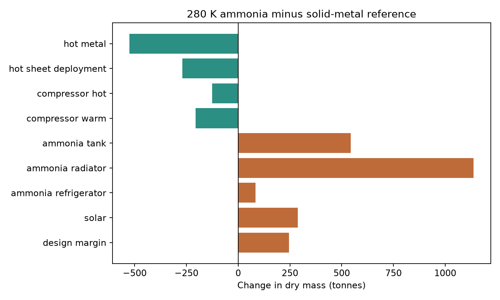

# Integrated ammonia cooling: initial payoff comparison

## Result

The fixed-tube ammonia option is now in `system.simulate`: heat exchange changes
front gas temperature/pressure, admission/leakage and compressor inlet states.
Actual coolant consumption and pump work determine regeneration, solar, radiator,
battery and tank budgets. Added folded volume and solar/radiator motion feed back
into the coast window. This is no longer a prescribed-duty component subtraction.

At the fixed **85 × 2,000 km orbit**, the best warm-ammonia case here gives
**538.4 days**, compared with
**522.0 days** for the retuned solid-metal reference.
The representative 200 K ammonia case gives **558.2 days**.
These are conditional **operating-orbit dry-mass payoffs**. Circular-apogee delivery
is still unimplemented. The large absolute vehicle masses reflect the current
power/propulsion hardware assumptions, not a qualified vehicle design.

| Case | Dry t | All compressors t | Peak compressor MW | Net new kg/pass | Dry payoff days | Payoff also charging ammonia inventory, days |
|---|---:|---:|---:|---:|---:|---:|
| Solid metal, retuned | 40,178 | 930 | 52.2 | 5,668 | 522.0 | — |
| Ammonia 200→300 K | 42,818 | 572 | 35.1 | 5,648 | 558.2 | 566.2 |
| Ammonia 200→300 K, smaller exchanger | 42,814 | 752 | 43.4 | 5,662 | 556.7 | 564.3 |
| Ammonia 280→340 K | 41,402 | 597 | 40.3 | 5,662 | 538.4 | 550.3 |

All table cases pass implemented screens at 1,601 samples. This does not validate
inlet shock stability, material life, heat-transfer correlations or machinery.
Ammonia inventory in the last column includes batch and fixed-tube hold-up; it
is additional to dry mass. Warm radiator-loop fluid is reported separately in
working mass, consistent with the existing model's distinction.

## What cooling buys, and what it costs

In the 200 K case, peak front compressor-inlet temperature drops from
**1053 to 581 K** and total compressor
mass falls by **358 t**.
The gas is not forced to equal the 200 K coolant supply. Finite gas-side heat
transfer, liquid capacity rate and incoming heat set its temperature.

The warmer case trades away some deep-cooling benefit to reduce regeneration
cost. Its mass changes against solid metal are:

| Budget entry | Solid t | Warm ammonia t | Change t |
|---|---:|---:|---:|
| hot_metal | 665.5 | 140.6 | -524.9 |
| hot_sheet_deployment | 269.2 | 0.0 | -269.2 |
| compressor_hot | 661.0 | 535.1 | -125.9 |
| compressor_warm | 267.7 | 61.4 | -206.3 |
| ammonia_tank | 0.0 | 543.7 | +543.7 |
| ammonia_radiator | 0.0 | 1,136.3 | +1,136.3 |
| ammonia_refrigerator | 0.0 | 83.7 | +83.7 |
| solar | 5,048.6 | 5,337.0 | +288.5 |
| battery | 4,558.7 | 4,551.2 | -7.4 |
| design_margin | 8,035.5 | 8,280.4 | +244.8 |

The reference assigns about **2.3%**
of total dry mass to compressors. Reboost peak electrical power remains around
**6.10 GW**, versus only
**52.2 MW** for peak compression in the solid case.
Cooling does not remove capture momentum. Consequently, substantial compressor
savings do not remove the dominant propulsion and power-system burden in this
particular numerical model. The heat-pump/radiator/tank cost exceeds the savings.



## Physical dimensions and cycle: 200 K example

Mouth/internal bore remains 30 m. Actual front chamber depth is
**3.83 m**; rear receiver depth is **16.00 m**.
The tube-bank envelopes include gas-accessible pores:

| Bank | Tube-bank depth m | Gas-contact area m² | Spent ammonia t | Available batch t | Mean return K | Peak inner-wall K |
|---|---:|---:|---:|---:|---:|---:|
| 1 | 3.828 | 170,000 | 489.11 | 538.02 | 299.0 | 307.4 |
| 2 | 0.135 | 6,000 | 12.16 | 13.37 | 289.7 | 315.0 |
| 3 | 0.135 | 6,000 | 2.00 | 2.20 | 292.7 | 296.3 |
| 4 | 0.135 | 6,000 | 2.25 | 2.47 | 294.1 | 296.6 |

The complete coolant tank has **1.45 m**
equivalent bore depth, including unused reserve, excluding tube hold-up. This is
volume accounting, not a selected hull-spanning diaphragm geometry. Shared
hot/cold storage counts the larger full inventory volume, not two full tanks.
Total assembled length is **251.4 m**, including
interstage envelopes, packed plant, panels, radiator and tank. Exterior diameter
is 31.7 m; the L/D limit remains 10 and receiver pressure cap 110 kPa.

- Orbit: **106.0 min**.
- Deployed coast: **85.1 min**; deployed sunlight: **45.9 min**.
- Common deployment/retraction allowance: **188.4 s** each, recalculated from combined areas.
- Added ammonia-loop radiator: **380,607 m²** emitting area.
- Total solar area: **3,548,798 m²**; ammonia adds **124.1 MW**.
- Separate existing warm-system radiator: **72,228 m²** physical panel area, two emitting faces.
- Deployable metal-cooler area: **zero**; tubes remain inside.

The dynamic encounter retains the reference's longer low-density admission and
recovery tails. No new fixed 60 s collection assumption is imposed. Heat-pump
operation is confined to actual deployed sunlight; its electrical work is charged
in full. Available coolant is sized from screening consumption plus 10% reserve,
then checked again after the changed packing/deployment window.

## Search, rejected cases and limitations

The 14-case screen includes a fresh solid reference; 200 K banks at 0.5/1/1.5
area multipliers and suction scales 0.6/0.85/1.1; and 240/280 K supply with 340 K
return target at two suction scales. Initial 200 K pressure is 2 MPa; warmer
340 K-return cases use 5 MPa to remain liquid with wall-temperature margin.

Two smaller 200 K variants exceed the local wall-boiling screen at 2 MPa. The
refined smaller-bank row explicitly raises pressure to **2.5 MPa**, charges the
resulting tank mass and rechecks properties/stress. No single-phase performance
is claimed for the rejected 2 MPa variants. The weakest small-bank suction case
also loses oxygen closure. Full rejected outputs remain alongside passing ones.

The refined cases run at 801 and 1,601 samples; the largest payoff change is
**0.235 day**. This is numerical convergence, not physical validation. It is
not a global optimization of orbit, gas storage, stage-specific coolant
conditions, control law or mixed cooling architectures. Cooler inventory depletion
rejects a trial rather than simulating post-exhaustion operation.

Tube walls and liquid flow are quasi-steady; liquid exchange uses a real-property
enthalpy secant and a conservative internal-film estimate. Compressor gas states
remain real-gas isentropic calculations with efficiency. The refrigerator still
uses 35% Carnot performance and 500 electrical W/kg as explicit capability
assumptions. Insulation, manifold geometry, cyclic containment, separator heat
leak and heat-pump hardware maps remain unresolved. See the
[integrated equations](../../modeling/liquid_cooling/INTEGRATED_MODEL.md).

## Reproduction

```
.venv/bin/python -m atmo_scoops.studies.ammonia_integrated
.venv/bin/python -m atmo_scoops.studies.ammonia_validation
.venv/bin/python -m atmo_scoops.studies.ammonia_report
.venv/bin/python -m atmo_scoops --config configs/ammonia_cold200_reference.json --samples 801 --output /tmp/ammonia.json
```

Full inputs and component ledgers are in `results/ammonia_integrated/`; complete
editable primary configurations are `configs/ammonia_cold200_reference.json`,
`configs/ammonia_cold200_small_reference.json` and
`configs/ammonia_warm280_reference.json`. The ordinary-metal default is retained.

The [tube geometry investigation](TUBE_GEOMETRY.md) revisits radius and pitch at the subsequently optimized perigee Isp.
