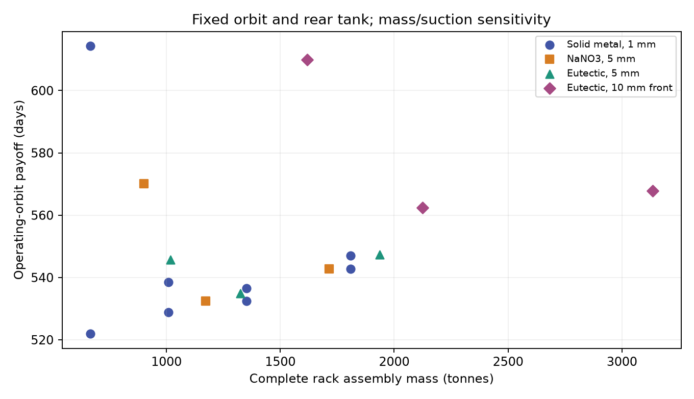

# Phase-change cores: capacity is useful only if the heat reaches it

## Finding

Optional PCM cells are now supported in every rack, including independent material,
outer radius and assembly mass. This comparison does **not** select them for the
reference: the tested PCM cases do not beat a fairly retuned solid-metal rack.
The model does demonstrate melting and complete coast refreezing. That is a
real capacity benefit, but it does not remove the gas-side heat-transfer limit.

All results below are **operating-orbit mass payoff**, not circular-apogee
delivered payoff. The very large absolute masses remain conditional on the
existing component model; this investigation compares rack changes within it.

## Controlled comparison

Fixed orbit 85 × 2,000 km, 30 m bore, rear depth 16 m, cold start 298 K,
no injected nitrogen, open inlet, four cooled compressor blocks. L/D ≤ 10,
storage ≤ 110 kPa and existing oxygen, packing, access-area, temperature and
coast-restoration screens remain active. This deliberately fixes altitude and
apogee so the material comparison is not disguised by an orbit change.

PCM cells have 0.5 mm walls/end caps, 0.5 m sealed length, 80% cavity fill,
contact resistance 1e-4 m² K/W, and no fins in the comparison table. Radius/pitch
is 0.1. Casing and sealed ullage are included in chamber displacement. All
rack/core/casing mass, compressor changes, deployment and radiation enter the
full system calculation. These containment dimensions are assumptions requiring
structural and chemical qualification.

| Case (outer radius) | Rack assembly t | Craft dry t | New net kg/pass | Payoff days | Maximum encounter melt fraction¹ | Longest reset min |
|---|---:|---:|---:|---:|---:|---:|
| Original solid metal, 1 mm | 1,808 | 41,918 | 5,668 | 544.5 | 0% | 11.9 |
| Retuned solid metal, 1 mm | 665 | 40,178 | 5,668 | 522.0 | 0% | 13.9 |
| NaNO3 core, 5 mm | 1,173 | 40,868 | 5,651 | 532.5 | 0% | 42.3 |
| Melting eutectic core, 5 mm | 1,018 | 40,566 | 5,473 | 545.7 | 100% | 41.9 |
| Eutectic: 10 mm front / 5 mm later | 2,124 | 42,075 | 5,509 | 562.4 | 0% | 56.3 |

¹ Maximum across racks, not a mass-weighted fleet melt fraction. The fastest salt
case stays below its melting point: its performance is a sensible-heat/geometry
result, not evidence that latent heat shortened payoff. All five displayed cases
pass the implemented screens at the reported resolution; this is not hardware
validation.



## What the centimetre radius changes

For a cylindrical cell, gas-contact area per outer volume is `2/r`. A larger
radius reduces external area and core conduction speed. At fixed rack-envelope
volume and pitch ratio it also reduces the number of wire planes. Changing from
a dense solid wire to a lighter salt-core cell changes outer volume per kilogram;
the model derives both effects rather than assuming equal area at equal mass.
Core diffusion/solidification time scales approximately as radius squared.

The 10 mm-front case in the table uses 5 mm cells between compressors. Making
**every** rack 10 mm did not yield a screen-passing candidate in the coarse
mass-factor sweep. Some cases exceeded the compressor property domain, some
lost oxygen closure, and others exceeded the model's small-interstage-holdup
limit or hull length. A property-domain error and the 1% holdup screen are model
limitations, not proofs that that hardware is impossible. The 10 mm-front case
shows that centimetre cells are representable without pretending that every
intermediate chamber can be arbitrarily large.

Adding capacity can also defeat its own latent-heat purpose: a sufficiently
massive core never reaches melting temperature. The final states and peak melt
fractions are saved separately for each rack. Hot skin is not treated as proof
of a molten core.

## Isolating latent heat

For the melting 5 mm eutectic case, turn off fusion enthalpy while holding every
assembly mass, radius, casing, void, orbit and suction setting identical.
Payoff changes from **545.73 days with latent heat to 545.69 days without**,
a signed **+0.007% change** with fusion heat. That is effectively
no payoff benefit at the precision warranted here.
The zero-latent control passes implemented screens: True.
Fusion heat lowers the peak skin temperature from about 549 to 537 K and
stores roughly 46 GJ as latent heat in the front rack, yet leaves peak compressor
inlet temperature essentially unchanged (1,132 K). It therefore provides thermal
margin without materially improving this case's throughput/power bottleneck.
This isolates phase change; it is not a comparison with an independently
optimized sensible-only material or with the tuned solid-metal design.

## Search scope and reproducibility

The first 21-case sweep compares solid radii 1/3/10 mm; tin, sodium nitrate and
eutectic 10 mm cores at mass factors 1.5/3/6/12; 5 mm eutectic cells; and a solid
front with PCM interstages. A further 31-case discrete sensitivity varies front
mass and compressor suction for both solid and PCM designs. Interstage mass
factors are recorded separately. One fin-enhanced trial fails compressor access
area; it is not a feasible recommendation. This is a local sensitivity, **not a
global optimization** of material, radius, rack allocation, orbit or controller.

Screening uses 201 samples. The five table cases are repeated at 801 and 1,601
samples in both inlet and compressor quadrature. The largest payoff change
between those resolutions is **0.069 day**. Exact inputs, per-stage states,
constraints and mass/energy outputs are retained in `results/pcm_racks/`.

```bash
.venv/bin/python -m atmo_scoops.studies.pcm_racks
.venv/bin/python -m atmo_scoops.studies.pcm_tuning
.venv/bin/python -m atmo_scoops.studies.pcm_validation
.venv/bin/python -m atmo_scoops.studies.pcm_report
```

Editable examples are `configs/pcm_melting_reference.json` and
`configs/pcm_10mm_reference.json`; neither replaces the ordinary-metal reference.
The [model dossier](../../modeling/metal_coolers/PCM_MODEL.md) contains equations,
source annotations, property approximations and implementation limits. The
[broader material survey](../../docs/PHASE_CHANGE_COOLERS.md) includes hotter
materials not covered by this terminal-cooler comparison. Stage-specific and
axially cascaded materials, conductive inserts and explicit transient
intermediate chambers remain worthwhile investigations.
