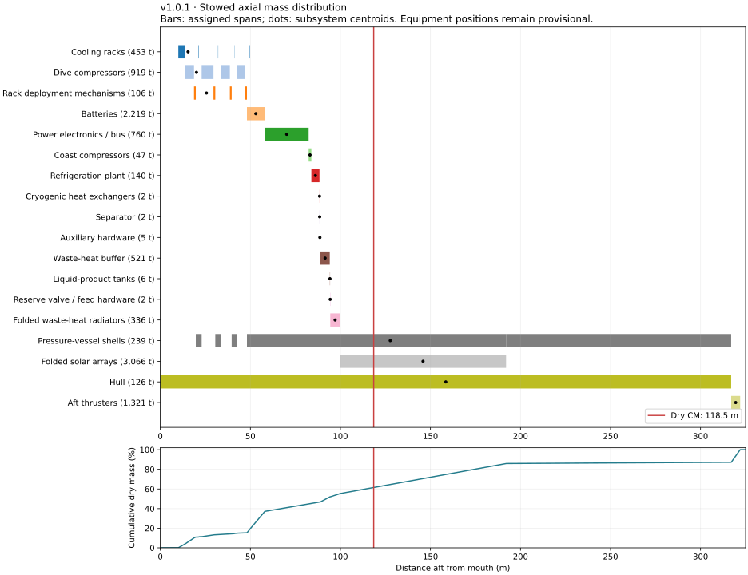

# v1.0.1 stowed axial mass allocation

Dry CM **118.48 m from the mouth (37.4% of hull length)**. Dry mass **12,840.22 t**. This is an assigned packaging estimate, not an optimized CM or aerodynamic stability result.

Masses and chamber/compressor/rack locations use the accepted frozen cycle. Receiver equipment is placed sequentially forward-to-aft within 48.097–192 m using its modeled package volumes and uniform available packing capacity: batteries, power electronics and processing machinery first; solar cassettes last. This refines the symbolic equipment strips in the scale drawing; those strip lengths were not measured package dimensions. The entire thruster mass is assigned to 317–322 m, an illustrative external hardware span. Actual separation of thruster heads and remote electronics needs engineering.

Vessel shell masses use the model barrel/head expression, distributed uniformly over each vessel. Hull mass is uniform; 25% margin follows component masses proportionally and does not shift CM. Rack mechanisms use deployed area to allocate mass. No wet inventory or deployed position is included.

This moves CM aft relative to the obsolete forward-pod layout. Stability still requires an aerodynamic center behind CM with adequate restoring derivatives; this mass calculation alone cannot establish that. A 10 m shift of all thruster hardware moves CM by 1.29 m under the proportional-margin convention.

| Component | Mass (t), before margin | Axial span (m) |
|---|---:|---|
| Dive compressors / Compressor 1 | 654.53 | 13.58–18.70 |
| Cooling racks / Rack 1 | 381.30 | 10.00–13.58 |
| Rack deployment mechanisms / Rack mechanism 1 | 82.96 | 18.70–19.70 |
| Dive compressors / Compressor 2 | 192.09 | 22.94–29.52 |
| Cooling racks / Rack 2 | 26.63 | 21.20–21.44 |
| Rack deployment mechanisms / Rack mechanism 2 | 9.97 | 29.52–30.52 |
| Dive compressors / Compressor 3 | 46.05 | 33.65–38.61 |
| Cooling racks / Rack 3 | 12.91 | 32.02–32.15 |
| Rack deployment mechanisms / Rack mechanism 3 | 4.57 | 38.61–39.61 |
| Dive compressors / Compressor 4 | 26.44 | 42.72–47.10 |
| Cooling racks / Rack 4 | 11.79 | 41.11–41.22 |
| Rack deployment mechanisms / Rack mechanism 4 | 3.17 | 47.10–48.10 |
| Cooling racks / Receiver rack | 20.56 | 49.60–49.82 |
| Batteries / battery | 2,218.52 | 48.10–57.98 |
| Power electronics / bus / bus | 760.00 | 57.98–82.37 |
| Coast compressors / coast_compressors | 46.90 | 82.37–83.88 |
| Refrigeration plant / refrigerator | 140.27 | 83.88–88.38 |
| Cryogenic heat exchangers / external_exchangers | 2.25 | 88.38–88.45 |
| Separator / separator | 2.50 | 88.45–88.53 |
| Auxiliary hardware / auxiliary | 5.00 | 88.53–88.69 |
| Rack deployment mechanisms / rack_mechanisms | 5.66 | 88.69–88.87 |
| Waste-heat buffer / warm_store | 520.95 | 88.87–94.10 |
| Liquid-product tanks / liquid_tanks | 6.00 | 94.10–94.29 |
| Reserve valve / feed hardware / gas_reserve_system | 2.50 | 94.29–94.37 |
| Folded waste-heat radiators / warm_radiator | 336.18 | 94.37–99.76 |
| Folded solar arrays / solar | 3,066.03 | 99.76–192.00 |
| Aft thrusters / Aft thruster assemblies | 1,321.43 | 317.00–322.00 |
| Pressure-vessel shells / Vessel 2 | 7.32 | 19.70–22.94 |
| Pressure-vessel shells / Vessel 3 | 23.42 | 30.52–33.65 |
| Pressure-vessel shells / Vessel 4 | 67.34 | 39.61–42.72 |
| Pressure-vessel shells / Vessel 5 | 66.93 | 48.10–192.00 |
| Pressure-vessel shells / Reserve shell | 73.73 | 192.00–317.00 |
| Hull / Hull | 126.28 | 0.00–317.00 |

Reproduce: `.venv/bin/python investigations/publication_v1_0_1/axial_mass.py`. Component sums are asserted against every frozen mass category.

