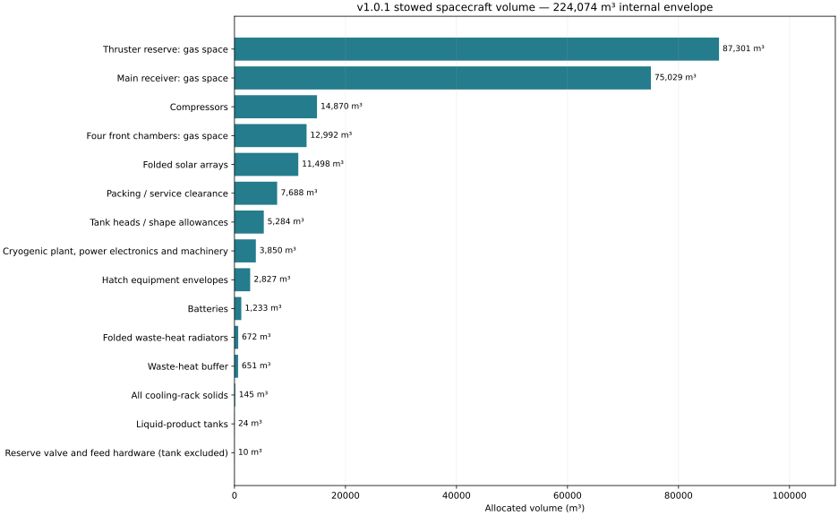
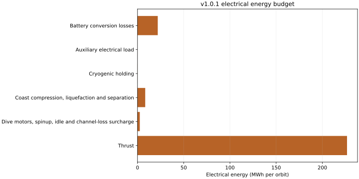

# v1.0.1 folded volume and cycle energy budgets

Derived from the same frozen trajectory as the current scale drawing. Reproduce with `PYTHONPATH=. .venv/bin/python investigations/subsystem_payoff/calculate.py` then `.venv/bin/python investigations/publication_v1_0_1/budgets.py`.

## Additive stowed envelope

The 30 m bore × 317 m hull gives **224,074.1 m³** of internal cylindrical envelope. The 31.7 m external cylinder is **250,188.7 m³**; the difference is the radial hull/clearance zone, not available tank space. The following rows sum to the internal envelope.

| Item | Volume m³ | Location / drawing region |
|---|---:|---|
| Volume 1: free gas | 9,481.39 | 0.000–13.581 m |
| Rack 1: solid | 118.78 | Inside corresponding gas chamber |
| Volume 1: head/shape allowance | 0.00 | Same chamber envelope |
| Compressor 1: axial envelope | 3,617.64 | 13.581–18.699 m |
| Hatch equipment 1: envelope | 706.86 | 18.699–19.699 m |
| Volume 2: free gas | 1,222.63 | 19.699–22.938 m |
| Rack 2: solid | 9.86 | Inside corresponding gas chamber |
| Volume 2: head/shape allowance | 1,056.75 | Same chamber envelope |
| Compressor 2: axial envelope | 4,649.31 | 22.938–29.515 m |
| Hatch equipment 2: envelope | 706.86 | 29.515–30.515 m |
| Volume 3: free gas | 1,150.64 | 30.515–33.645 m |
| Rack 3: solid | 4.78 | Inside corresponding gas chamber |
| Volume 3: head/shape allowance | 1,056.75 | Same chamber envelope |
| Compressor 3: axial envelope | 3,511.78 | 33.645–38.613 m |
| Hatch equipment 3: envelope | 706.86 | 38.613–39.613 m |
| Volume 4: free gas | 1,137.72 | 39.613–42.724 m |
| Rack 4: solid | 4.37 | Inside corresponding gas chamber |
| Volume 4: head/shape allowance | 1,056.75 | Same chamber envelope |
| Compressor 4: axial envelope | 3,091.02 | 42.724–47.097 m |
| Hatch equipment 4: envelope | 706.86 | 47.097–48.097 m |
| Main receiver free gas | 75,029.09 | 48.097–192 m; narrowed barrel |
| Receiver rack solid | 7.61 | Inside main receiver |
| Folded solar arrays | 11,497.63 | Around main receiver, before x=192 m |
| Folded waste-heat radiators | 672.36 | Around main receiver, before x=192 m |
| Batteries | 1,232.51 | Around main receiver, before x=192 m |
| Waste-heat buffer | 651.19 | Around main receiver, before x=192 m |
| Cryogenic plant, power electronics and machinery | 3,850.32 | Around main receiver, before x=192 m |
| Liquid-product tanks | 24.00 | Around main receiver, before x=192 m |
| Reserve valve and feed hardware (tank excluded) | 10.00 | Around main receiver, before x=192 m |
| Aft packing clearance | 7,687.72 | Around main receiver |
| Main receiver head/shape allowance | 1,056.75 | Main receiver ends |
| Thruster reserve free gas | 87,300.54 | 192–317 m; full bore |
| Reserve head/shape allowance | 1,056.75 | Reserve ends |

Rack **solid volume** is additive; the porous rack envelope contains gas already counted in free gas volume. Do not add its full envelope again. Compressor/hatch rows are installed axial envelopes, not solid metal volumes. Vessel-head/shape allowances are geometrical residuals, not additional gas. Detailed shell/support occupation remains a reduced-model allowance rather than a collision-free CAD inventory.

## Folded equipment around the main receiver

The waste-heat buffer absorbs equipment heat pending radiator rejection; it is not stored warmth for a heating service. Reserve valve/feed hardware excludes the 87,301 m³ reserve gas volume, which is counted separately above. These packages are included in the additive table, not extra volume. The model divides their sum by 0.7 to allow packing/service clearance; this narrows the receiver once. Symbols in the scale picture identify sectors, but their drawn strip lengths do not individually encode these volumes. Use the table for 3D sizing, not the thickness of a symbolic strip.

| Package | Stowed volume m³ |
|---|---:|
| Folded solar arrays | 11,497.63 |
| Folded waste-heat radiators | 672.36 |
| Batteries | 1,232.51 |
| Waste-heat buffer | 651.19 |
| Cryogenic plant, power electronics and machinery | 3,850.32 |
| Liquid-product tanks | 24.00 |
| Reserve valve and feed hardware (tank excluded) | 10.00 |

The machinery package breaks down as follows:

| Machinery | m³ |
|---|---:|
| coast compressors | 187.61 |
| refrigerator | 561.09 |
| external exchangers | 9.00 |
| separator | 9.98 |
| bus | 3,040.00 |
| auxiliary | 20.00 |
| receiver rack mechanisms | 22.64 |

Solar volume uses 40 kW/m³ of rated output; warm radiator uses 0.02 m³ per physical m²; machinery uses 250 kg/m³. These are capability allowances, not measured package designs. Liquid tanks occupy 24 m³ including a 20% packaging factor around 20 m³ rated liquid capacity. Thrusters are external: no internal gas displacement is charged to them. Mass contingency has no standalone volume; general packing clearance is separately explicit.

## Electrical energy per orbit

| Load/source | MWh/orbit |
|---|---:|
| Thrust | 226.686721 |
| Dive motors, spinup, idle and channel-loss surcharge | 2.496908 |
| Coast compression, liquefaction and separation | 8.352475 |
| Cryogenic holding | 0.053706 |
| Auxiliary electrical load | 0.017673 |
| Total delivered electrical load | 237.607483 |
| Battery conversion losses | 21.922930 |
| Solar energy actually used (integrated ledger) | 259.531136 |

Battery charging and discharge are transfers, not extra end-use loads: charge input **224.851 MWh**, discharge output **202.928 MWh**. Their difference is the conversion loss above, with negligible net stored-energy change. Do not add charging again to the delivered loads.

## Thermal and mechanical energy — separate ledger views

Warm-loop radiation: **50.262 MWh**; direct solid-rack radiation: **54.098 MWh**. Total gas-compression shaft work: **1.779 MWh**. Rack-friction electricity: **0.337 MWh**, already included in compressor/processing loads. These are not additional electrical demands to add to the table. Thermal energy includes captured-gas enthalpy as well as dissipated electrical work.

Timing matters: these are integrated energies, not installed power or battery capacity. The frozen battery is 332.778 MWh and the bus is 760 MW; neither equals an energy-per-cycle row. Shared-hardware attribution is explained in the [subsystem payoff study](../subsystem_payoff/README.md).

