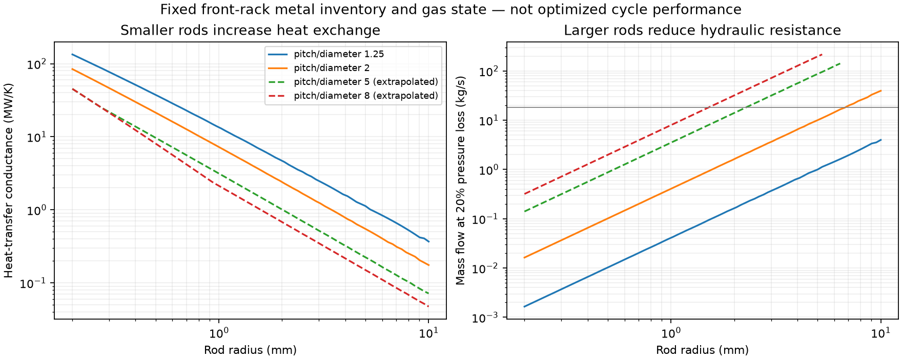

# Rod radius and pitch: coupled constrained search

**Superseded as the active reference:** retained as an exploratory study. Follow
[the staged refinement](../staged_refinement/README.md) for the current model.

This is a finite global-search attempt with the low-Re inline-bank model, not a converged optimum. Each candidate compiles hardware and runs one forward orbit. No inner cycle iteration or automatic capacity resizing is used.

Evaluations: **16**; complete trajectories: **5**; feasible: **2**; unresolved numerical evaluations: **4**; fewer-than-five-row geometry exclusions: **7**.

The search varies 55 scalar coordinates, including five radii, five common pitches, five solid inventories, four clear depths, compressor capacities, propulsion, power and thermal hardware, gas reserve, initial rack temperatures and cutoff/vent timing. Perigee remains 85 km; bore is 30 m and hull L/D is 10. All bounds and inputs are in [the manifest](../../results/transient/rack_wide_optimization/search.json).

Radius bounds are 0.2–10 mm. Pitch/diameter is 1.25–8. Values above 2 extend beyond the illustrated low-Re square-bank anchors: this is explicitly a geometry-extrapolation search, pending sensitivity and additional evidence. See [equations and evidence](../../modeling/metal_coolers/LOW_RE_BANK.md).

Lowest accepted operating-orbit payoff in this run: **1037.1 days**. This is not circular-apogee delivery payoff.

The earlier approximately 304-day result used a different rack heat-transfer treatment and omitted rack resistance. Geometry and installed capacities also differ; the ratio of these payoffs is not a controlled estimate of the pressure-loss penalty alone.

## Completed candidates

| Case | Dry mass, t | Liquid, kg/orbit | Gas-reserve change, kg | Feasible |
|---|---:|---:|---:|---|
| 0 | 20685.9 | 1696.9 | 0.0 | True |
| 3 | 20787.6 | 855.8 | -0.0 | True |
| 4 | 21003.0 | 465.5 | -0.0 | False |
| 11 | 24593.4 | 822.0 | -0.0 | False |
| 12 | 24984.9 | 63.2 | -1380.5 | False |

The declared reference seed remains the best candidate in this finite run. The mutation generation did not establish a better allocation; these dimensions must not be described as a converged optimum.


## Lowest-violation completed candidate (0)

This table describes a search candidate; it is an accepted numerical reference only if the feasibility column above is true.

| Rack | Radius, mm | Common pitch, mm | Requested rack depth, m |
|---|---:|---:|---:|
| 1 | 3.0000 | 30.0000 | 5.4200 |
| 2 | 1.0000 | 4.0000 | 0.0640 |
| 3 | 1.0000 | 4.0000 | 0.0288 |
| 4 | 1.0000 | 4.0000 | 0.0320 |
| 5 | 0.2000 | 0.8000 | 0.0512 |

Racks at the 0.2 mm floor: 5. This bound hit is in the tested reference; it does not establish an optimized radius.

Path/closure margins outside tolerance: none.

Largest installed mass contributions (before margin except the margin entry):

| Component | Mass, t |
|---|---:|
| solar | 5314.7 |
| margin | 4137.2 |
| battery | 3907.0 |
| thrusters | 2069.5 |
| bus | 1551.3 |
| dive compressors | 937.7 |
| warm store | 775.7 |
| warm radiator | 689.5 |
| racks | 454.2 |
| pressure vessels | 211.6 |

## Why radius and pitch compete



This calculation holds front-rack solid inventory and a representative completed-trial state fixed: 458 Pa, 1,339 K gas, 436 K metal. The left panel evaluates exchange at 18 kg/s; it does not assert that every geometry can pass that flow. The right panel finds flow for a 20% pressure drop, omitting points above Re=75. Dashed curves extrapolate geometry beyond the illustrated low-Re anchors. Integer row rounding causes small ripples. Reproduce with `python -m atmo_scoops.transient.rack_trade_plot`.

## Independent compact-bank 4,000 s reference

Dry mass 20597.6 t; liquid 623.82 kg/orbit; diagnostic mass/production ratio 2808.9 days. Full acceptance: **False**. This is a separate declared reference, not a search optimum.

Minimum numerical gas inventory: -0.00030480659 kg (required >−0.0001 kg). Gas-reserve change: 2.34479e-13 kg. A diagnostic ratio is not an accepted payoff when any audit fails.

[Trajectory](../../results/transient/high_isp_rack.json.gz) and embedded inputs preserve the exact numerical settings.

## Resolution and resistance checks

- Tighter integration: dry 20685.9 t; product 1697.026 kg/orbit; accepted=True; accepted payoff=1036.9712358392228; minimum gas=-8.57941e-08 kg. [Exact trajectory](../../results/transient/wide_rack_refined.json.gz).
- Double hydraulic resistance, unchanged hardware: dry 20685.9 t; product 1169.928 kg/orbit; accepted=True; accepted payoff=1504.1680786665222; minimum gas=-3.5776e-06 kg. [Exact trajectory](../../results/transient/wide_rack_double_loss.json.gz).
- Extended inlet tail (170/150 km): dry 20685.9 t; product 1696.992 kg/orbit; accepted=False; accepted payoff=None; minimum gas=-0.000281539 kg. [Exact trajectory](../../results/transient/wide_rack_inlet_check.json.gz).

The tighter check uses the corrected interior one-sided control value at both integration event boundaries. This prevents using the pre-burn derivative to start the burn segment. It changes no finite-duration control schedule. Doubling resistance alone leaves thermal conductance unchanged; it is an uncertainty probe, not a calibration of coupled heat/drag behavior.

## Reproduction and limits

```sh
OPENBLAS_NUM_THREADS=1 .venv/bin/python -m atmo_scoops.transient.property_table
OPENBLAS_NUM_THREADS=1 .venv/bin/python -m atmo_scoops.transient.global_search --config configs/transient_low_re_wide_search.json --output results/transient/rack_wide_optimization --population 8 --generations 1 --workers 4 --seconds 480 --max-new 16 --pitch-max 8 --isp-max 6000
.venv/bin/python -m atmo_scoops.transient.rack_search_report
```

The search resumes from exact encoded candidates. Use a fresh output directory after changing equations. `done.json` records completion of the declared generations, not mathematical convergence. Numerical limits are 480 s and 160,000 RHS evaluations per trial.

Unresolved priorities are robust trace-inventory integration, more effective exploration around feasible seeds, broader sparse-bank evidence, and thermal uncertainty. The radius floor was tested, but no claim of a global optimum follows from a small population in 55 dimensions. The tighter check passes; the extended-inlet check changes production by only about 0.002%, but fails the 0.1 g nonnegative-inventory tolerance. That numerical defect remains unresolved and is not silently accepted.

The pressure/heat law is a reduced continuum array model with an existing molecular heat-transfer resistance; hydraulic slip is not validated. Compressor maps, support structure, repeated deployment and circular-apogee export remain separate physical uncertainties.
