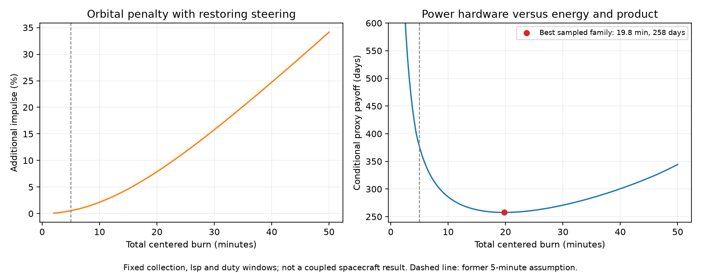

# Centered reboost duration: orbital penalty versus installed mass

**Isolated screening calculation, not a new coupled spacecraft result.** The old
300 s battery-fed burst was a fixed assumption, not an optimized duration. This
aside uses the existing 85 × 2000 km orbit, 1765.95 s Isp and the SiC/aluminum
proxy ledger. It does not evaluate the new fixed-L/D 317 m craft.

## Orbital penalty

Let tau be the **total** burn duration, centered on perigee, with constant thrust
magnitude and optimal in-plane steering. Approximate atmospheric momentum loss
by a perigee impulse J0. Let `K(tau) = required_total_impulse/J0`; this is an
orbital impulse multiplier, not a change in the thruster's electrical efficiency.

```
u = g0*Isp
propellant = J0*K/u
propulsion electricity = J0*K*u/(2*eta_thruster)
constant-burn electric power = J0*K*u/(2*eta_thruster*tau)
```

Both orbital energy and angular momentum must be restored. Symmetric radial
steering cancels the first-order apsidal change. Define along the unperturbed
orbit `ar=vr/vp`, `at=vt/vp`, and `b=r/rp`. For radial/tangential thrust direction
components `(ur,ut)`, the two efficiencies are

```
eta_E = average(ar*ur + at*ut)
eta_h = average(b*ut)
require eta_E = eta_h; maximize their common value; K = 1/eta_h.
```

The constant-magnitude optimum has direction proportional to
`(lambda*ar, b + lambda*(at-b))`. One scalar multiplier enforces equal energy and
angular-momentum restoration. Existing `reboost.arc_restore` evaluates this cheap
Kepler quadrature; it is not another full spacecraft simulation or an inner
cycle-closure iteration. This function may be tabulated as a reduced penalty
map over orbit and duration.

For a short centered burn, expansion around perigee gives

```
K(tau) = 1 + mu*tau²/(24*rp³) + O(tau⁴).
```

To leading order the steering angle from local prograde is `theta(t) ~ vp*t/rp`:
outward after perigee, inward before it. With `k=mu/rp³`, expanding both invariants
under that steering gives the same loss `k*average(t²)/2 = k*tau²/24`.
The exact quadrature should replace the quadratic at longer durations; the
quadratic is a near-perigee explanation, not a global fit or a universal law for
arbitrary thrust profiles/drag histories.

| Total burn, min | Impulse multiplier K | Peak power, GW | Maximum steering from local prograde, deg | Frozen-budget proxy days |
|---|---:|---:|---:|---:|
| 1.0 | 1.00022 | 13.468 | 2.2 | 1314.8 |
| 5.0 | 1.00549 | 2.708 | 11.1 | 376.3 |
| 10.0 | 1.02146 | 1.375 | 22.2 | 285.8 |
| 15.0 | 1.04655 | 0.939 | 33.2 | 262.4 |
| 20.0 | 1.07888 | 0.726 | 44.0 | 257.6 |
| 30.0 | 1.15791 | 0.520 | 64.4 | 270.8 |
| 40.0 | 1.24718 | 0.420 | 82.0 | 300.5 |
| 50.0 | 1.34150 | 0.361 | 96.8 | 344.3 |

The short-burn coefficient here is **6.152e-08 s^-2**.
Five minutes costs only about 0.55% more impulse than an ideal perigee impulse;
its important penalty is the installed GW rating, not a large orbital loss.
Twenty minutes costs about 7.9% more impulse but cuts peak power to about 27%
of the old impulse-equivalent 300 s rating.

## A conditional mass/payoff optimum

Holding Isp and the captured/processed batch fixed, the one-variable minimum is
approximately **19.75 minutes**, with **1.0771× impulse**,
**0.734 GW**, **12,558 t** proxy dry mass and
**257.6 proxy days**. Compare the finite-arc-corrected five-minute
case above, rather than silently calling the old impulsive 373-day case exact.

The calculation resizes thrusters and the shared bus from peak power. It also
charges additional propellant, battery energy, solar recharge energy, retained
thruster heat, battery losses, warm buffer and radiator heat, and reapplies the
existing margin once. Battery energy/power requirements are compared. Capture,
racks, compressor hardware, processing package, ordinary packaging and sunlight/
coast windows remain fixed. All propulsion energy is still charged through the
battery: no direct-solar thrust credit is introduced.

Schematically, before ratings/limits change branches, mass has the form
`M(tau) = A + B*K(tau)/tau + C*K(tau)` and useful mass is
`batch - (J0/u)*K(tau)`. This is the hardware-versus-energy/propellant trade the
300 s assumption omitted. Optimizing only thruster mass would favor much longer
burns and miss the energy and product penalties.

## Limitations and checks

This is not the final coupled payoff: the changing burn overlaps deployment and
processing, may require gimbal/attitude/plume accommodations, changes component
packing and propellant-reserve storage, and may affect battery/radiator thermal
schedules. Those effects are not fully resized here. At the selected burn
endpoints the steering is about 43.5 degrees and altitude
about 289 km. Distributed atmospheric drag should supply
the actual target energy/impulse/angular-momentum change in the coupled model.
Finite-gas-flow and mass-changing orbit propagation are not solved by the penalty.
Isp must ultimately be co-optimized, not held permanently at the earlier optimum.

An independent planar Newtonian trajectory with a single 0.1 m/s perigee drag
impulse checks the small-perturbation restoration: relative energy residual
-3.88e-10, relative angular-momentum residual
-4.37e-10, apsidal change
-9.75e-10 degrees. Refining orbital quadrature from 2,001 to
16,001 half-arc samples changes K by
3.09e-09.
These validate the reduced orbital calculation, not the whole design.

## Disposition

**Release burn duration as an outer design variable.** Keep a symmetric centered
constant-magnitude burn family initially and use the orbital penalty/steering
relation for screening. Integrate its actual power/heat/inventory history in the
coupled model, with restoration constraints. Treat 300 s as a comparison point,
not a fixed design requirement; the approximately 20-minute optimum is a seed,
not a prescribed answer.

Reproduce with `.venv/bin/python -m atmo_scoops.studies.burn_duration`.
Inputs, ledgers and checks: `results/reboost/burn_duration/comparison.json`.
Related: [prior separated solar-arc study](SOLAR_ARCS.md),
[propulsion equations and references](../../modeling/propulsion/REBOOST_INVESTIGATIONS.md).


