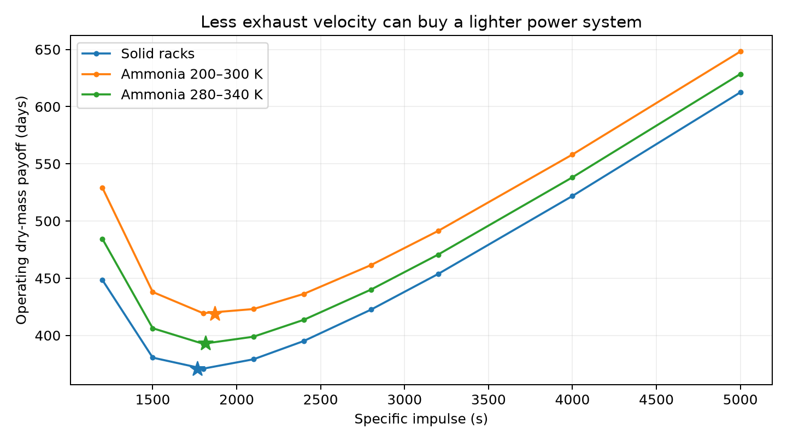

# Exhaust velocity versus dry-mass payoff

**The present model favors about 1,800–1,900 s Isp for battery-fed perigee reboost.**
Allowing nitrogen propellant removes the oxygen-only constraint; every kilogram
expelled still comes out of useful product. These are conditional minima for the
fixed 85 × 2,000 km orbit and existing thermal designs, not global spacecraft optima.
All payoffs below end in the operating orbit; circular-apogee delivery remains unmodeled.

## Full-primary-model results

| Cooling | 4,000 s payoff, days | Optimized Isp, s | Payoff, days | Dry mass, tonnes | Net liquid/pass, kg | Propellant/pass, kg | Of which N2, kg |
|---|---:|---:|---:|---:|---:|---:|---:|
| Solid racks | 522.0 | 1766 | 370.9 | 19,454 | 3,862 | 3,233 | 1,583 |
| Ammonia 200–300 K | 558.2 | 1869 | 419.0 | 22,885 | 4,022 | 3,054 | 1,409 |
| Ammonia 280–340 K | 538.4 | 1816 | 393.0 | 21,054 | 3,945 | 3,144 | 1,496 |



For fixed impulse J and effective exhaust speed u, propellant is J/u while
propulsion electricity is Ju/(2η). Lower Isp sacrifices liquid output but reduces
battery, solar, engine and power-distribution mass. Too low an Isp consumes most
of the product; too high an Isp carries excessive electrical hardware. The minimum
is broad: the last few seconds of the reported optimum have no engineering significance.

Voltage is indeed a control for Hall thrusters, but actual efficiency, ionization,
propellant species and discharge operating limits must be coupled. These runs
hold the existing 60% thrust efficiency and hardware-specific masses fixed.
They establish a useful design target, not a qualified O2/N2 throttle setting.
[Equations and annotated primary references](../../modeling/propulsion/REBOOST_INVESTIGATIONS.md)
include NASA variable-Isp Hall tests, JPL propulsion theory and an oxygen experiment.

## Scope and reproduction

The primary model is rerun at every Isp; array, battery, thermal, packing and
deployment effects are included. Orbit, capture controls, cooler inventories,
compressor capabilities and the 300 s reboost burst are held fixed. The O2/N2
allocation is an inventory calculation, not a separate nitrogen-engine design.
A 1,200–5,000 s screen brackets a bounded 1,400–2,400 s local minimization at
201 samples. Final outputs are recalculated at 801 and 1,601 samples; the maximum
payoff change is below 0.34 days. This is numerical convergence, not hardware validation.

Run from the repository root:

```sh
.venv/bin/python -m atmo_scoops.studies.reboost_isp
.venv/bin/python -m atmo_scoops.studies.reboost_isp_refine
.venv/bin/python -m atmo_scoops.studies.reboost_report
```

Complete editable inputs: `configs/reboost_{solid,ammonia,warm_ammonia}_isp_optimum.json`.
Exact output states and mass ledgers: `results/reboost/*_isp_optimum_1601.json`.
The new `scenario.allow_nitrogen_propellant` switch defaults to false, preserving
older oxygen-only configurations. [Direct-solar comparison](SOLAR_ARCS.md).
