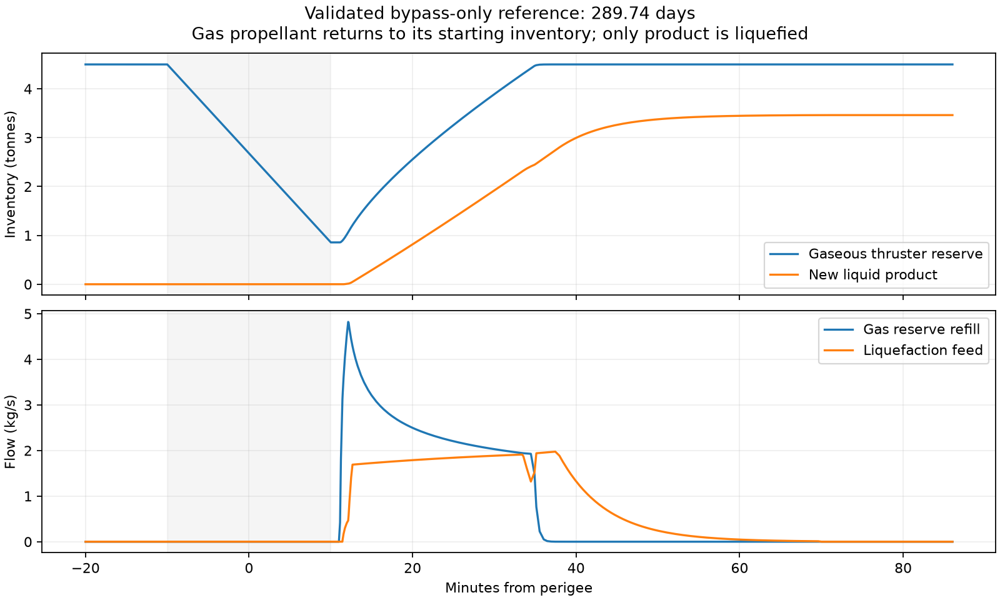

# Staged numerical results

This is the preserved zero-loss/full-loss staging study. The current active reference is the subsequent [1% resistance continuation](REDUCED_LOSS.md). This earlier study retained gaseous propellant bypass, finite cooling and all system budgets, but disabled rack losses in its accepted reference. The earlier joint lattice search remains experimental.

All payoffs below are **operating-orbit** dry-mass payoff. Circular-apogee export is not included. These are bounded local searches and declared coupled proposals, not proofs of a global optimum.

## Run status

| Study | Evaluations | Complete | Physically feasible | Numerical errors |
|---|---:|---:|---:|---:|
| bypass | 2 | 2 | 2 | 0 |
| bypass_search | 43 | 43 | 33 | 0 |
| bypass_reboost | 3 | 2 | 2 | 1 |
| bypass_verify | 2 | 2 | 2 | 0 |
| loss_fixed | 2 | 0 | 0 | 2 |
| loss_fixed_extended | 2 | 1 | 0 | 1 |
| loss_reboost | 3 | 2 | 1 | 1 |
| loss_verify | 2 | 1 | 1 | 1 |
| segmentation_probe | 2 | 1 | 1 | 1 |

## Physically feasible completed trajectories

Passing the physical checks for one trajectory is not the numerical release gate. Only the bypass reference has passed paired resolution checks; head-loss figures below remain provisional.

| Case | Dry mass, t | New liquid, kg/orbit | Payoff, days |
|---|---:|---:|---:|
| bypass: baseline_refined | 14315.5 | 3463.66 | 304.319 |
| bypass_search: r1_combined | 13625.6 | 3462.53 | 289.748 |
| bypass_reboost: isp_2600 | 19558.4 | 4627.97 | 311.173 |
| bypass_verify: check_refined | 13625.6 | 3462.58 | 289.744 |
| loss_reboost: isp_2400 | 17377.2 | 1060.84 | 1206.117 |
| loss_verify: check | 27054.1 | 2133.53 | 933.668 |
| segmentation_probe: bypass | 13625.6 | 3462.52 | 289.750 |

## Numerical release gates

- **bypass: PASS** — two_complete_trajectories: True, conservation_and_nonnegative_inventory: True, resolution_within_half_percent: True, two_feasible_cycles: True.
- **bypass_verify: PASS** — two_complete_trajectories: True, conservation_and_nonnegative_inventory: True, resolution_within_half_percent: True, two_feasible_cycles: True.
- **loss_fixed: NOT PASSED** — two_complete_trajectories: False.
- **loss_fixed_extended: NOT PASSED** — two_complete_trajectories: False.
- **loss_verify: NOT PASSED** — two_complete_trajectories: False.

## Original study disposition (superseded by reduced-loss continuation)

**Disposition:** promote the bypass-only configuration at **289.748 days** (tighter check **289.744 days**). Fixed radius is 1 mm and pitch is 10 mm; all five rack inventories and chamber allocations remain fixed. The active configuration is `configs/transient_active.json`.

Adding head loss at unchanged hardware did not refill the next-pass gas reserve: the completed tighter run left a **683 kg shortfall** and only **781 kg of new liquid**. That cycle has no accepted sustainable payoff. A separate coarse trajectory stagnated and remains unresolved.

Declared Isp/power-system proposals at fixed rack geometry found a feasible **2,400 s** case at **1,206 days**. A **4,000 s** case missed required thrust by **0.141%** near the battery reserve floor. Increasing only battery energy capacity by **3%** produced a feasible complete trajectory at **933.668 days**, but its tighter check stagnated: 10,000 additional RHS evaluations advanced only **0.00316 s** around 202 s after perigee. Consequently neither head-loss candidate is promoted or presented as a resolution-validated optimum. The 3,200 s proposal also stagnated.

An optional 60 s BDF-history restart probe preserved bypass payoff (**289.750 days**) but did not cure head-loss stagnation. It carries all state and ledgers forward unchanged and remains disabled in the active model. Exact local caching accelerates repeated hydraulic trial calculations without changing their answers.

**Pitch and radius optimization were deliberately not run:** the fixed-geometry head-loss stage failed its numerical release gate. The next task is to isolate the low-inventory hydraulic/control stiffness and obtain converged trajectories before expanding the design space. These failures do not establish whether dense racks are beneficial or harmful. No physical closure or conservation tolerances were relaxed to obtain an apparent result.

## Gas bypass through the cycle



The shaded interval is the prescribed burn. Gas is stored for the next pass; no future capture is borrowed to pay the current burn. Reproduce with `python -m atmo_scoops.transient.staged_plot`.

## What was optimized

The fixed-geometry coordinate search changes Isp, burn duration, solar area, battery energy and power ratings, bus rating, warm-store mass, warm-radiator area, and plant flow/electrical ratings. It polls ±12%, then ±6%, testing any combined favorable directions in an additional full trajectory. No installed capacity changes during a forward evaluation. Radius, pitch, rack inventories, chamber clear depths, orbit, material assumptions and gas-feed component capabilities remain fixed in that local search.

Separate declared Isp proposals scale energy and peak-power capacities before integration, and preserve the ratio of gas reserve to required propellant. These provide coupled feasible directions that an independent coordinate poll can miss; they are not an inner hardware-sizing loop.

The initial gas-bypass baseline passed at 304.321 days and 304.319 days under tighter integration. The wider 2,100 s Isp proposal timed out; it is explicitly unresolved rather than assigned an infeasible physical interpretation or a payoff.

## Reproduction

```sh
OPENBLAS_NUM_THREADS=1 .venv/bin/python -m atmo_scoops.transient.staged_search --action baseline
OPENBLAS_NUM_THREADS=1 .venv/bin/python -m atmo_scoops.transient.staged_search --action optimize --output results/transient/staged/bypass_search --rounds 2
OPENBLAS_NUM_THREADS=1 .venv/bin/python -m atmo_scoops.transient.staged_search --action reboost --output results/transient/staged/bypass_reboost --isps 1500 2100 2600 --workers 3
OPENBLAS_NUM_THREADS=1 .venv/bin/python -m atmo_scoops.transient.staged_search --action verify --config configs/transient_staged_bypass.json --output results/transient/staged/bypass_verify
OPENBLAS_NUM_THREADS=1 .venv/bin/python -m atmo_scoops.transient.staged_search --action reboost --config configs/transient_staged_loss_refined.json --output results/transient/staged/loss_reboost --isps 2400 3200 4000 --workers 3 --seconds 900
OPENBLAS_NUM_THREADS=1 .venv/bin/python -m atmo_scoops.transient.staged_search --action verify --config configs/transient_staged_loss_repaired.json --output results/transient/staged/loss_verify --workers 2 --seconds 900
.venv/bin/python -m atmo_scoops.transient.staged_report
```

Each result directory stores exact candidate input files and compressed histories for completed trajectories. Existing evaluations are cached: use a new output directory to repeat a run, especially after changing equations or numerical settings. Manually stopped stagnating trajectories have explicit unresolved records and no fabricated histories. `configs/transient_active.json` names the promoted reference; default `python -m atmo_scoops.transient` now reads it.

The [stage plan](README.md) defines what remains fixed and the pitch/radius release order. The [gas-feed dossier](../../modeling/propellant_feed/GAS_RESERVE.md) gives the propellant path, hardware and energy accounting.
