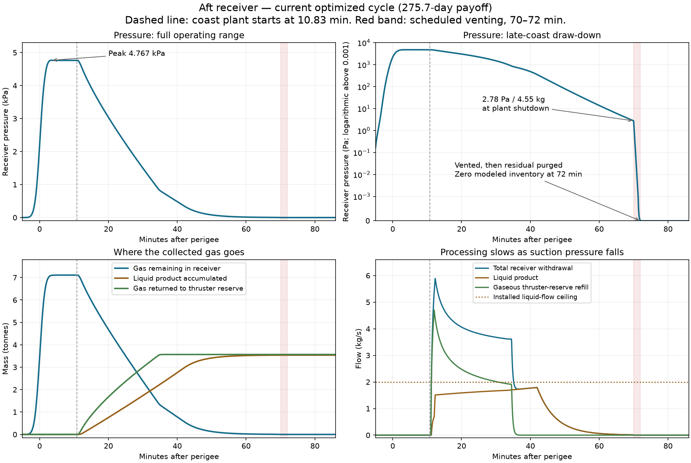

# Aft receiver coast draw-down: current optimized cycle

This is a readout of the committed corrected-spacing trajectory, not a new
simulation, optimization or model change. Source:
`results/transient/staggered/thermal_equivalence/selected_validation/check_refined.json.gz`.



The receiver is pumped down during coast. It does not itself become a cryogenic
tank: gas is withdrawn through the coast compressor train and split between
liquid production and gaseous thruster-reserve refill. The separate product tanks
hold liquid. The receiver gas cools from roughly 357 K to 324 K while processing;
the large pressure reduction is predominantly inventory withdrawal, not cooling.

| Minutes after perigee | Receiver Pa | Gas remaining kg | Liquid accumulated kg |
|---:|---:|---:|---:|
| 10.83, processing starts | 4,763.33 | 7,110.21 | 0 |
| 20 | 3,037.39 | 4,681.72 | 754.79 |
| 30 | 1,498.18 | 2,380.86 | 1,732.42 |
| 40 | 482.78 | 783.85 | 2,758.83 |
| 50 | 79.79 | 130.67 | 3,412.01 |
| 60 | 13.83 | 22.69 | 3,519.99 |
| 70, processing stops | 2.78 | 4.55 | 3,538.13 |
| 72, vent/release complete | 0 modeled | 0 modeled | 3,538.13 |

The receiver inventory at processing start closes as:

**7,110.21 kg = 3,538.13 kg liquid + 3,567.53 kg gaseous reserve refill +
4.55 kg remaining at shutdown.**

Thus 99.936% is removed into useful product or working propellant before the
scheduled vent. The pressure reaches its overall peak of 4,766.83 Pa at about
3.45 minutes; the small decline before processing begins is thermal equilibration.

## Residual pressure and the next pass

The coast plant operates from 650 to 4,200 s after perigee (10.83–70 min).
It stops on schedule at 2.78 Pa, before reaching the 0.1 Pa suction cutoff.
From 70 to 72 minutes the existing model vents at `mass / 10 s`. At the rack
release event it removes the remaining inventory explicitly and charges it to
lost gas. Immediately before that final purge, pressure is about 1.70e-5 Pa and
inventory is 2.80e-5 kg. All of the approximately 4.55 kg left at shutdown is lost,
not credited as liquid. A real valve/conductance model does not underlie that
10 s vent time constant.

The main receiver consequently returns to an evacuated starting state for the
next cycle; exact zero is a purge bookkeeping convention, not demonstrated
perfect vacuum. The separate thruster reserve remains pressurized and refilled.
The trajectory runs from 20 minutes before perigee to 86.03 minutes afterward,
one 106.03-minute orbit. Periodic closure joins that endpoint to the next
pre-entry state. No unmodeled gas residual is carried between cycles.

## What the liquefaction model actually assumes

- Three coast compressor blocks bring receiver gas toward a **100 kPa feed**;
  they use real-gas compression work, 75% isentropic efficiency and 95% motor
  efficiency, with finite flow, head and power. Installed coast motor capacity
  is 21.68 MW. Intercooling is reduced to a warm-loop-relative temperature cap
  and an aggregate precooler allowance, not individually resolved exchangers.
- Installed refrigerator electricity is **14.64 MW**; liquid-flow ceiling is
  **1.997 kg/s**. Actual peak liquid flow is **1.791 kg/s**. Flow also depends on
  available bus power, compressor capacity and the gaseous-reserve branch,
  which receives priority.
- Species caloric data, boiling points, latent heats and liquid densities come
  from the property model. Electrical duty integrates sensible cooling plus
  latent heat at **15% of local Carnot COP**, using a 5 K cold-side approach
  and a rejection temperature 20 K above the warm loop.
- Finite precooler UA is 200 kW/K with a 20 K allowance; condenser UA is
  250 kW/K with a 5 K allowance. Separation adds a prescribed 250 kJ/kg.
  Heat and electrical costs feed the cycle's thermal/power balances.
- The saved `plant_MJ` ledger is **34.97 GJ**, or **2.745 kWh/kg liquid**.
  This is the product branch including its coast compression, separation and
  rack-loss costs, not refrigerator electricity alone. Reserve-refill work,
  compressor spin-up and other system overhead are outside this particular ledger.

These are finite, thermodynamically motivated study assumptions. They are not a
qualified liquefaction plant design. Missing details include the selected cycle,
recuperators, actual mixture separation/phase equilibrium, cold-hardware thermal
inventory and startup, part-load maps, and validated installed mass/volume.
The model condenses species with an aggregate duty rather than resolving the
full mixed-air process. It therefore cannot yet establish the optimum plant or
its actual repeated-cycle performance.

As an order-of-magnitude check, the manufacturer's
[StirLIN-1/2 specification](https://stirlingcryogenics.com/wp-content/uploads/2023/06/DS-StirLIN-1-ext-and-StirLIN-2-ENG-28-06-2023-1.pdf)
lists 23 kW for 11.5 L/h and 34 kW for 23 L/h at its 1 bar(g) nominal condition:
2.00 and 1.48 kWh per nominal litre. The optional chiller is excluded, and usable
litres vary with production pressure. These are much smaller terrestrial
nitrogen-only plants, not direct calibrations for mixed-air, low-pressure orbital
processing. They support the broad scale of the energy allowance, not the
spacecraft plant's capacity, mass or startup assumptions.

## Reproduction

```sh
PYTHONPATH=. .venv/bin/python investigations/staggered_stage_a/plot_receiver_coast.py
```

The script generates PNG/SVG and a JSON numerical readout and checks the receiver
mass accounting. It does not call the forward solver. Model improvements remain
on hold.
