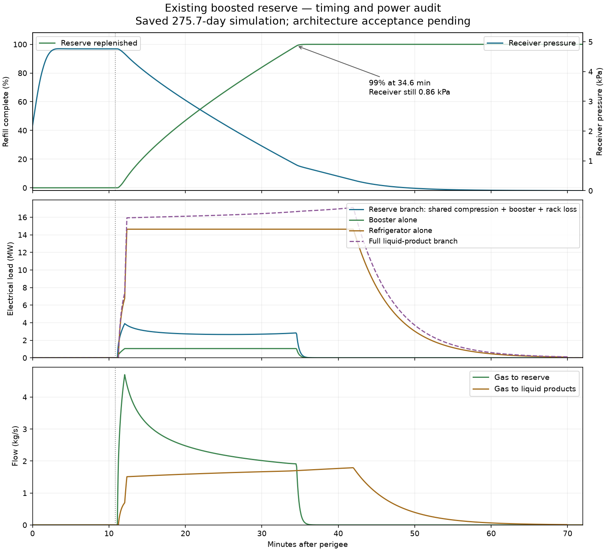

# Boosted thruster reserve: timing and power audit

**Rejected architecture — v1.0.1-rejected-boosted.**

See the [frozen archive](../../docs/design_archive/v1.0.1_rejected_boosted/README.md). This extracts the saved
275.7-day optimized cycle. It does not introduce the booster, resize it, rerun the
forward model or establish superiority over the agreed valve-connected reserve.



## Timing and source pressure

Coast processing is enabled at **10.833 minutes after perigee**. Refilling the
3,567.535 kg consumed by propulsion reaches these milestones:

| Refill complete | Minutes after perigee | Minutes after plant enable | Main receiver Pa | Reserve bar absolute |
|---:|---:|---:|---:|---:|
| 50% | 20.750 | 9.916 | 2,913 | 6.59 |
| 90% | 31.791 | 20.958 | 1,244 | 9.67 |
| 99% | 34.558 | 23.725 | 860 | 10.32 |
| 99.9% | 35.328 | 24.495 | 791 | 10.32 |
| 99.99% | 36.094 | 25.260 | 739 | 10.24 |

Meaningful refill occupies about 24–25 minutes early in the coast. It does not
rely on the receiver's few-pascal late tail. The refill branch receives priority
over liquid production, subject to its own limits; this behavior is an explicit
control assumption. At one quarter of the 106.03-minute orbit after perigee
(26.51 min), only **71.9%** is refilled. Thus it does not meet a strict demand to
finish by that epoch. The 25-minute refill is approximately 43% of the scheduled
59.17-minute processing window, not its first quarter.

The model keeps the refill rotor enabled until plant shutdown at 70 minutes,
although flow and compression load become negligible after refill. There is no
independent realistic standby/windage loss model for that booster. These times
therefore describe useful pumping, not a demonstrated physical stop command.
The exponential taper follows the existing 20-second target-inventory controller.

## Which compressor sees which pressure?

Main receiver → shared three-block coast train → nominal **1 bar** feed →
additional reserve booster → gas reserve (15 bar structural rating).

The shared coast train experiences falling receiver suction pressure. The extra
booster's suction is nominally 1 bar, not the receiver's pressure. Its upstream
supply is still finite and pressure-limited. At 99% refill the shared train is
working from 860 Pa, while the reserve is near 10.3 bar. By the few-pascal part
of receiver pump-down, virtually all withdrawal goes to the liquid-product branch.

## Power and energy accounting

| Load | Peak electrical processing load MW | Processing energy MWh/cycle |
|---|---:|---:|
| Extra reserve booster only | 1.053 | 0.411 |
| Shared coast compression allocated to reserve gas | 2.842 | 0.703 |
| Full reserve branch, including rack loss | 3.894 | 1.113 |
| Refrigerator only | 14.638 | 8.586 |
| Full liquid-product branch | 17.104 | 9.713 |
| Four dive compressors plus rack-loss surcharge | 31.024 | 1.721 |
| Thrusters | 759.129 | 260.248 |

Rows are **nested**, not additive: the full reserve branch includes the first
two rows; the product branch includes its refrigerator. Compressor figures
include motor inefficiency but exclude startup/idle loads. The main simulation
accounts for rotor spin energy separately; the reserve booster has no separate
idle-loss term. Product branch includes its share of coast compression,
refrigeration, prescribed separation and rack-loss electricity. Numerical
integration of reconstructed product power matches the saved plant-energy ledger
within the script's 0.1% check; reserve branch power matches saved samples within
3.1e-9 MW.

Installed ratings differ from these actual loads:

- Extra booster motor: **5 MW**, fixed input, not an optimized result.
- Dive compressor motors: **30.936, 10.119, 7.953 and 13.005 MW**, 62.012 MW total.
- Shared coast compressor motors: **21.681 MW** total.
- Refrigerator: **14.638 MW** electrical capacity.

The booster never approaches its 5 MW motor rating because its fixed cooling
allowance limits transferred compression heat to `50 kW/K × 20 K = 1 MW`.
At motor efficiency 0.95 this permits 1.053 MW electrical compression power.
The assumed UA/temperature difference needs engineering validation, but its
constraint is explicit. The charged motor/hardware size has not been optimized
against that cooling bottleneck.

## Interpretation and illustration boundary

Spreading compression over coast reduces required instantaneous power and can
use sunlight directly; it does not inherently reduce total compression work.
Pumping later from lower receiver pressure can increase work. Here the reserve
refill is early enough that the near-vacuum tail does not control it.

Reserve-branch compression is only **0.43% of thruster energy**, but approximately
**65% of dive-compression processing energy**. It is small in the whole-craft
energy budget without being negligible in the compression subsystem. Reporting
both makes the design choice visible instead of hiding it under propulsion.

The booster was fixed in the inherited model, **not introduced or selected by
this optimizer**. Its modeled compressor/motor mass is 5.35 t; the complete
reserve system is 51.91 t including tanks/support, booster, heat exchanger and
feed hardware. Any processing-only or mothership-supported illustration should
assign those reserve-specific items to propulsion support, while splitting
shared coast-compressor duties explicitly. Their removal is a different mission
boundary and is not credited in the integrated 275.7-day payoff.

The data support the timing feasibility of this modeled architecture, conditional
on its component assumptions. They do not prove it beats the valve-connected
125 m compartment. The owner has rejected the boosted reserve; this audit is retained as evidence.

## Reproduce

```sh
PYTHONPATH=. .venv/bin/python investigations/staggered_stage_a/reserve_refill.py
```

The script reconstructs work from saved pressure/temperature/species states using
the existing property model, checks it against saved branch power and produces
the PNG/SVG and numerical JSON. No forward cycle is integrated.
