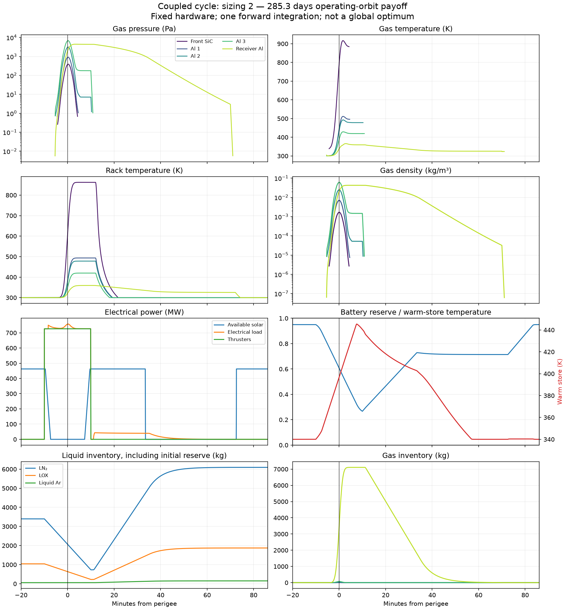
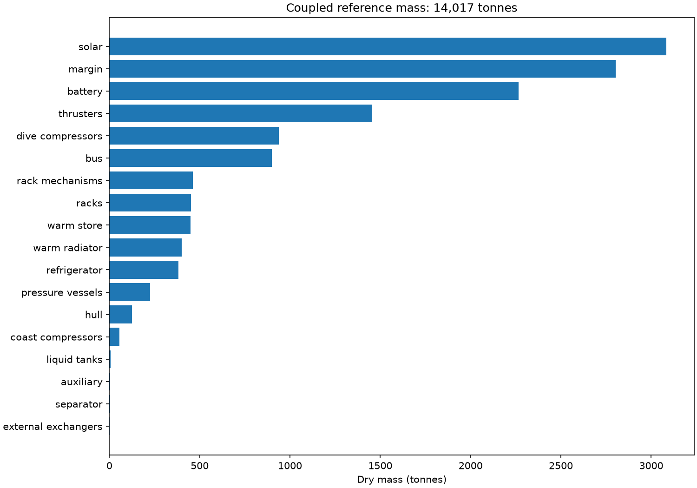

# Coupled-cycle numerical results

Generated with `python -m atmo_scoops.transient.report`. Payoff is in the operating orbit; circular-apogee delivery is not included. Feasible means the declared reduced-model constraints pass, not that hardware is qualified.

| Case | Isp (s) | Burn (min) | Dry mass (t) | Net liquid/orbit (kg) | Payoff (days) | Accepted? |
|---|---:|---:|---:|---:|---:|---|
| Reference | 1766 | 20.00 | 15,473 | 3,593.9 | 317.02 | True |
| search 0 | 1800 | 16.67 | 16,037 | 3,730.8 | 316.52 | True |
| search 1 | 1800 | 23.33 | 15,548 | 3,581.6 | 319.62 | True |
| search 2 | 2300 | 16.67 | 19,526 | 4,460.5 | 322.32 | True |
| search 3 | 2300 | 23.33 | 18,900 | 4,343.9 | 320.36 | True |
| search 4 | 2800 | 16.67 | 23,014 | 4,929.7 | 343.74 | True |
| search 5 | 2800 | 23.33 | 22,252 | 4,833.9 | 338.95 | True |
| sizing 0 | 1766 | 20.00 | 14,017 | 3,593.7 | 287.20 | True |
| sizing 1 | 1766 | 20.00 | 14,454 | 3,593.5 | 296.16 | True |
| sizing 2 | 1766 | 20.00 | 14,017 | 3,617.4 | 285.32 | True |

## Best tested case: sizing 2

**285.32 days**, 14,017.4 t dry, 3,617.4 kg net liquid per 106.03-minute orbit. This is the best tested candidate, not a converged all-variable optimum.

Admission 7,112.19 kg; gross liquid 7,104.98 kg; propulsion 3,487.62 kg; total leaked/vented 7.21 kg. Initial liquid reserve is restored before surplus counts.

Physical chamber depths, front to receiver: **5.42 m, 3.40 m, 3.18 m, 3.20 m, 239.11 m**. Equipment bay 62.69 m; total 317 m.

Solar 1,850,000 m²; warm radiator 40,000 m² physical / 80,000 m² emitting; metal-rack footprint 460,872 m². Motion at 10 m/s is included.

Battery 340.0 MWh; bus 900.0 MW; thrust 726.4 MW. Finite-burn impulse penalty 1.07888.

| Component | Dry mass (t) |
|---|---:|
| solar | 3,083.33 |
| margin | 2,803.49 |
| battery | 2,266.67 |
| thrusters | 1,452.76 |
| dive compressors | 937.75 |
| bus | 900.00 |
| rack mechanisms | 460.87 |
| racks | 452.31 |
| warm store | 450.00 |
| warm radiator | 400.00 |
| refrigerator | 383.30 |
| pressure vessels | 226.39 |
| hull | 126.28 |
| coast compressors | 56.04 |
| liquid tanks | 6.00 |
| auxiliary | 5.00 |
| separator | 5.00 |
| external exchangers | 2.25 |

## Numerical checks

Maximum species-ledger error 2.91e-11 kg; energy-ledger error 3.26e-09 MJ. One forward integration.

Largest rack endpoint enthalpy discrepancy 0.385 J/kg; battery discrepancy -2.4 MJ; warm store 0.729 MJ.

Independent HEOS audit: maximum |Z−1| 1.42e-05; compressor-work difference 2.68e-10 relative. Maximum checked compressor discharge temperature 1302.2 K.

Unresolved exospheric incident tail 0.1369 kg/pass (momentum still charged).

Inputs: `results/transient/best_config.json`; complete trajectory: `results/transient/best.json`. Read the [implementation limits](../../modeling/primary/TRANSIENT_IMPLEMENTATION.md) before interpreting these engineering estimates.
