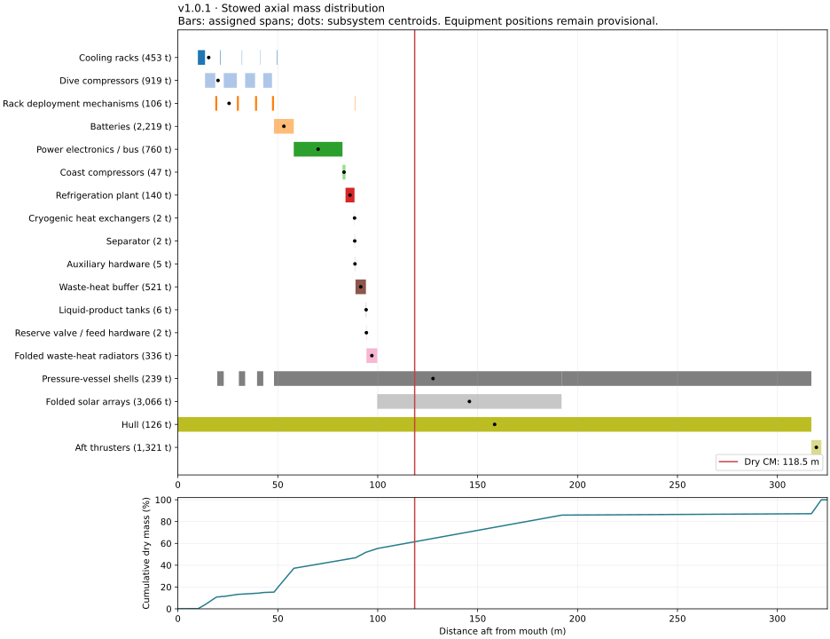

# v1.0 axial tour and stability screen

This is a **subjective but explicit placement of the existing component masses**,
not a new optimized vehicle or a collision-free mechanical design. The mass
source is verified plate reference case 72. Nothing here changes the 278.02-day
cycle result. The complete [axial mass table](MASS_REGISTER.md) assigns every
mass entry an interval and centroid; [results.json](results.json) preserves the
unrounded arithmetic, package volumes, loaded-state estimates and orbit screen.



## Tour from mouth to tail

Take x=0 at the mouth and positive x toward the tail. Overall length is 317 m,
with a 30 m bore and 31.7 m outer diameter. Positions below are rounded; use the
register for precise, potentially disjoint spans.

- **0–0.90 m: first gas/cooler volume.** The 383 t SiC cooler occupies the front
  volume. This is the numerical model's compact front geometry, not evidence
  that a shock/diffuser and protected leading edge fit into 0.90 m. That inlet
  geometry remains an important refinement for the mechanical design.
- **0.90–12.90 m: first equipment bay.** Compressor 1 (657 t), most of the rack
  mechanisms and the 2,228 t battery inventory are forward. Batteries occupy
  x≈0.90–5.89 m in a different radial sector from the compressor machinery.
  Power electronics start at x≈5.89 m. This creates short high-power connections
  to the largest compressor; the later compressors still require cable runs.
- **12.90–15.95 m: second gas volume and Al cooler.** Its pressure vessel surrounds
  the cooler; gas transitions between volumes through compressor ducting.
- **15.95–25.95 m: second equipment bay.** Compressor 2 (192 t), its mechanisms,
  continuing bus equipment and folded solar cassettes.
- **25.95–28.98 m: third gas volume; 28.98–38.98 m: third equipment bay.** Another
  Al cooler feeds the 46 t third compressor. Part of the thruster installation
  starts here, in symmetric side pods with aft-directed exhaust. This requires
  plume clearance outside the long receiver; it is a proposed placement, not a
  qualified plume or external-drag design.
- **38.98–42.01 m: fourth gas volume; 42.01–69.63 m: fourth equipment bay.** The
  26 t fourth compressor shares axial space with the rest of the thrusters,
  propellant reserve, warm buffer, coast compressors, refrigeration equipment,
  folded arrays/radiators and small liquid tanks. These are parallel radial
  sectors, not one serial pipe filling the bore. The register gives each span.
- **69.63–317 m: large aft receiver.** This is the long, low-mass gas volume:
  about 173,793 m³ of free gas volume and 132 t of modeled vessel mass. Its Al
  cooler is near its forward end, x≈71.13–71.17 m, close to the coast-gas pickup
  and withdrawal mechanism. Product liquid tanks stay near the front of this
  zone, around x≈66–70 m, because their volume is small; it is the *gas receiver*
  that extends far aft.
- **Full length:** hull/thermal shell mass is distributed uniformly over
  x=0–317 m. An aft fin/skirt station near x=300 m is a stability concept; no
  separate fin sizing/mass has been established by this ledger.

**Solar position:** folded cassettes occupy available dorsal/ventral sectors in
all four equipment bays, x≈0.90–12.90, 15.95–25.95, 28.98–38.98 and 42.01–69.63 m.
Their mass is not uniform along those spans: the script apportions volume to
remaining local space after fixed machinery. They deploy outward, with separate
corridors from lateral warm radiators and cooler hatches. Most of the receiver's
length is free of these heavy folded packages.

## What the placement checks, and what it does not

The four bay lengths sum exactly to the model's **59.62 m** equipment allowance;
the five chamber depths and those bays sum to 317 m. Each component mass is
counted once, and each stored equipment volume is preserved. Compressor bank
lengths fit within their assigned bays. Other small packages receive explicit
minimum lengths (for example 4 m for liquid tanks and the refrigerator), rather
than mistaking a few cubic metres for a centimetre-thick full-bore tank.

The package-to-cross-section check reaches **88.7% locally**, although the
aggregate equipment fill is the existing 70%. That leaves little local routing
space in the busiest slice. It checks an area/volume budget, not whether circular
tanks, annular compressors, hatches, ducts, supports and cables physically nest.
Some package spans overlap deliberately in different radial sectors. The
uniform-in-span mass assumption for each entry is approximate. Moving or folding
these structures must later be checked in three dimensions.

## Center of mass

Use x_CM = sum(m_i x_i) / sum(m_i), with each assigned interval's midpoint as its
centroid. Multiple intervals are weighted by their allocated mass. Vessel heads
and barrels are symmetric about their assigned chamber midpoint.

**Dry CM = 32.76 m**, or **10.33% of the length**, for **13,249.97 t dry**.
The 25% margin is distributed proportionally to the physical component masses;
it is not counted as fictional nose ballast. It therefore leaves this CM
unchanged. The gas/liquid histories add only tonnes to a 13,250 t vehicle: the
stowed-coordinate CM remains near **32.8 m**, moving aft by less than 0.1 m during
collection. The register includes entry, perigee, cutoff and end-processing states.
Coast values use stowed axial coordinates; deployment-induced CM motion is not
modeled. Radially symmetric deployment would not move lateral CM, but that is
an assumption requiring mechanism design.

The dominant uncertainty is placement, not captured gas. Moving the solar mass
20 m aft moves the whole dry CM about **4.64 m** if contingency stays where it
was. Distributing all contingency uniformly along the hull instead of in
proportion to equipment puts CM near **57.9 m**. Putting all contingency at
x=300 m puts it near **86.2 m**. These are transparent sensitivity cases, not
alternative mass predictions. Publish “about 33 m,” not centimetre-level accuracy.

## Small stability assessment

For nose-first flight at small angle of attack, the normal aerodynamic force
should act behind the CM to provide a restoring moment. NASA's
[rocket stability explanation](https://www1.grc.nasa.gov/beginners-guide-to-aeronautics/conditions-for-rocket-stability/)
establishes this basic sign criterion and why aft fins/forward mass help. It does
not provide a hypersonic scoop's pressure distribution or guarantee damping.

With x increasing aft, define illustrative static margin S=(x_CP−x_CM)/D,
using D=31.7 m. Thus x_CP must exceed about **33 m** for positive static margin.
A **one-diameter illustrative margin** would put CP beyond **64.5 m**; this is
not a universal requirement or a demonstrated CP value. The 247 m receiver and
a tail station near 300 m leave a long potential restoring lever arm.

A two-force illustration makes that leverage concrete. If an unknown forebody
normal-force slope acts at x=5 m and an aft-fin slope acts at x=300 m, stability
requires C_Nalpha,tail / C_Nalpha,fore > (x_CM−5)/(300−x_CM), about **0.104**.
A one-diameter margin raises that ratio to about **0.253**. These are force-slope
ratios, **not fin-area fractions**: local flow, shielding, shocks and Mach number
set their relationship to geometry. No aerodynamic coefficients were calculated.

Assessment: **promising mass placement for a statically stable arrangement**, but
not a stability result. Forebody/inlet normal-force moments could dominate;
near-zero-angle pitching-moment derivatives and damping need investigation.
Tail loads, heating, structural flexibility, thrust alignment and asymmetric
capture/deployment also matter. Do not infer CP from the geometric midpoint or
from axial drag force alone. The missing fin/skirt and inlet engineering masses
must eventually be entered at their actual locations.

## Reproduction

```sh
MPLCONFIGDIR=.mplconfig PYTHONPATH=. .venv/bin/python investigations/v1_layout/build.py
```

This checks exact mass-category sums, total length, bank lengths and package
volume allocation, then writes the register and publication figures. It does not
change or rerun the optimizer. [Sun-synchronous target](SUN_SYNCHRONOUS.md) is a
separate orbital assumption screen.
