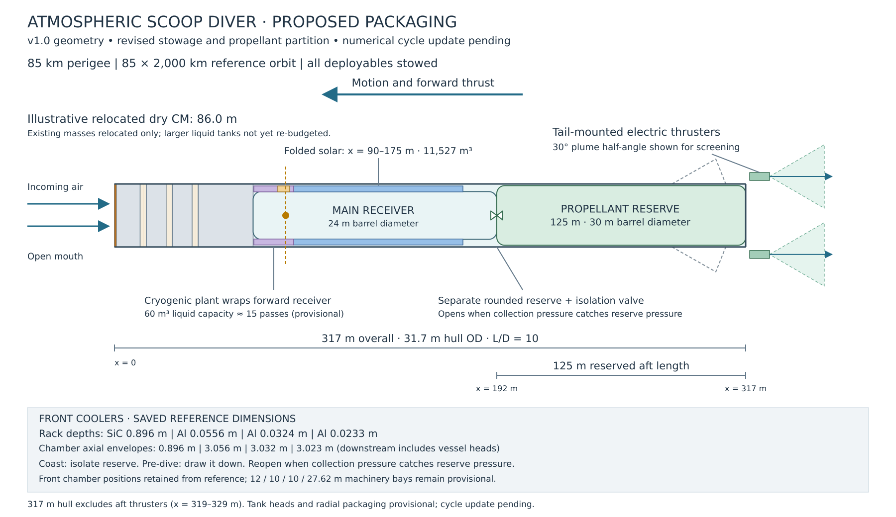
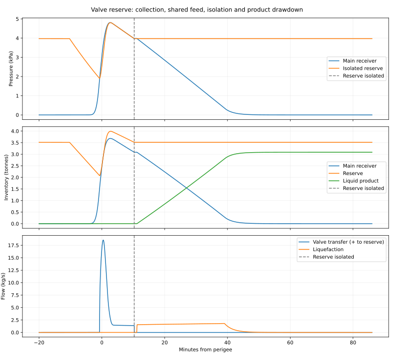

# v1.0.1 valve-connected reserve

**306.399 days operating-orbit mass payoff**, after a successful 46-variable constrained COBYLA solve and tighter-resolution validation. This is a local numerical result within the documented bounds, not a global-optimum or hardware qualification claim. Circular-apogee delivery and return are not included.

The final 125 m of the hull holds the valve-only reserve. It feeds approach thrust, connects at pressure catch-up, then isolates before main-receiver coast liquefaction. No reserve refill compressor, boosted tank or reserve thermal-reset device is present.

| Quantity | Selected result |
|---|---:|
| Dry mass | 12,840.22 t |
| New liquid per orbit | 3,085.886 kg |
| Admitted gas | 6,188.807 kg |
| Propellant | 3,101.412 kg |
| Perigee / apogee | 85.804456 / 2,000 km |
| Isp / total burn duration | 1811.98 s / 1235.14 s |
| Main receiver / reserve length | 143.903 / 125 m |





## Racks

Depth is metal core flow depth, excluding row clearances and vessel heads. Physical spacing and effective thermal spacing are distinct in the adopted staggered-plate approximation. Pressure-drop ratios below are evaluated at perigee; hydraulic losses are charged as compressor energy, not coupled into the pressure solution.

| Rack | Material | Metal (t) | Core depth (m) | Thickness (mm) | Physical gap (mm) | Initial / final K | Peak K | Δp / gas pressure at perigee |
|---|---|---:|---:|---:|---:|---:|---:|---:|
| 1 | sic | 381.298 | 3.5665 | 1.432 | 28.956 | 300.03 / 300.03 | 804.85 | 21.496% |
| 2 | aluminum | 26.632 | 0.2236 | 0.989 | 14.865 | 300.10 / 300.10 | 457.28 | 0.430% |
| 3 | aluminum | 12.914 | 0.1146 | 1.047 | 16.688 | 300.05 / 300.05 | 422.91 | 0.017% |
| 4 | aluminum | 11.789 | 0.0957 | 1.379 | 19.996 | 300.02 / 300.02 | 388.88 | 0.002% |
| 5 | aluminum | 20.559 | 0.2194 | 1.345 | 19.079 | 302.49 / 302.49 | 339.50 | 0.000% |

## Mass accounting

| Component | Tonnes |
|---|---:|
| racks | 453.19 |
| rack mechanisms | 106.32 |
| dive compressors | 919.11 |
| coast compressors | 46.90 |
| refrigerator | 140.27 |
| external exchangers | 2.25 |
| separator | 2.50 |
| solar | 3,066.03 |
| battery | 2,218.52 |
| bus | 760.00 |
| thrusters | 1,321.43 |
| warm store | 520.95 |
| warm radiator | 336.18 |
| liquid tanks | 6.00 |
| auxiliary | 5.00 |
| gas reserve system | 2.50 |
| pressure vessels | 238.74 |
| hull | 126.28 |
| margin | 2,568.04 |

## Numerical evidence

COBYLA returned success: trust-region radius reached its lower bound (0.001 in normalized coordinates), 284 objective evaluations, max constraint violation 0. The log contains 325 evaluations including precomputed initialization probes; those are not 325 optimizer iterations. Positive constraint scaling improves conditioning without relaxing the physical checks. Search-only closure buffers provide resolution headroom.

The search result was 306.400559398 days; the independent replay at rtol 5e-6 and maximum step 5 s gives 306.398724113 days. Reserve total-mass mismatch is -0.010006 kg and energy mismatch 0.124474 MJ. All physical constraints pass. Receiver peak is within 50 Pa of its fixed 4,766.83 Pa target. Capture exceeds 99.9%, and all commanded thrust is delivered.

The reserve valve opens at −43.616 s, about 1.899 kPa. After isolation, its mass and temperature remain constant through coast while the main receiver is processed. Valve-specific checks verify species/energy conservation and absence of hidden booster power or mass. The full suite passed 162 tests; the audit passed eight cycle resolution/conservation cases and orbital invariant checks.

The smaller-power alternate seed was rejected: solar area ×0.8 and battery energy ×0.95 left a 60,189.7 MJ (16.719 MWh) battery closure deficit. Its 279.5-day diagnostic is not feasible. The initial restored feasible baseline was 309.0375 days.

## Decisions and limits

- Reserve length is fixed at 125 m; perigee and starting reserve inventory/temperature are outer solve coordinates. Every candidate is integrated once; closure is enforced by the optimizer.
- Receiver radius is reduced for folded packages, all before the reserve. External thrusters do not consume internal package volume. Full-bore reserve head volume and pressure-shell mass are included.
- Valve area 4 m² and feed opening 1 m² are fixed assumptions. Feed discharge is modeled to 100 Pa. Actual low-pressure thruster feed acceptance needs qualification; no unmodeled pressure booster is credited.
- The 4.77 kPa receiver filling target, 2,000 km apogee, 317 m hull and material/heat-transfer capabilities remain fixed. No updated CM or leading-edge lifetime is established.

[Equations and assumptions](../../modeling/propellant_feed/VALVE_RESERVE.md) · [46 coordinates and constraints](../../modeling/optimization/VALVE_COORDINATES.md) · [Rejected boosted candidate](../../docs/design_archive/v1.0.1_rejected_boosted/README.md)

## Reproduction

```sh
PYTHONPATH=. .venv/bin/python investigations/valve_reserve/run_case.py configs/transient_v1_0_1_valve.json /tmp/valve.json.gz
PYTHONPATH=. .venv/bin/python investigations/valve_reserve/verify.py /tmp/valve.json.gz
PYTHONPATH=. OPENBLAS_NUM_THREADS=1 .venv/bin/python investigations/valve_reserve/cobyla_scaled.py --manifest results/transient/valve_restore/optimization/manifest.json --output /tmp/valve_search --workers 4 --maxiter 300 --rhobeg .03 --tol .001
```

Exact selected and refined histories, inputs, solver manifests, termination, trial metrics and test logs are retained under `results/transient/valve_restore/`. Redundant trial histories were removed; each trial JSON preserves its inputs for replay. The default scale generator reads the selected refined trajectory.
