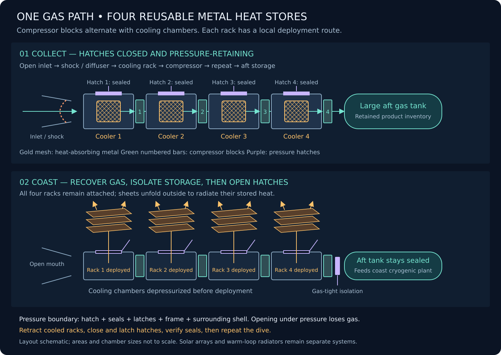

# Chamber, rack and deployment interfaces

The collection train alternates **cooling chamber → compressor block → cooling
chamber → compressor block**, ending in a large aft gas-storage volume. Three
or four compressor blocks are the starting architecture; the illustration shows
four. A block may contain multiple blade rows or parallel machines. Its flow
area, speed and pressure ratio can differ from those of the adjacent blocks.

This expands the gas-conditioning part of the overall condensation system.
These metal racks cool gas; they need not condense it. Final cryogenic
condensation or deposition, refrigeration and product handling remain a
separate coast process whose pressure and phase path is still to be selected.

Each chamber contains its own metal lattice/sheet rack. The first absorbs heat
from the shock/diffuser stream; subsequent racks remove heat added by the
preceding compressor before gas reaches the next block. Rack mass, lattice
geometry, flow area and chamber depth are independently designed where they
represent distinct physical choices. Gas outlet temperature follows finite
heat transfer and the rack's changing temperature; it is not a freely imposed
isothermal endpoint. Pressure loss and stored heat must be charged to each rack.

**The same metal that absorbs heat in the dive unfolds outside the spacecraft
to radiate during coast.** The schematic gives each rack a local side hatch and
attached deployment mechanism, so it does not have to pass through downstream
compressors. This is one candidate routing arrangement; hatch count and side,
sheet geometry, booms and clearances remain layout variables. Each rack needs
an unobstructed route and enough separation to expose its radiating faces
without blocking other racks, solar arrays or warm-loop radiators. The front
rack could alternatively deploy through the existing open mouth.

**Deployment hatches are pressure-vessel closures.** They remain closed and
latched throughout atmospheric collection and any subsequent pressurized
recovery. Their panels, frames, seals, latches and surrounding shell must carry
the chamber's maximum credible pressure differential, thermal distortion and
cyclic loads. Pressure load scales as `force = differential pressure × hatch
area`; pressure relief and pump transients belong in the design load case.
These are separate from the omitted inlet-mouth closure.

Opening is restricted to coast **after** the relevant chamber is isolated and
depressurized. First transfer recoverable interstage gas into aft storage or a
recovery system, isolate the stored product, then equalize the deployment
chamber with space. Any unrecovered gas is an explicit product loss. Compressor
rows alone are not assumed to provide gas-tight isolation. Open the hatch only
after its differential pressure is sufficiently small; extend and unfurl the
attached rack. The aft storage vessel stays sealed while cooling chambers are
open. Hatches do not open directly into retained pressurized product.

After radiative cooldown, retract each rack into its operating position, close
and latch its hatch, and verify the pressure boundary before the next dive.
Rack recovery/deployment and hatch operations consume coast time and require
power, hardware mass and repeat-cycle life allowances. An intermediate chamber
may deploy later than another if gas recovery takes longer. The drawings do not
assign a deployment time or qualified hatch mass.

This arrangement moves some compression heat into directly radiating metal;
it does not eliminate the warm loop or the refrigerator's heat-rejection duty.
The primary numerical model still uses a lumped front rack and approximate
compression duties. Multiple finite-capacity racks, interstage states,
pressure hatches and their recovery sequence are **specified here but not yet
implemented or included in reported payoff**. The
[compressor calculation dossier](README.md)
and [refinement plan](../../local-issue-drafts/specifications/modeling/compressor/MODEL_PLAN.md) define
the next model work.

