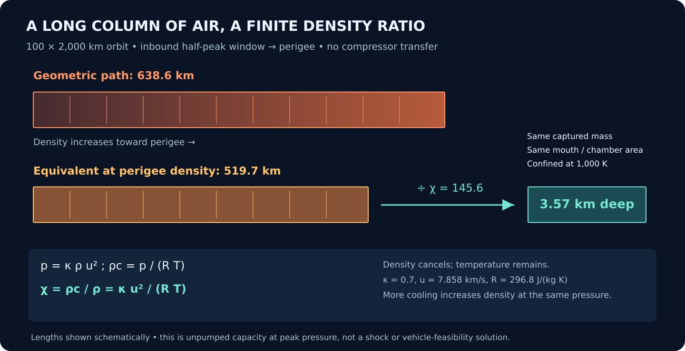

# Atmospheric column, confinement and the need for compression

## The question

How can a spacecraft fly through hundreds of kilometres of atmosphere and keep
that air in a chamber only hundreds of metres deep? Before solving shocks or
choosing a compressor, conservation of mass gives a useful scale.

For the **100 × 2,000 km** comparison orbit, collection from half the peak ram
pressure inbound to perigee lasts **81.3 s**. The atmosphere-relative
travel distance is **638.6 km**. Because density rises
through that interval, the collected mass is equivalent to a column only
**519.7 km long at perigee density**. That approximately
500 km quantity is an atmospheric-column length, not a spacecraft dimension.

The column length and the required spacecraft depth are different quantities.
Under the explicit cooled, unmixed inputs below, the unpumped equal-area chamber
is **3.57 km** deep. Added coolant gas and
different temperature/pressure assumptions can make that required depth much
larger. The derivation below relates all of these quantities.



## 1. Specify the compression ratio we actually need

Dynamic pressure is `q = ½ rho_inf u²`. It is a pressure scale, not by definition
the pressure available inside this inlet. Introduce a recovery/control factor:

    p_c = C_q q = kappa rho_inf u²,       C_q = 2 kappa

The code's `inlet_pressure_fraction` multiplies **rho u²**, not q. Thus kappa=0.7
means p_c=1.4q. This convention does not assert that the shock provides that
pressure: inlet flow analysis must determine the admissible value. See
[NASA's dynamic-pressure definition](https://www1.grc.nasa.gov/beginners-guide-to-aeronautics/dynamic-pressure/).

Using `p_c = rho_c R_c T_c`, the **density compression ratio** is

    chi = rho_c / rho_inf
        = kappa u² / (R_c T_c)
        = C_q u² / (2 R_c T_c).

The density cancels. Units also cancel: both u² and R_c T_c have units m²/s².
This is the ratio that shrinks an upstream volume of the same mass. A pressure
ratio alone is insufficient when the gas changes temperature. For example,
`p_c/p_inf = kappa u²/(R_inf T_inf)`, whereas the confined volume depends on T_c.
The ideal-gas density relation is given in
[NASA's equation of state](https://www1.grc.nasa.gov/beginners-guide-to-aeronautics/equation-of-state/).

**At fixed composition, confined temperature and pressure-recovery factor,
speed fixes chi.** Speed alone does not fix it if cooling or chemistry changes.
This note uses an explicit nitrogen-equivalent R_c=296.8 J/(kg K) to isolate
the scaling; the system model uses a composition-dependent mixture instead.

This cooled-plenum density ratio is not the instantaneous jump across a normal
shock. In the calorically perfect gamma=1.4 limit that jump tends to six, with
much of the encounter energy left as heat. Subsequent heat removal can raise
density at a given pressure. Real hypersonic chemistry needs a richer model;
[NASA's normal-shock relations](https://www.grc.nasa.gov/WWW/BGH/normal.html)
state the perfect/imperfect-gas distinction. We do not use an incompressible
Bernoulli relation across a shock.

## 2. Turn a changing atmosphere into one representative column

For atmosphere-relative distance ds=u dt, define column mass per mouth area:

    Sigma = integral rho(t) u(t) dt                         [kg/m²]
    ell_geometric = integral u(t) dt                       [m]
    ell_effective = Sigma / rho_reference                  [m]

Choose perigee density as rho_reference. Then ell_effective is the length of a
uniform column at that density with exactly the same mass as the sampled pass.
There is no single “distance through the atmosphere” without a time/pressure
window: atmosphere has no sharp collection edge. This convention makes the
window and density weighting explicit.

Let A_m be mouth area and A_c the unpumped chamber cross-section. If all admitted
air is held at the perigee pressure allowance and at T_c, mass conservation gives

    M = A_m Sigma = rho_c A_c L
    L = (A_m/A_c) ell_effective / chi_perigee.

Dividing column length by chi yields **V/A_m**, an equivalent depth. It is a
physical axial chamber depth only when A_c=A_m and the chamber is prismatic.
For a bulb or varying area, use its actual volume integral; volume does not
remove the required material, surface and load budgets.

## 3. Numerical example: 100 × 2,000 km, inbound half-peak window

| Quantity | Value |
|---|---:|
| Perigee atmosphere-relative speed | 7.8582 km/s |
| Perigee atmospheric density | 6.2066e-07 kg/m³ |
| Dynamic pressure q | 19.16 Pa |
| Assumed confinement p_c = 0.7 rho u² | 26.83 Pa |
| Confined gas temperature | 1,000 K |
| Confined density | 9.0393e-05 kg/m³ |
| Density compression chi | 145.64 |
| Column mass Sigma | 0.32254 kg/m² |
| Mass through an 18.3 m mouth | 84.83 kg |
| Geometric / effective column | 638.6 / 519.7 km |
| Unpumped physical depth at equal mouth/chamber area | 3.568 km |
| Full orbital period | 106.19 min |

So the scale is **about 520 km / 146 = 3.57 km**, despite collecting only about
85 kg. The small mass and large volume are compatible: the permitted pressure
is only tens of pascals.

For a uniform peak-density encounter, filling time is

    t_fill = (A_c/A_m) chi L / u
           = (A_c/A_m) kappa u L / (R_c T_c).

Again density cancels. An equal-area **500 m chamber fills in
9.27 s** at the peak conditions. The inbound
mass column corresponds to **66.1 s** at peak mass
flux, spread across 81.3 s of actual travel. This is why a few
hundred metres of unpumped, cooled chamber cannot simply retain the entire
selected batch under that pressure allowance. Finite filling transients and
changing confinement pressure still need analysis.

## 4. Window and thermal sensitivity

Every row below is inbound-only, ending at perigee; T_c=1,000 K and the same
nitrogen-equivalent gas constant. These are column calculations, not new
optimized spacecraft results.

| Orbit km | Opening / peak ram | kappa | Inbound time | Geometric column | Effective column | Equal-area depth |
|---|---:|---:|---:|---:|---:|---:|
| 100 × 2000 | 0.5 | 0.7 | 81.3 s | 638.6 km | 519.7 km | 3.57 km |
| 100 × 2000 | 0.1 | 0.7 | 144.7 s | 1136.4 km | 652.6 km | 4.48 km |
| 90 × 937 | 0.1 | 0.8 | 219.5 s | 1670.5 km | 944.0 km | 6.04 km |

A symmetric inbound-plus-outbound window doubles these mass columns in the
prescribed atmosphere. Dividing that mass by peak supported density gives twice
the displayed capacity depth, but that is **not** a feasible open-bottle storage
protocol: support pressure falls outbound. For arbitrary final time t_f, use
`V_required = A_m Sigma(t_f) R_c T_c / p_support(t_f)` and track backflow.

Holding the first row's orbit/window and kappa=0.7 fixed:

| Confined gas temperature | Density ratio chi | Equal-area depth |
|---|---:|---:|
| 300 K | 485.5 | 1.07 km |
| 710 K | 205.1 | 2.53 km |
| 1000 K | 145.6 | 3.57 km |

These temperature endpoints require heat removal; they are not free compression.
The metal rack makes denser front gas possible without adding gas mass. The
compressor then transfers it into a rear pressure vessel whose pressure need
not be supported by the atmosphere. Its flow/work requirements and the vessel's
mass replace the enormous unpumped storage volume. Together, precooling and
active transfer address different parts of the same column problem.

If r kilograms of circulating coolant gas accompany each kilogram of captured
air, capacity at a common temperature becomes
`V = (1+r) M_air R_mix T_mix / p_c`. Compare `(1+r)R_mix T_mix`, not temperature
alone. For r=10 at the same 1,000 K and R, the first row would require eleven
times the volume. Whether mixing changes the required temperature, admissible
pressure, heat-transfer performance or compressor map enough to compensate is
a separate [planned study](../../local-issue-drafts/specifications/docs/DESIGN_STUDIES_PLAN.md).

## 5. What the altitude cancellation does and does not say

Multiplying the entire density history by a constant a multiplies Sigma and
p_support by a. At fixed trajectory, R, T and kappa, their ratio—and required
volume per mouth area—is unchanged. Admitted mass, heat and encounter impulse
all increase. Lower altitude is therefore not a free solution to unpumped
volume: stronger pressure support arrives with more gas to confine.

Changing perigee is not exactly the same operation. It changes speed, the shape
and duration of the density pulse, composition, chemistry, heat transfer and
possibly pressure recovery. The same profile model, fixed 2,000 km apogee,
half-peak inbound window, kappa=0.7 and T_c=1,000 K gives:

| Perigee | Effective column | Density ratio | Equal-area depth |
|---|---:|---:|---:|
| 90 km | 525.7 km | 146.0 | 3.60 km |
| 100 km | 519.7 km | 145.6 | 3.57 km |
| 110 km | 508.4 km | 145.3 | 3.50 km |

Those differences are compatible with cancellation of the **density amplitude**.
They do not establish an altitude-independent mission payoff or a minimum
survivable altitude. In particular, active leading-edge cooling and repeated
life remain essential design constraints as perigee is lowered.

## Reproduce

```sh
.venv/bin/python -m atmo_scoops.studies.column_physics
```

Inputs and numerical results are in `results/column_physics.json`. The generator
uses the repository's reference NRLMSIS profile and atmosphere-relative Kepler
trajectory. It checks 4,001→8,001-point quadrature and an exact 10× density
rescaling. It does not alter the cycle kernel or run an optimization.

